# 🍃 Indexes in MongoDB - 1

- In MongoDB, an index is a special data structure **(based on a B‑tree)** that makes queries faster by avoiding full collection scans. 
- `Without an index`, MongoDB must check every document **(COLLSCAN)**, but with an index, it can jump directly to the matching values.

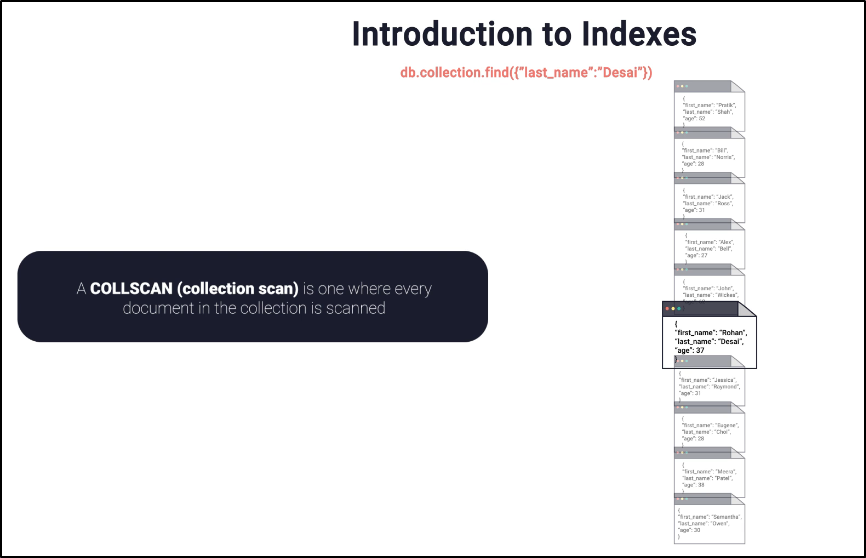
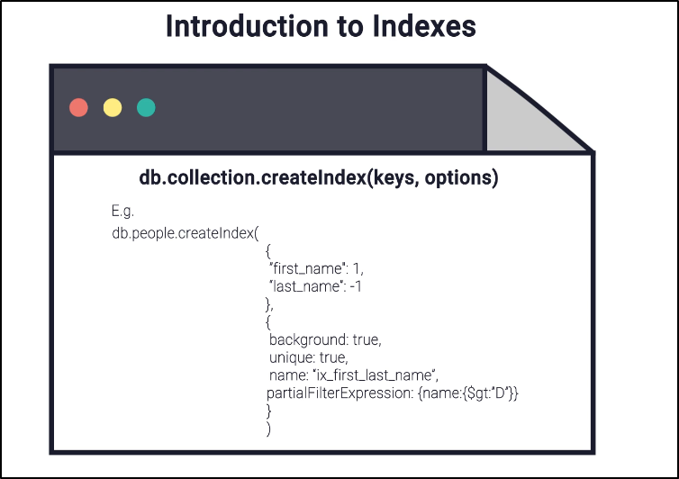


<br>


### 📘 1. What is an `Index` in MongoDB:
- **Definition**: An index stores a small, ordered subset of fields from documents in a collection.
- **Purpose**: Speeds up query execution by reducing the number of documents scanned.
- **Structure**: MongoDB indexes are implemented using B‑trees, which allow efficient equality and range queries.


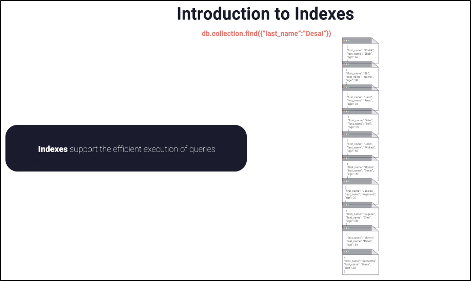


<br>


### 🔍 1.2. `B-Tree` Index:
- An index is a data structure that stores specific fields from documents in a sorted order.
- MongoDB uses **B‑trees** (balanced trees) to implement indexes.
- This allows MongoDB to quickly locate values instead of scanning the entire collection.
- B‑trees are efficient for both read and write operations, making them suitable for database indexing.

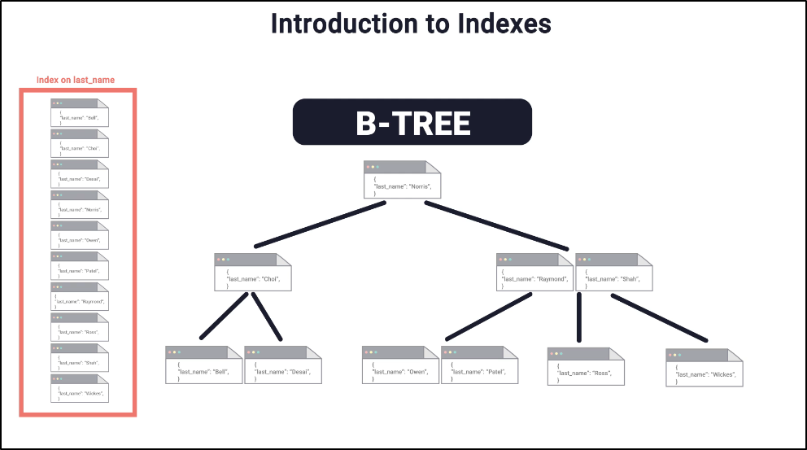

##### 🌳 1.3.1 How B‑Tree Index Works
Imagine you create an index on last_name:

```js
db.collection.createIndex({last_name: 1})
```

##### 🌳 1.3.2 MongoDB builds a `B‑tree` where:
- Each node contains sorted values of last_name.
- The tree is balanced, meaning search operations take logarithmic time **(O(log n))**.
- When you query for a specific last_name, **MongoDB traverses** the **B‑tree** to find the matching value.
- MongoDB can traverse the tree to jump directly to "Desai" instead of scanning all documents.

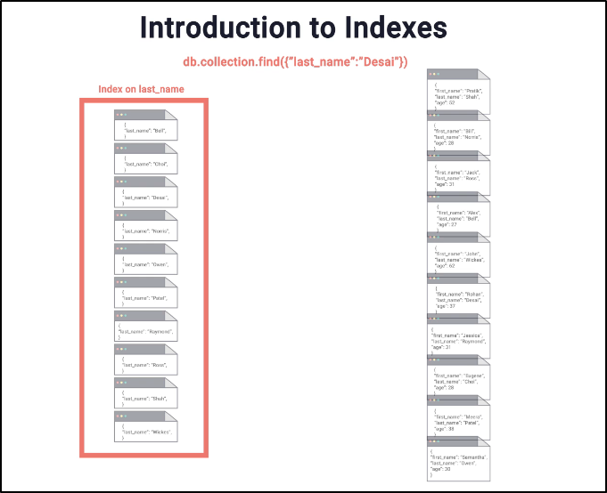
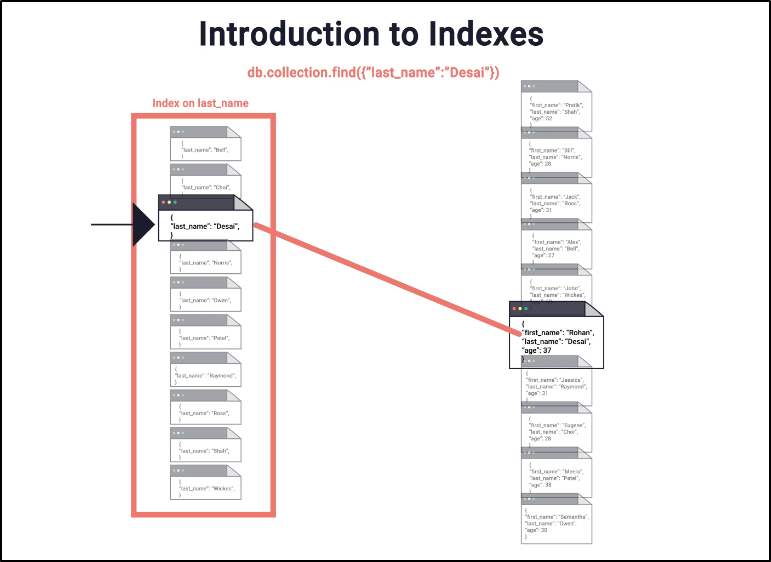

<br>


### 1.4. 📂 Types of Indexes: 

| **Index Type** | **Use Case** | **Example** |
| --- | --- | --- |
| **Single Field Index** | Queries on one field | ``db.movies.createIndex({title:1})`` |
| **Compound Index** | Queries on multiple fields | ``db.movies.createIndex({year:1, ``runtime:1, ``title:1})`` |
| **Multikey Index** | Indexes array fields | ``db.users.createIndex({tags:1})`` |
| **Text Index** | Full-text search | ``db.articles.createIndex({content:"text"})`` |
| **Geospatial Index** | Location-based queries | ``db.places.createIndex({location:"2dsphere"})`` |
| **Unique Index** | Prevents duplicate values | ``db.users.createIndex({email:1}, {unique:true})`` |


<br>

### 1.5. `Check Indexes` in existing collection:
```MongoDB
db.trips.getIndexes()
```

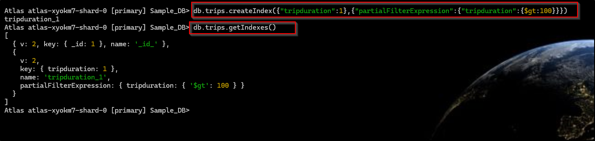

<br>


### 1.6. 📘 Why Not Create Too Many Indexes?

❓ *So why don’t we create indexes for every field in a collection to improve query performance?*

##### ⚠️ Key Reasons

- 💾 **Indexes take up storage space**  
  Each index consumes disk space and memory. More indexes = more overhead.

- 🎯 **Indexes should be created on commonly queried fields**  
  Not every field is used in queries. Indexes are most useful when they match frequent query patterns.


<br>


### 1.7. ⚖️ Pros and Cons -

##### ✅ Advantages:
- Faster queries (especially for large collections).
- Supports equality, range, and prefix queries.
- Enables covered queries (query answered entirely from index).

##### ⚠️ Disadvantages
- Slows down writes (insert/update/delete) because indexes must also be updated.
- Consumes extra storage space.
- Too many indexes can degrade performance.


<br>


### 1.8 📘 Index Usage in `Aggregation Pipelines`:
Not all stages in the MongoDB aggregation pipeline can take advantage of indexes. Here’s the key idea:

- **1. ⚠️ Index Limitations**
- If a stage cannot use indexes, then subsequent stages also lose index support, even if they normally could.
  - Example:
    - $match at the beginning → can use indexes.
    - But if $project or $group comes first (which don’t use indexes), then later $match won’t benefit from indexes.

- **2. 🔧 Optimizer Behavior**
  - MongoDB’s query optimizer tries to reorder pipeline stages so that index-eligible stages (like $match$ or $$sort$) appear earlier.
  - This maximizes the chance of using indexes for performance gains.

- **3. Best Practice**
  - Place index-friendly stages ($match, $sort, $limit) as early as possible in the pipeline.
  - Avoid putting non-index stages before them if you want queries to leverage indexes.

**URL:** https://www.mongodb.com/docs/manual/core/aggregation-pipeline/#std-label-aggregation-pipeline-operators-and-performance

<br>

---

<br>

## 2. `Create Indexes` in MongoDB:

#### Before creating an index:
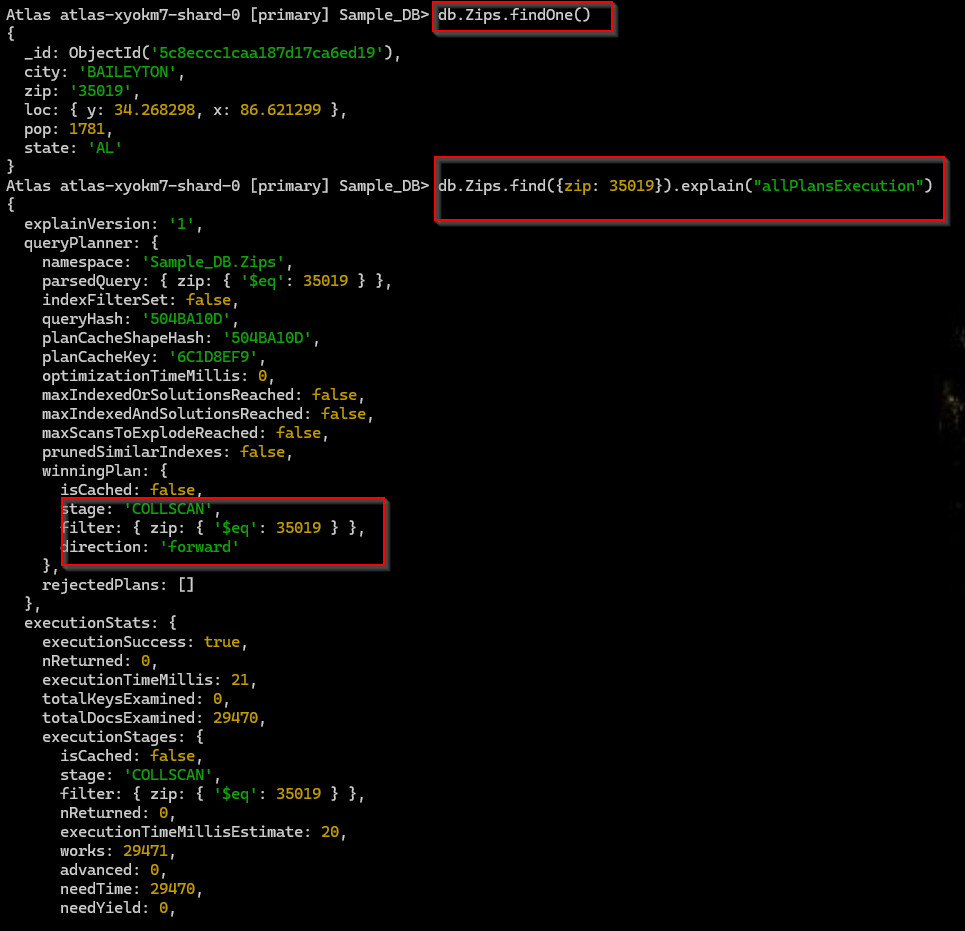

<br>

### Create Index:
**Command:** `db.Zips.createIndex({"pop": 1})`
>[!Note] The `1` indicates ascending order. Use `-1` for descending order.
> ✅ This means an ascending index on pop was created.

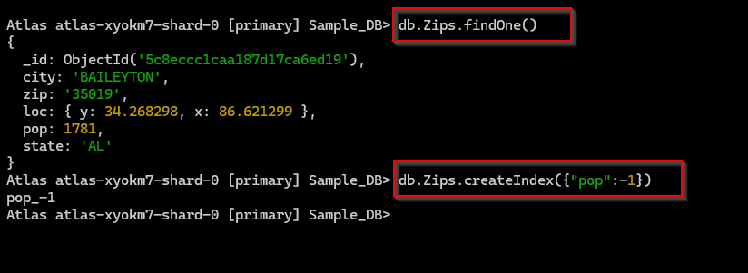

<br>

#### After creating an index: 
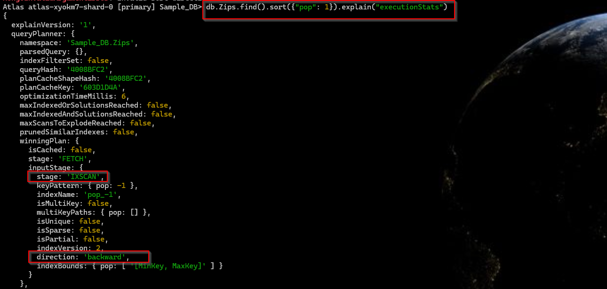
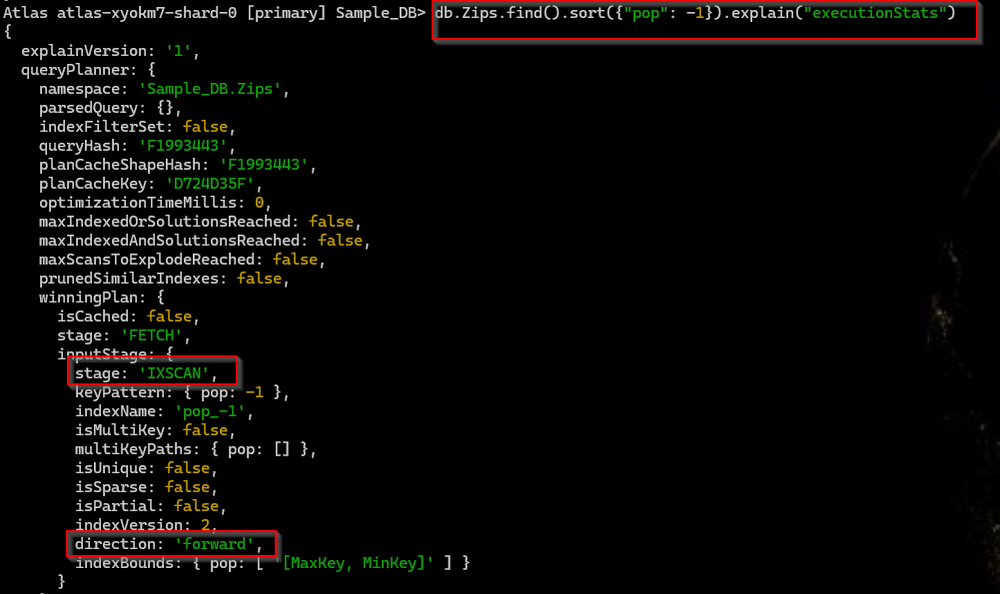
<br>

####  Drop index: 
**Command:** `db.Zips.dropIndex({pop: 1})`
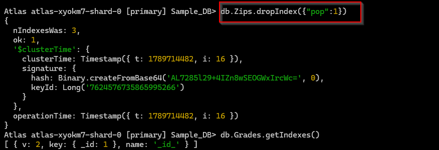
<br>

---

<br>


## 3. `Explain` methods to create indexes in MongoDB.

###  📊 3.1 MongoDB explain() — 

| Term                      | Full Form / Meaning  | Easy Explanation                                                                                     | Example / Purpose                                      |
| ------------------------- | -------------------- | ---------------------------------------------------------------------------------------------------- | ------------------------------------------------------ |
| **IXSCAN** 🔎             | Index Scan           | MongoDB searches an **index** to find matching documents.                                            | `{founded_year: 2010}` with an index on `founded_year` |
| **COLLSCAN** 🔍           | Collection Scan      | MongoDB scans the **entire collection** because a suitable index isn't being used.                   | No index on `founded_year`                             |
| **FETCH** 📄              | Fetch Documents      | Retrieves the **actual documents** after the index identifies them.                                  | `IXSCAN → FETCH`                                       |
| **PROJECTION_DEFAULT** 📋 | Default Projection   | Applies the requested projection to the returned documents.                                          | `.find({}, {name:1})`                                  |
| **SORT** ↕️               | Sort Stage           | Sorts documents when an appropriate index cannot provide the required order.                         | `.find().sort({founded_year:1})`                       |
| **LIMIT** 🔢              | Limit Stage          | Restricts the number of documents returned.                                                          | `.find().limit(5)`                                     |
| **SKIP** ⏭️               | Skip Stage           | Skips a specified number of documents.                                                               | `.find().skip(10)`                                     |
| **SHARDING_FILTER** 🧩    | Sharding Filter      | In a sharded cluster, filters documents according to shard ownership.                                | Used internally in sharded deployments                 |
| **SHARD_MODE** 🧩         | Shard Execution      | Coordinates query execution across shards.                                                           | Query sent to relevant shard(s)                        |
| **$cursor** 🎯            | Cursor Stage         | Represents the cursor/query execution portion of an aggregation pipeline.                            | Often seen in `aggregate().explain()`                  |
| **executionStats** 📊     | Execution Statistics | Shows **actual query execution statistics**.                                                         | `explain("executionStats")`                            |
| **allPlansExecution** 🔬  | All Plans Execution  | Provides information about **candidate plans** considered during query planning.                     | `explain("allPlansExecution")`                         |
| **queryPlanner** 🧠       | Query Planner        | Shows the query plan MongoDB selected/planned, without executing the query for execution statistics. | `explain("queryPlanner")`                              |
| **winningPlan** 🏆        | Selected Query Plan  | Shows the plan MongoDB selected to execute the query.                                                | `IXSCAN → FETCH`                                       |
| **rejectedPlans** ❌       | Rejected Query Plans | Shows alternative plans that MongoDB considered but did not select.                                  | Another index may appear here                          |

<br>

##### Example 1: `Explain()` for a query with an index on `founded_year`:
Command: `db.Companies.find({founded_year: 2010}).explain()`
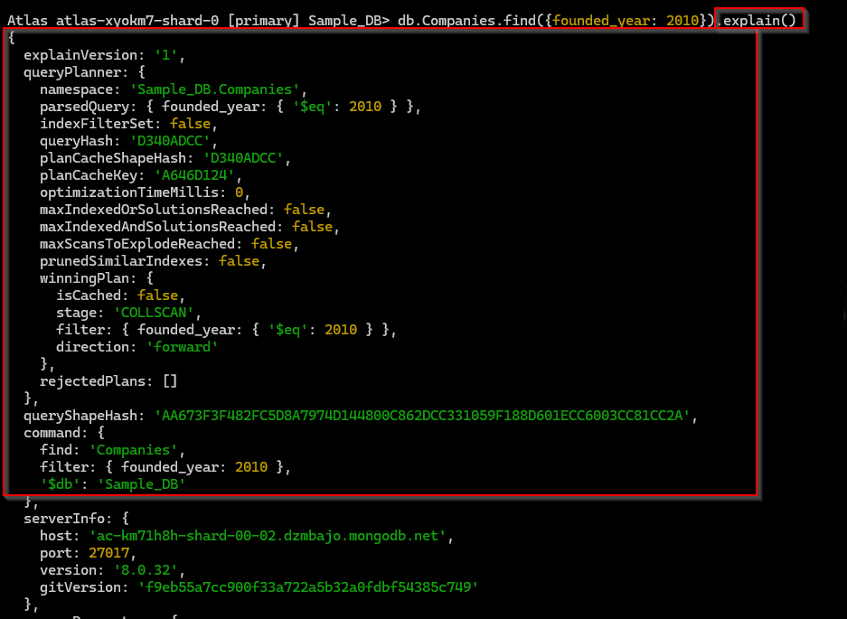

<br>

##### Example 2: `Explain("queryPlanner")` 
Command:: `Companies.find({founded_year: 2010}).explain(queryPlanner)`
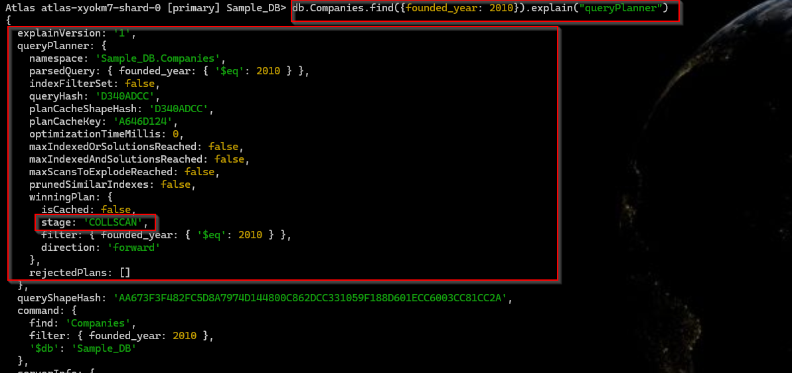

<br>

##### Example 3: `Explain("executionStats")` 
Command:: `Companies.find({founded_year: 2010}).explain(executionStats)`
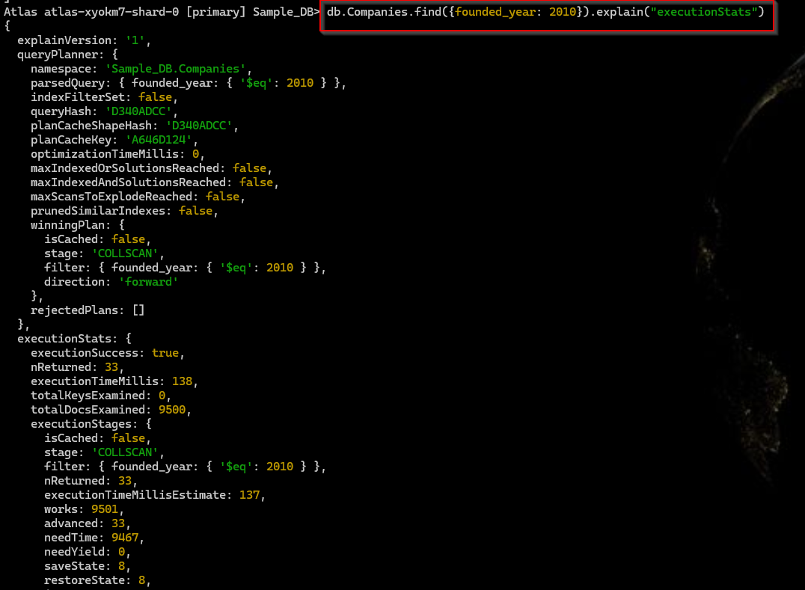

<br>

##### Example 4: `Explain("allPlansExecution")` 
Command:: `Companies.find({founded_year: 2010}).explain(allPlansExecution)`
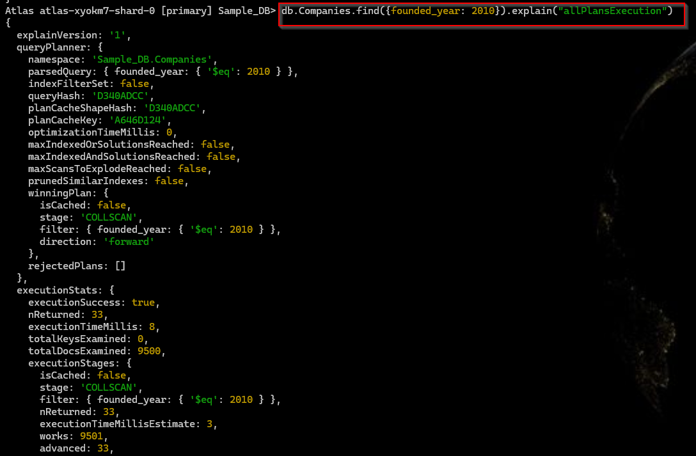

<br>

##### Example 5: `Limit()` provides a way to restrict the number of documents returned by a query. 
Command:: `db.Grades.find({class_id: 57}).limit(3)`
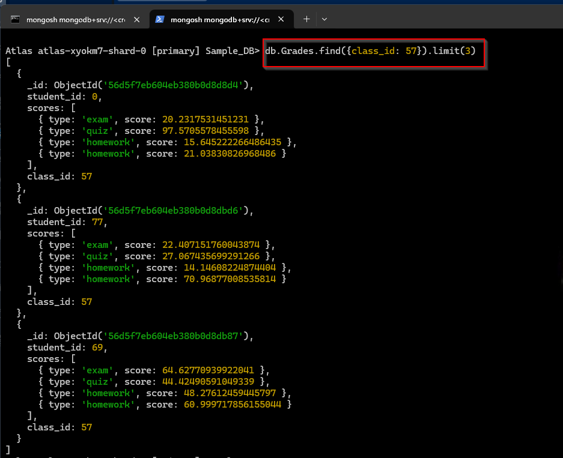

<br>

##### Example 6: `Skip()` provides a way to `skip` a specified number of documents in the result set. 
Command:: `db.Grades.find({class_id: 57}).skip(2))`
Command:: `db.Grades.find({class_id: 57}).skip(2).limit(3)`
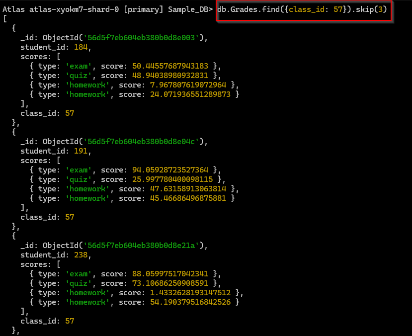

<br>

##### Example 7: `Sort()` provides a way to sort the documents in the result set. 
###### Ascending order ⬆️
Command:: `db.Grades.find({class_id: 57}).sort({class_id: 1})`
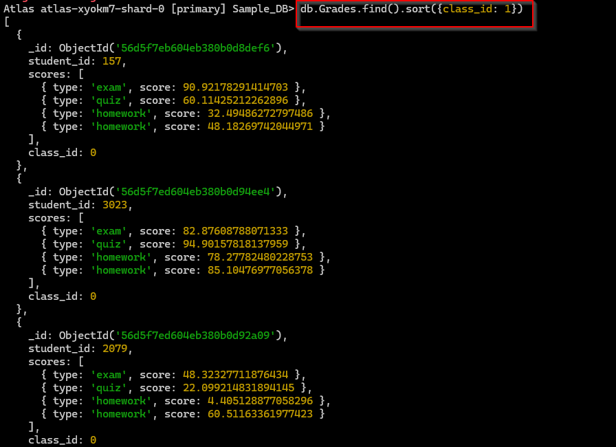


<br>

##### Example 7: `Sort()` provides a way to sort the documents in the result set. 
###### Descending order ⬇️
Command:: `db.Grades.find({class_id: 57}).sort({class_id: -1})`
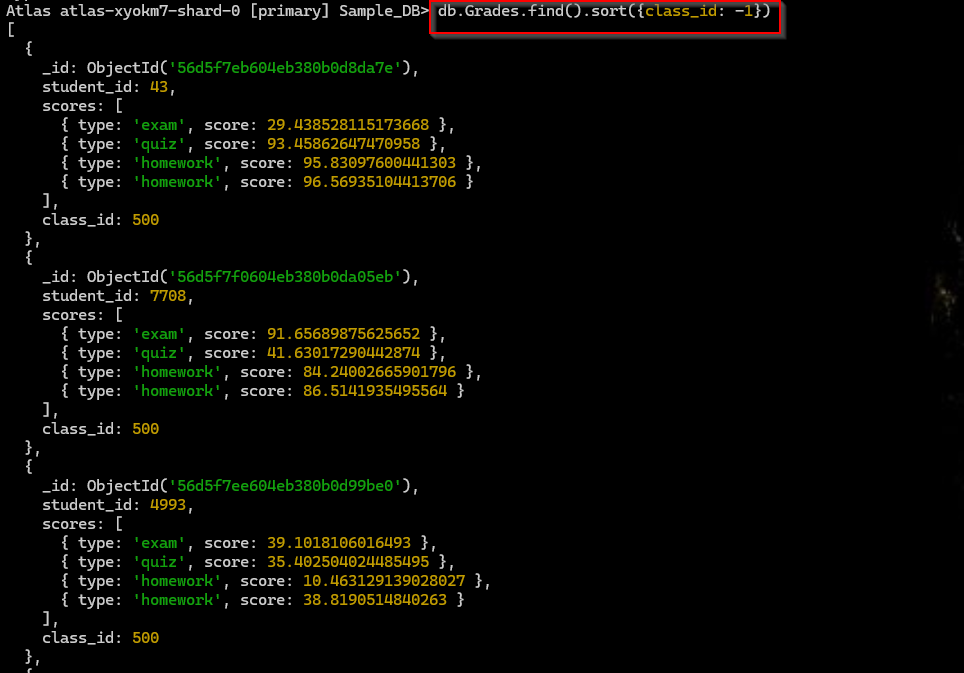

<br>

### ⭐ 3.2 Three `explain()` Methods You Should Memorize:

These are particularly important:

| Method              | What it tells you                                      | Easy Memory                    |
| ------------------- | ------------------------------------------------------ | ------------------------------ |
| `queryPlanner`      | Shows the **planned/winning query plan**               | 🧠 What plan will MongoDB use? |
| `executionStats`    | Shows **actual execution statistics**                  | 📊 What actually happened?     |
| `allPlansExecution` | Shows additional information about **candidate plans** | 🔬 What plans were considered? |

<br>

### 🎯 3.3 Exam Memory Trick

```
             MongoDB explain()
                    │
       ┌────────────┴────────────┐
       │                         │
 Execution Stages          Explain Modes
       │                         │
   ┌───┴────┐              ┌─────┴─────────┐
   │        │              │               │
 IXSCAN   FETCH       executionStats   allPlansExecution
   │        │              │               │
 Search   Get data      Actual stats    Compare plans
 Index    Document
 ```


<br>

### 🧠 3.4 Quick Exam Revision:

| Keyword                  | Remember                  |
| ------------------------ | ------------------------- |
| 🔎 **IXSCAN**             | Search **Index**          |
| 🔍 **COLLSCAN**           | Scan **Collection**       |
| 📄 **FETCH**              | Fetch actual document     |
| ↕️ **SORT**                | Sort results              |
| 🔢 **LIMIT**              | Limit results             |
| ⏭️ **SKIP**               | Skip results              |
| 🧩 **SHARDING_FILTER**    | Shard ownership filtering |
| 🧠 **queryPlanner**      | Query plan                |
| 📊 **executionStats**     | Actual execution          |
| 🔬 **allPlansExecution**  | Candidate plans           |
| 🏆 **winningPlan**        | Selected plan             |
| ❌ **rejectedPlans**       | Plans not selected        |

<br>

---

<br>


## 4. Create Indexes in MongoDB Compass:


The four options visible are:
- 1 (asc)
- -1 (desc)
- 2dsphere
- text (full text search)

<br>


#### 4.1 📊 MongoDB `Index Types` 

| Index Type         | Meaning          | Used For                                                    | Example                  |
| ------------------ | ---------------- | ----------------------------------------------------------- | ------------------------ |
| **`1 (asc)`** ⬆️   | Ascending index  | Searching/sorting values from **small → large**             | `{age: 1}`               |
| **`-1 (desc)`** ⬇️ | Descending index | Searching/sorting values from **large → small**             | `{age: -1}`              |
| **`2dsphere`** 🌍  | Geospatial index | Location-based queries using **Earth's spherical geometry** | `{location: "2dsphere"}` |
| **`text`** 🔤      | Text index       | Searching words/phrases inside **string fields**            | `{description: "text"}`  |


<br>

#### 4.2 📊 MongoDB Index `Options`


| Option                           | Meaning                   | Easy Explanation                                                | Example                                                                     | Memory Trick                  |
| -------------------------------- | ------------------------- | --------------------------------------------------------------- | --------------------------------------------------------------------------- | ----------------------------- |
| **Create unique index** 🔐       | `unique: true`            | Prevents duplicate values in the indexed field                  | `{email: 1}` → no two users can have the same email                         | **Unique = No duplicates**    |
| **Index name** 🏷️               | `name`                    | Gives your index a custom name                                  | `{name: "email_index"}`                                                     | **Name = Label**              |
| **Create TTL** ⏰                 | `expireAfterSeconds`      | Automatically deletes documents after a specified time          | `{expireAfterSeconds: 3600}` → expires after 1 hour                         | **TTL = Time-based deletion** |
| **Partial Filter Expression** 🎯 | `partialFilterExpression` | Indexes **only documents that satisfy a condition**             | `{partialFilterExpression: {status: "active"}}` → indexes only active users | **Partial = Some documents**  |
| **Wildcard Projection** 🌟       | `wildcardProjection`      | Controls which fields are included/excluded in a wildcard index | `{wildcardProjection: {name: 1, email: 1}}`                                 | **Wildcard = Dynamic fields** |


<br>


#### 4.3 📊 Creating and Managing Indexes

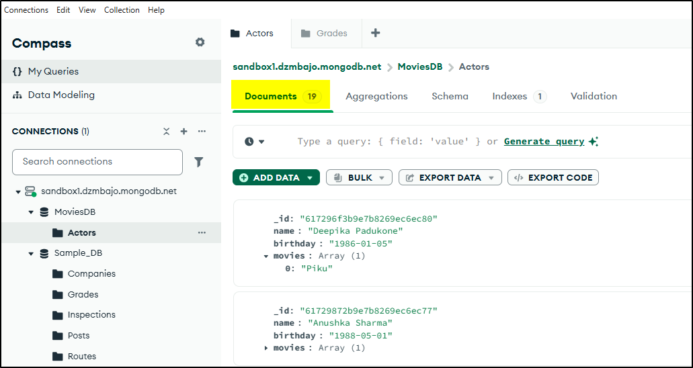
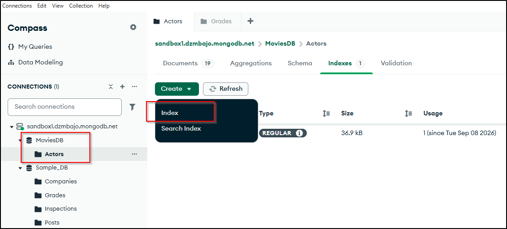
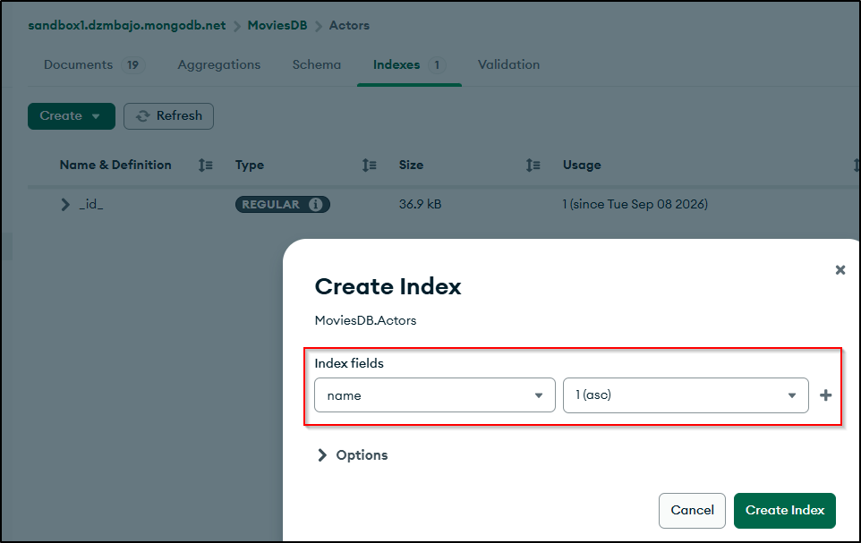
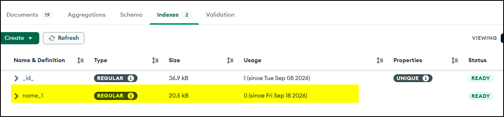


<br>


#### 4.4 📊 MongoCompass - Execute Plan:

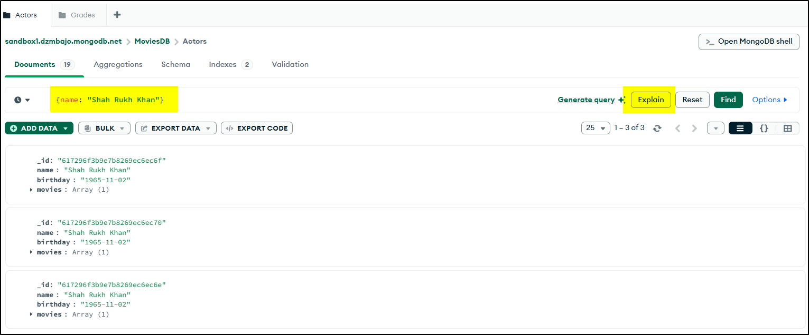
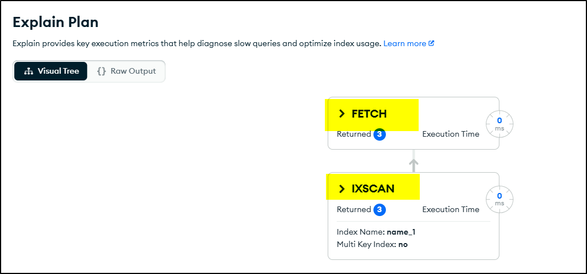


<br>

---
