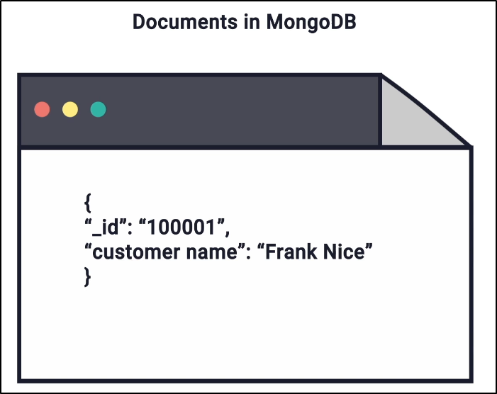
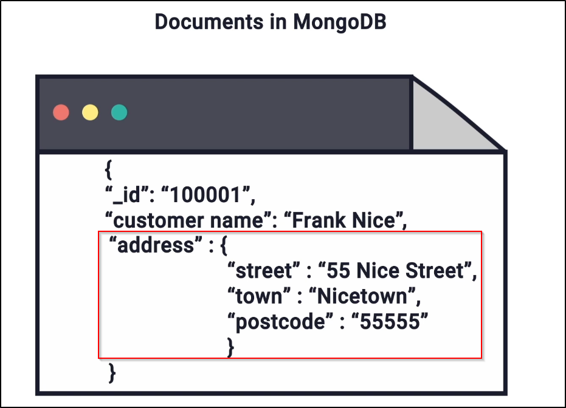
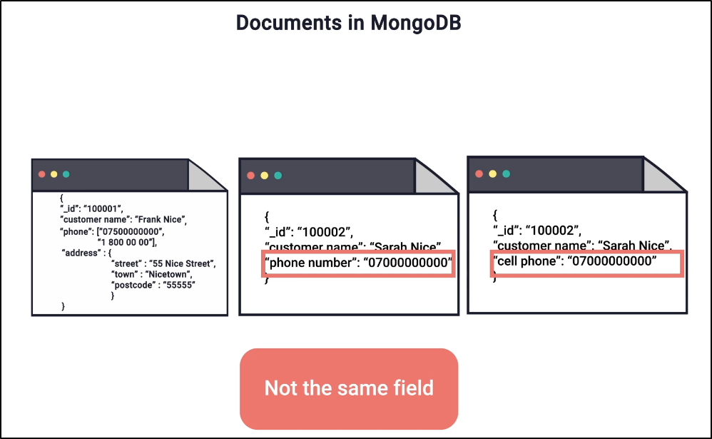
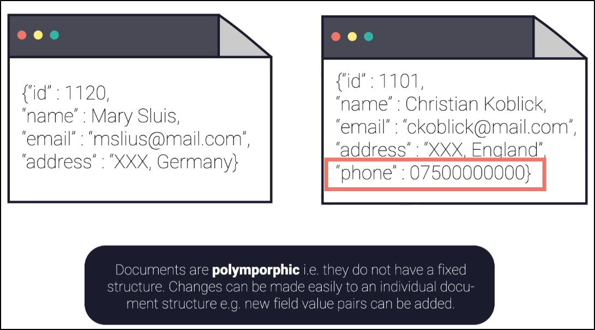
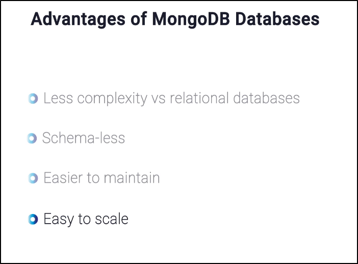

# 🍀 MongoDB Introduction:


## 1️⃣ What is MongoDB?

MongoDB is a NoSQL database server used to store large amounts of data.

* "Mongo" comes from the word "Humongous", meaning very large.
* MongoDB is designed to store huge amounts of data efficiently.
* Multiple databases can be created inside one MongoDB server.

---

## 2️⃣ MongoDB vs MySQL

| Feature           | MySQL                         | MongoDB                          |
| ----------------- | ----------------------------- | -------------------------------- |
| Database Type     | Relational Database (SQL)     | NoSQL Database                   |
| Structure         | Tables, Rows, Columns         | Collections, Documents           |
| Schema            | Fixed Schema Required         | Flexible / No Fixed Schema       |
| Data Format       | Tabular                       | JSON-like Documents              |
| Adding New Fields | Need to alter table structure | Simply add new field in document |
| Relationships     | More relationships and joins  | Fewer relationships              |
| Query Speed       | Can become slower with joins  | Faster for many use cases        |

---

## 3️⃣ Structure of MongoDB

MongoDB stores data in the following hierarchy:

```text
MongoDB Server
   └── Database
          └── Collection
                  └── Document
```

### Comparison with SQL

| SQL      | MongoDB    |
| -------- | ---------- |
| Database | Database   |
| Table    | Collection |
| Row      | Document   |
| Column   | Field      |

---

## 4️⃣ Database

A MongoDB server can contain many databases.

Example:

```text
MongoDB Server
   ├── companyDB
   ├── schoolDB
   └── foodDB
```

<br>

### 🌿 4.1 Collection

A collection in MongoDB is similar to a table in MySQL.

Example:

```text
employee
food
students
orders
```

Example:

```text
companyDB
   └── employee (collection)
```
---

## 5️⃣ Document

A document is similar to a row in a SQL table.

MongoDB stores documents in JSON-like format.

Example document:

```json
{
  "name": "Amit",
  "age": 27,
  "city": "Noida",
  "identity": "Aadhar"
}
```

Here:

* `name`, `age`, `city`, `identity` are called fields.
* `Amit`, `27`, `Noida`, `Aadhar` are field values.

#### 1. Document: 
 

#### 2. Sub-Document: 
 

#### 3. Array in the Documents: 
 

#### 4. 'phone number' and 'cell number' are two different fields in the same document: 
 

#### 5. Polymorphic Documents: 


- **A. Polymorphic Pattern in MongoDB**
The Polymorphic Pattern is a schema design approach in MongoDB where documents in the same collection have different fields/structures but represent related entities.
<br>
- **Core Concept**
Instead of splitting similar-but-different objects across multiple collections, you store them together in one collection, with a type discriminator field to distinguish them.

```JSON
{ "_id": 1, "type": "car",        "brand": "Toyota", "doors": 4, "fuel": "petrol" }
{ "_id": 2, "type": "motorcycle", "brand": "Honda",  "wheels": 2, "sidecar": false }
{ "_id": 3, "type": "truck",      "brand": "Volvo",  "payload_tons": 20, "axles": 6 }
```

- **When to Use It:**
  - Entities share common fields but also have type-specific fields
  - You frequently query across all types (e.g., "find all vehicles in a city")
  - A single logical concept maps to multiple subtypes (products, users, events, etc.)

**Advantages:**
| **Benefit** | **Explanation** |
|-------------|-----------------|
| **Simpler queries** | One query covers all subtypes |
| **Flexible schema** | Each document can have unique fields |
| **Better performance** | No multi-collection joins ($lookup) |
| **Easy to extend** | Add a new type without schema migrations |

---
## 6️⃣ Mongo DB is Case Sensitive Language

Objects in MongoDB are also case  <span style="color:red">sensitive</span>.

For example:  the findOne method (performed in the sample_training database on the trips collection) should be as follows:

- `db.trips.findOne()` – this is the correct syntax

- `Db.trips.findOne()` – will not work because Db contains an upper case character

- `db.Trips.findOne()` – will not work because the collection is saved as “trips” not “Trips”, case sensitivity matters

- `db.trips.FindOne()` – will not work because case sensitivity also matters on methods. It should be “findOne “not “FindOne”

---

## 7️⃣ Flexible Schema in MongoDB

MongoDB does not require all documents in a collection to have the same structure.

Example:

##### First Employee Document

```json
{
  "name": "Amit",
  "age": 27,
  "city": "Noida"
}
```

##### Second Employee Document

```json
{
  "name": "Nitin",
  "age": 30,
  "city": "Delhi",
  "previousCompanies": ["Amazon", "Google"]
}
```

Notice:

* The second document contains an extra field: `previousCompanies`
* No need to change the collection structure.
* No need to alter schema like in SQL.

This is one of the biggest advantages of MongoDB.

---

## 8️⃣ Why Flexible Schema is Useful

Suppose a new employee joins and now we also want to store department information.

```json
{
  "name": "Rahul",
  "age": 25,
  "city": "Pune",
  "department": "IT"
}
```

MongoDB allows this directly.

You only add the new field in that document.

You do NOT need:

* ALTER TABLE
* Schema migration
* Database redesign

---

## 9️⃣ Key Advantages of MongoDB

##### 1. Flexibility

* Documents can have different fields.
* Easy to add or remove fields.
* Useful when application requirements change frequently.

##### 2. Easy to Store Complex Data

MongoDB can store:

* Arrays
* Nested objects
* Lists
* Different types of data in same collection

Example:

```json
{
  "name": "Nitin",
  "skills": ["Java", "Python", "MongoDB"],
  "address": {
    "city": "Delhi",
    "pin": 110001
  }
}
```

##### 3. Less Relationship Handling

In SQL databases, data is usually split across multiple tables.

Example:

* Employee Table
* Department Table
* Company Table

Then joins are required.

```sql
SELECT *
FROM employee
JOIN department ON employee.dept_id = department.id
```

MongoDB usually stores related data together in one document or collection.

Because of this:

* Fewer joins are needed
* Queries become simpler
* Performance is often faster


##### 4. Why MongoDB Queries Can Be Faster

In relational databases:

* Data may be spread across many tables.
* Multiple joins may be required.
* More processing time is needed.

In MongoDB:

* Most related data is stored together.
* Data can often be fetched from a single collection.
* This reduces complexity and increases speed.

#####  Advantage of Mongo DB: 


---

## 🔟 MongoDB Company and Products

The company behind MongoDB is:

* MongoDB Inc.

Some products from MongoDB Inc. are:

1. MongoDB Database
2. MongoDB Atlas
3. MongoDB Compass
4. MongoDB Stitch / App Services

####  Mongo Query Language (MQL): 


<br>

---

<br>

###  🔎 11. Important Interview Questions

#### 1. What is MongoDB?
> A NoSQL database that stores data in collections and documents.

#### 2. What is the difference between Collection and Document?
* Collection = Similar to Table
* Document = Similar to Row

#### 3. Does MongoDB require a fixed schema?
> No. MongoDB supports dynamic schema.

#### 4. What is BSON?
> Binary JSON used internally by MongoDB.

#### 5. Why is MongoDB more flexible than MySQL?
> Because documents in the same collection can have different fields.

#### 6. Why are joins less common in MongoDB?
> Because related data is usually stored together.

---

