# 🍃 1. Mongo Database Query Language - (MQL)

<br>

## 🎖️ 1.1 Basic Query Operations:

| # | Command           | Syntax                        | Example                          | Description                                   |
| - | ----------------- | ----------------------------- | -------------------------------- | --------------------------------------------- |
| 1 | Show Databases    | `show dbs`                    | `show dbs`                       | Lists all databases                           |
| 2 | Use Database      | `use <db_name>`               | `use admin` <br> `use Sample_DB` | Switch to a database (creates if not exists)  |
| 3 | Show Collections  | `show collections`            | `show collections`               | Lists collections in current DB               |
| 4 | Create New DB     | `use <db_name>`               | `use Sales_DB`                   | MongoDB creates DB only when data is inserted |
| 5 | Create Collection | `db.createCollection("name")` | `db.createCollection("orders")`  | Creates a new collection                      |
| 6 | Drop Collection   | `db.collection.drop()`        | `db.orders.drop()`               | Deletes a collection                          |
| 7 | Drop Database     | `db.dropDatabase()`           | `db.dropDatabase()`              | Deletes current database                      |
| 8 | Clear Screen      | `cls`                         | `cls`                            | Clears the terminal screen                    |

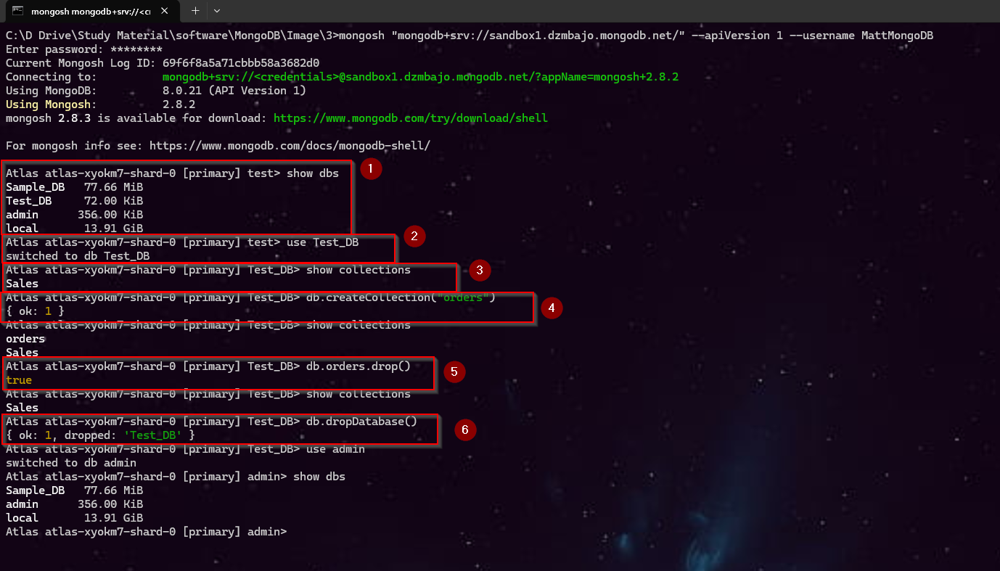

<br>
<br>

---

<br>


## 1.2 📊 MongoDB `createCollection()` Examples

| # | Use Case                | Syntax                                             | Example                                                                                                                                                                                            | Description                                   |
| - | ----------------------- | -------------------------------------------------- | -------------------------------------------------------------------------------------------------------------------------------------------------------------------------------------------------- | --------------------------------------------- |
| 1 | Basic Collection        | `db.createCollection(name)`                        | `db.createCollection("orders")`                                                                                                                                                                    | Creates a simple collection                   |
| 2 | Auto-created Collection | (No command needed)                                | `db.orders.insertOne({item:"Laptop"})`                                                                                                                                                             | Collection is created automatically on insert |
| 3 | Capped Collection       | `db.createCollection(name,{capped:true,size})`     | `db.createCollection("logs",{capped:true,size:100000})`                                                                                                                                            | Fixed-size collection (overwrites old data)   |
| 4 | Capped with Limit       | `db.createCollection(name,{capped:true,size,max})` | `db.createCollection("logs",{capped:true,size:100000,max:1000})`                                                                                                                                   | Limits size + number of documents             |
| 5 | Schema Validation       | `db.createCollection(name,{validator:{...}})`      | `db.createCollection("users",{validator:{ $jsonSchema:{ bsonType:"object", required:["name"], properties:{ name:{bsonType:"string"} }}}})`                                                         | Ensures data follows structure                |
| 6 | Validation Level        | `validationLevel` option                           | `db.createCollection("users",{ validationLevel:"strict" })`                                                                                                                                        | Controls validation behavior                  |
| 7 | Full Example            | Combined options                                   | `db.createCollection("employees",{ capped:false, validator:{ $jsonSchema:{ bsonType:"object", required:["name","salary"], properties:{ name:{bsonType:"string"}, salary:{bsonType:"double"} }}}})` | Collection with schema rules                  |


<br>

---

<br>


## 1.3 🧹 🧮`findOne()` vs `find()`

| Feature          | `db.collection.findOne()` | `db.collection.find()`                  |
| ---------------- | ------------------------- | --------------------------------------- |
| Purpose          | Returns **one document**  | Returns **multiple documents (cursor)** |
| Output type      | Single JSON document      | Cursor (list of documents)              |
| Default behavior | First matching document   | All matching documents                  |
| Use case         | Fetch one record          | Fetch multiple records                  |
| Performance      | Faster (single result)    | Depends on dataset size                 |


<br>


#### 🧹Example:


| # | Use Case                   | `findOne()` Example                                               | `find()` Example                                               | Output                                                             |
| - | -------------------------- | ----------------------------------------------------------------- | -------------------------------------------------------------- | ------------------------------------------------------------------ |
| 1 | Get all data (no filter)   | `db.sales.findOne()`                                              | `db.sales.find()`                                              | `findOne()` → first document only <br> `find()` → all documents    |
| 2 | Filter by field            | `db.sales.findOne({product:"Laptop"})`                            | `db.sales.find({product:"Laptop"})`                            | `findOne()` → one Laptop record <br> `find()` → all Laptop records |
| 3 | Filter by amount           | `db.sales.findOne({amount:55000})`                                | `db.sales.find({amount:55000})`                                | Single match vs multiple matches                                   |
| 4 | Projection (select fields) | `db.sales.findOne({product:"Laptop"},{product:1,amount:1,_id:0})` | `db.sales.find({product:"Laptop"},{product:1,amount:1,_id:0})` | Limited fields returned                                            |
| 5 | No match case              | `db.sales.findOne({product:"TV"})`                                | `db.sales.find({product:"TV"})`                                | `findOne()` → `null` <br> `find()` → empty cursor                  |
| 6 | Limit results              | ❌ Not applicable                                                  | `db.sales.find().limit(2)`                                     | Returns first 2 documents                                          |
| 7 | Pretty output              | ❌ Not needed                                                      | `db.sales.find().pretty()`                                     | Formatted output                                                   |


<br>


#### Ex1: db.CollectionName.findOne()
```mongodb
db.Grades.findOne()
```
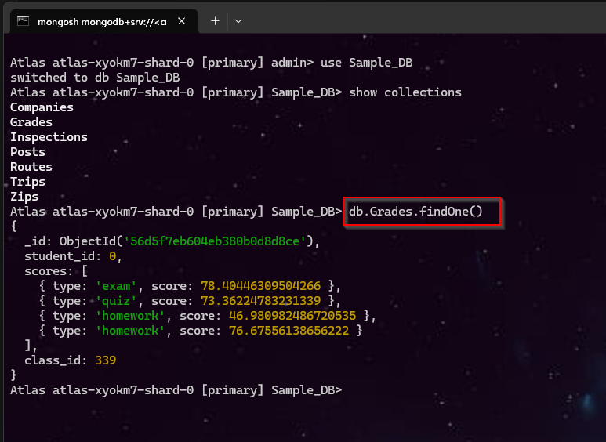


<br>


#### Ex2: db.CollectionName.find()
```mongodb
db.Grades.find()
```
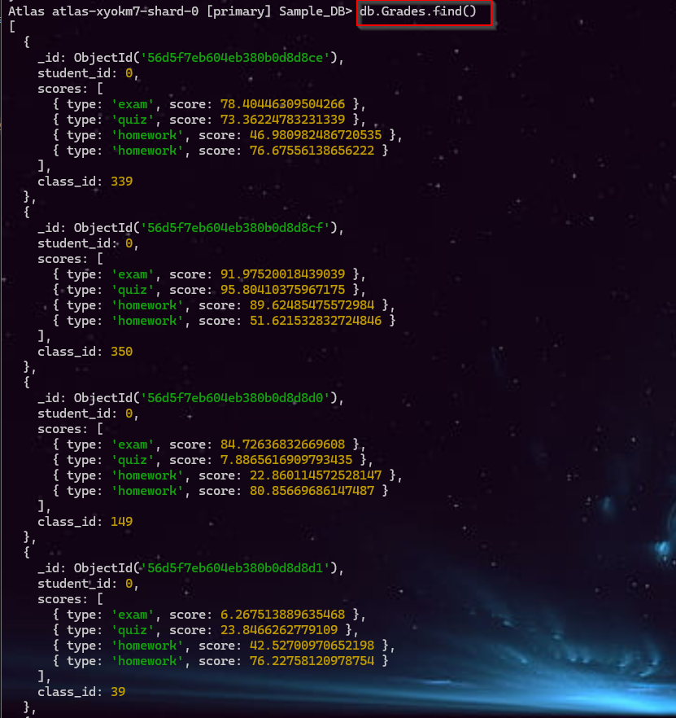


<br>


#### Ex3: `db.CollectionName.find(query, projection)`
```mongodb
db.Grades.find({"class_id":460})
db.Grades.find({"student_id":4})
db.Grades.find({"class_id":460,"student_id":4})
```

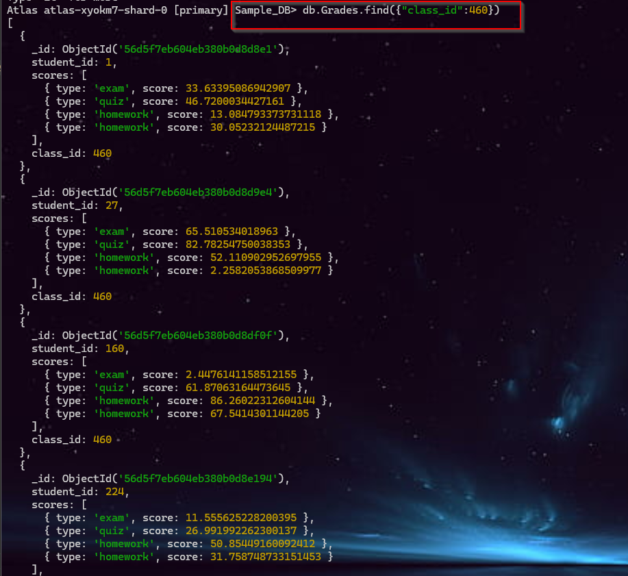
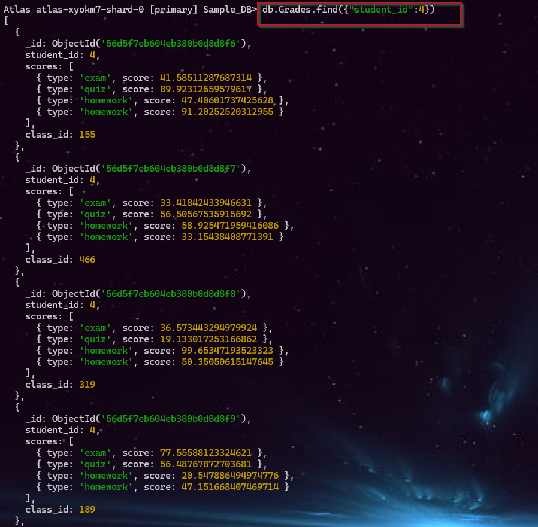
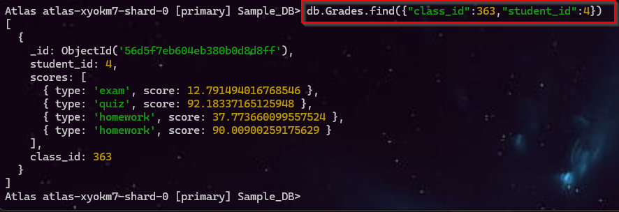


```mongodb
db.Inspection.find({"result": "Violation Issued", "sector": "Home Improvement Contractor - 100"})
```

<br>

#### 🧭 Mongo Compass:
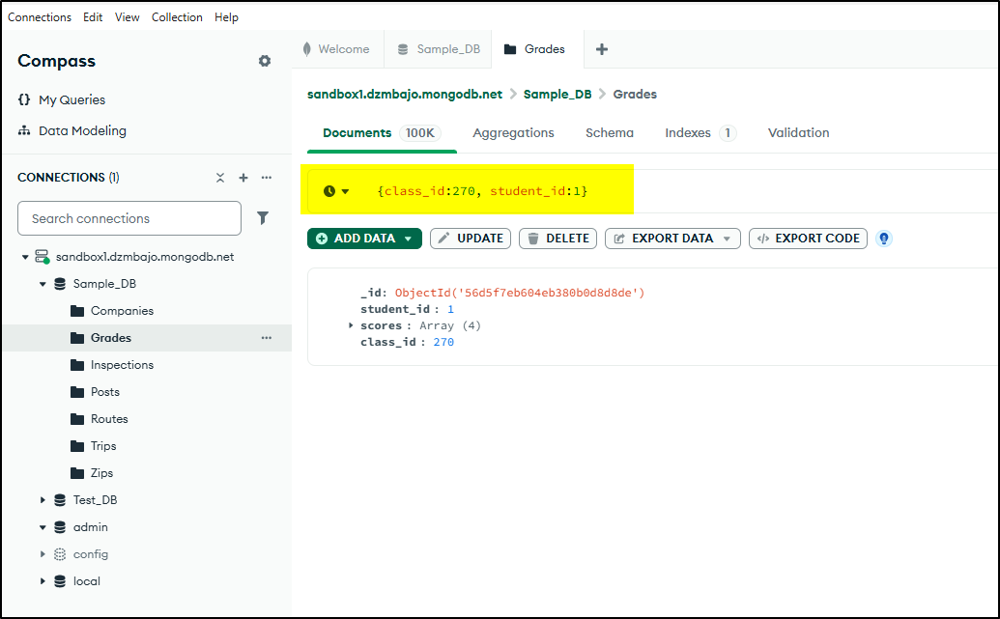
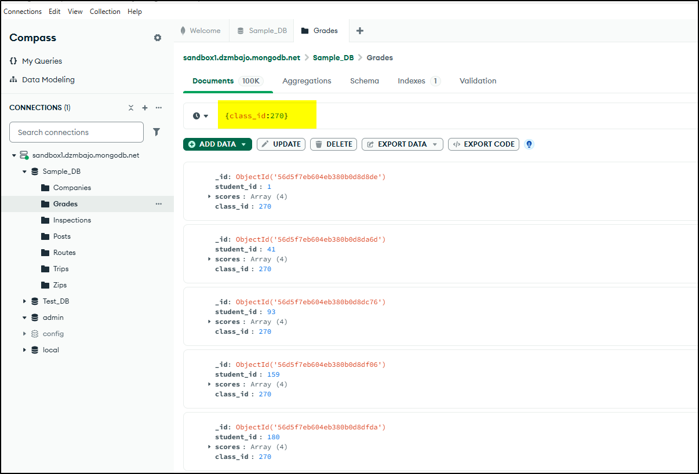


<br>

---

<br>


## 1.4 👨🏻‍🏫 MongoDB: `Comparison Operators`

- **URL:** https://www.mongodb.com/docs/manual/reference/mql/query-predicates/
- **URL:** https://www.mongodb.com/docs/manual/reference/mql/query-predicates/comparison/

<br>

| Operator | Meaning               | Example                | Shell Example                         |
| -------- | --------------------- | ---------------------- |------------------- |
| `$eq`    | Equal                 | `{age: {$eq: 25}}`     | `db.users.find({ "age": { $eq: 25 } })` |
| `$ne`    | Not equal             | `{age: {$ne: 25}}`     | `db.users.find({ "age": { $ne: 25 } })` |
| `$gt`    | Greater than          | `{age: {$gt: 25}}`     | `db.users.find({ "age": { $gt: 25 } })` |
| `$gte`   | Greater than equal    | `{age: {$gte: 25}}`    | `db.users.find({ "age": { $gte: 25 } })` |
| `$lt`    | Less than             | `{age: {$lt: 25}}`     | `db.users.find({ "age": { $lt: 25 } })` |
| `$lte`   | Less than equal       | `{age: {$lte: 25}}`    | `db.users.find({ "age": { $lte: 25 } })` |
| `$in`    | Value exists in array | `{age: {$in:[20,25]}}` | `db.users.find({ "age": { $in: [20, 25] } })` |
| `$nin`   | Value not in array    | `{age: {$nin:[20]}}`   | `db.users.find({ "age": { $nin: [20] } })` |


<br>


#### 🧭 Mongo Compass:
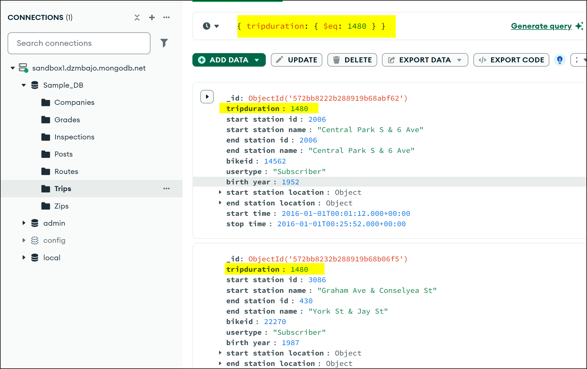
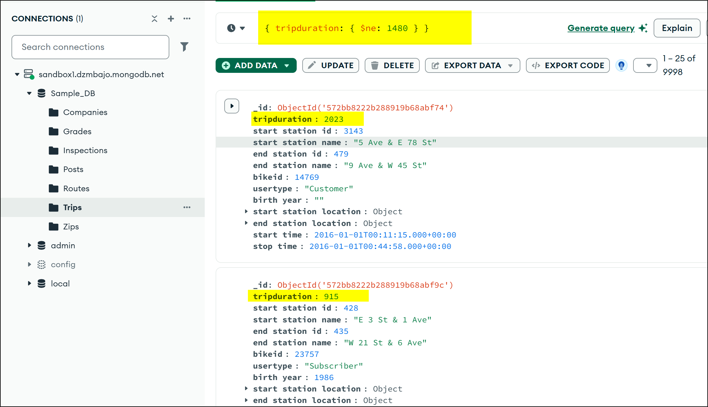
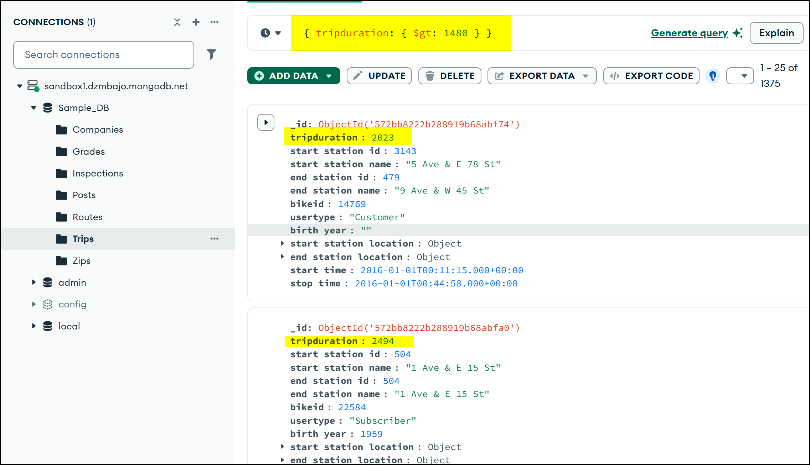


<br>


#### 🦪Mongo Shell Example: 
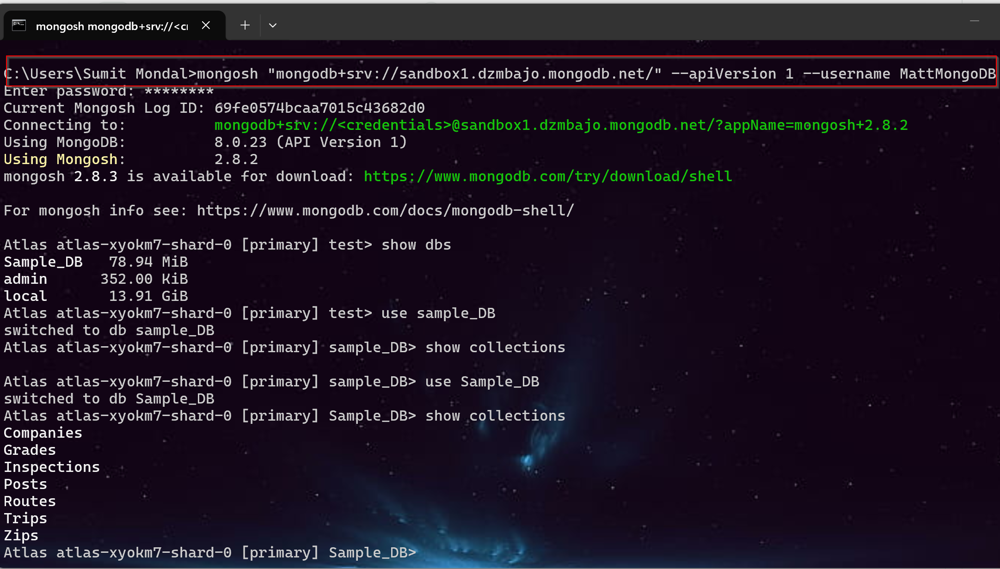

<br>

#### ☄️ Command1:  `db.Trips.find({"tripduration":{$gte:2023}})`
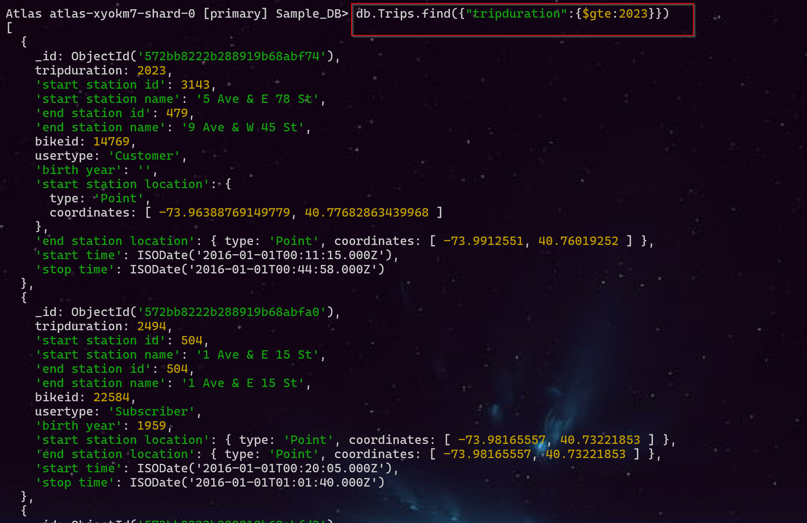

<br>

#### ☄️ Command2:  `db.Trips.find({"tripduration":{$in:[2023,2025]}})`
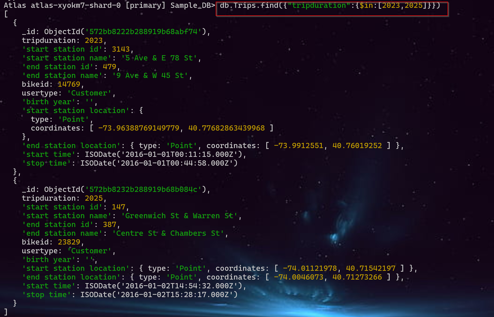

<br>

#### ☄️ Command3:  `db.Trips.find({"tripduration":{$nin:[2023,2025]}})`
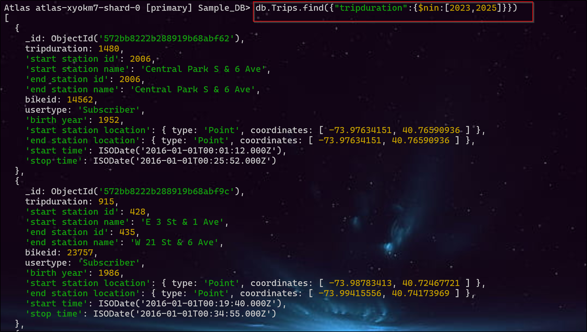


<br>

---

<br>


## 1.5 📊 MongoDB: `Logical Operators`

| Operator |  Description                                                                 | Example                                                                                     | Shell Example                                                                                   |
| -------- | ---------------------------------------------------------------------------- | ------------------------------------------------------------------------------------------- | ------------------------------------------------------------------------------------------------ |
| `$and`   | Joins query clauses with a logical AND and returns documents that match the conditions of `all clauses.` | `{ $and: [{ age: { $gte: 25 } }, { name: { $regex: "John" } }] }`                        | `db.users.find({ $and: [{ age: { $gte: 25 } }, { name: { $regex: "John" } }] })`              |
| `$nor`   | Joins query clauses with a logical NOR and `returns all documents that fail to match all clauses`. | `{ $nor: [{ age: { $gte: 25 } }, { name: { $regex: "John" } }] }`                        | `db.users.find({ $nor: [{ age: { $gte: 25 } }, { name: { $regex: "John" } }] })`              |
| `$not`   | `Inverts the effect of a query predicate` and returns documents that `do not match the query predicate`. | `{ age: { $not: { $eq: 25 } } }`                                                           | `db.users.find({ age: { $not: { $eq: 25 } } })`                                                |
| `$or`    | Joins query clauses with a logical OR and returns all documents that match `at least one clause.` | `{ $or: [{ age: { $gte: 25 } }, { name: { $regex: "John" } }] }`                         | `db.users.find({ $or: [{ age: { $gte: 25 } }, { name: { $regex: "John" } }] })`              |  


<br>


#### ☄️ Command1:  `db.Trips.find({$and:[{"tripduration":{$eq:2023}},{"birth_year":{$lte:2025}}]})`
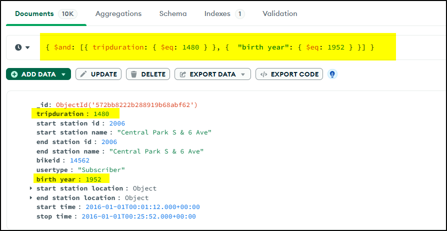
> [!note]
> `db.Trips.find({{"tripduration":{$eq:2023}},{"birth_year":{$lte:2025}}})`
> `$and` is used by `default` as an implicit operator when no other operators or duplicate fields are specified 
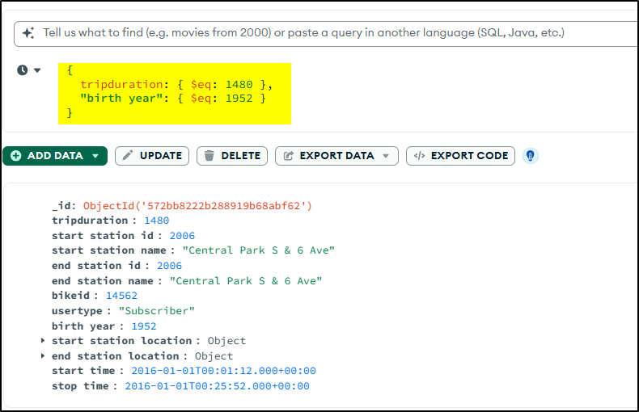


<br>


#### ☄️ Command2:  `db.Trips.find({$or:[{"tripduration":{$eq:2023}},{"birth_year":{$lte:2025}}]})`
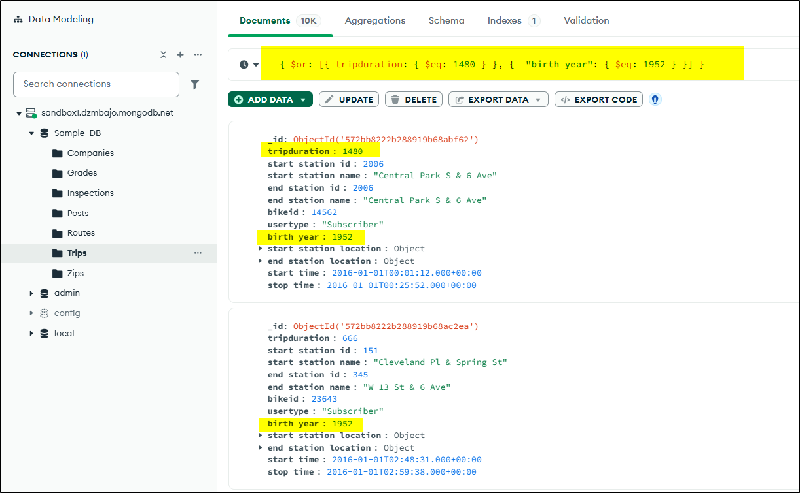 


<br>


#### ☄️ Command3:  `db.Trips.find({$nor:[{"tripduration":{$eq:2023}},{"birth_year":{$lte:2025}}]})`
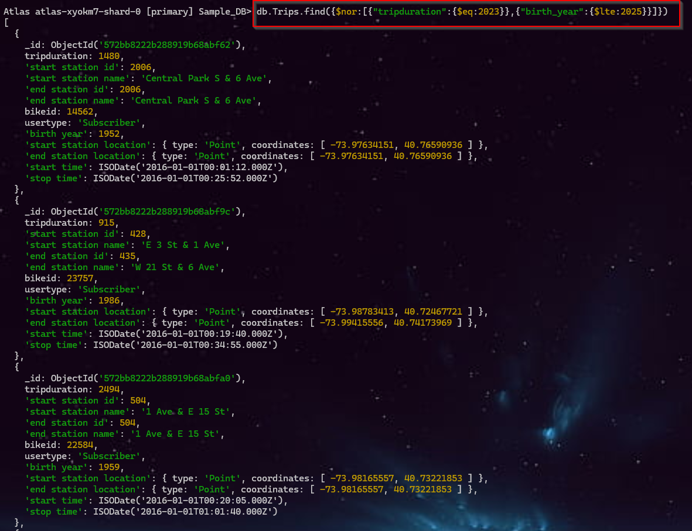 


<br>


#### ☄️ Command4:  `db.Trips.find({ tripduration: { $not: { $eq: 2023 } } })`
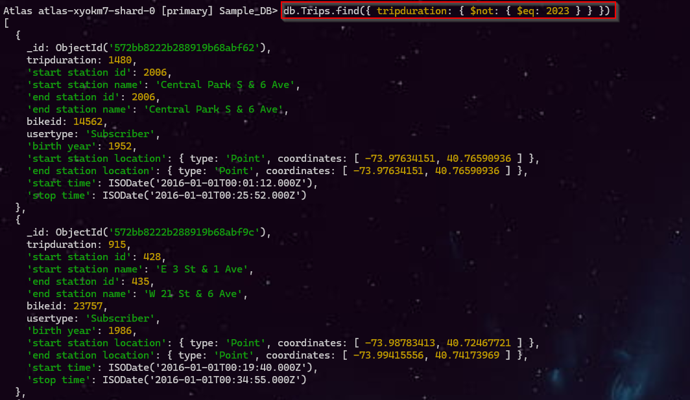 
> [!note]
> `db.Trips.find({ tripduration: {  $ne: 2023 } }})`
> `not` and `ne` are equivalent in this case, but `$not` can be used with more complex expressions, while `$ne` is specifically for inequality checks.
> 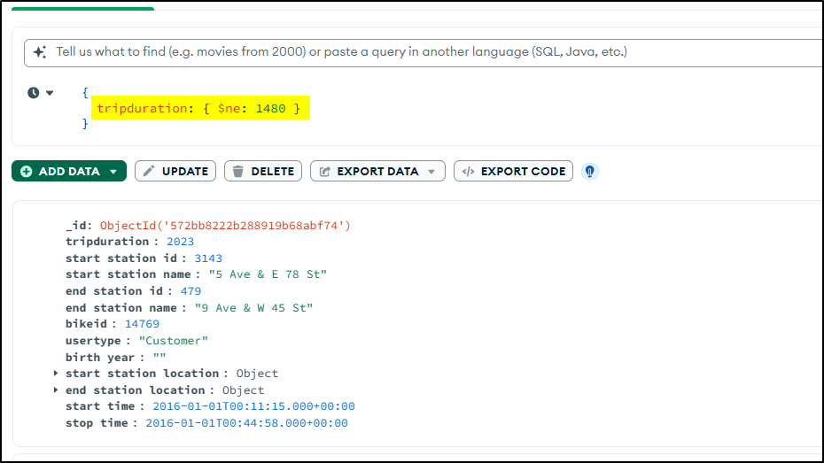


<br>

---

<br>

### 📚 Assignment: ⭐⭐⭐⭐⭐

| SNo | Question | Query |
| --- | --- | --- |
| 1 | Return all documents in the inspections collection where the result is either "Unable to Locate" or "Violation Issued" - use the `$in` operator | `db.inspections.find({ result: { $in: ["Unable to Locate", "Violation Issued"] } })` |
| 2 | Return all documents in the inspections collection where the result is either "Unable to Locate" or "Violation Issued" - use the `$or` operator | `db.inspections.find({ $or: [{ result: { $eq: "Unable to Locate" } }, { result: { $eq: "Violation Issued" } }] })` |
| 3 | Return all documents in the Companies collection where the number of employees is less than or equal to 100 and the founded year is equal to 2009 | `db.companies.find({ founded_year: { $eq: 2007 }, number_of_employees: { $lte: 100 } })` |
| 4 | Return all documents in the Companies collection where there are fewer than or equal to 200 but over 100 employees | `db.companies.find({ number_of_employees: { $gte: 100, $lte: 200 } })` |


---

