# 🍃 1. Mongo Database Query Language - (MQL2)

<br>


## 1. 🎯 MongoDB: Expression `$exp` : 
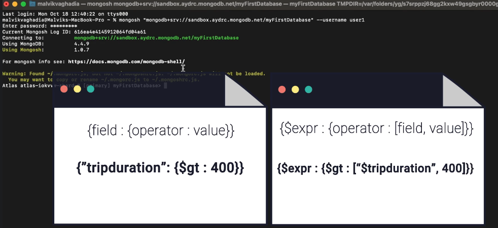 

<br>

#### 🔮 Example 1:
**command:**`db.Routes.find({$expr:{$eq:["$src_airport","$dst_airport"]}})`

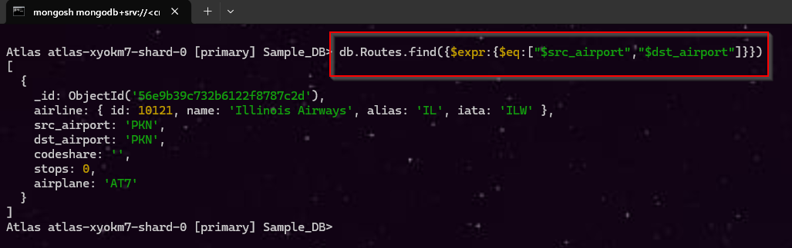 

##### 🧩 Query Breakdown:

| Part                               | Meaning           | Easy Explanation                              |
| ---------------------------------- | ----------------- | --------------------------------------------- |
| `db`                               | Database          | Current MongoDB database                      |
| `Routes`                           | Collection        | Search inside the `Routes` collection         |
| `.find()`                          | Find documents    | Retrieves matching documents                  |
| `$expr`                            | Expression        | Allows us to **compare values of two fields** |
| `$eq`                              | Equal operator    | Checks whether two values are equal           |
| `"$src_airport"`                   | Source field      | Gets the value of `src_airport`               |
| `"$dst_airport"`                   | Destination field | Gets the value of `dst_airport`               |
| `["$src_airport", "$dst_airport"]` | Values to compare | Compare the two fields                        |

**In simple words:** Find documents where `src_airport == dst_airport`.

<br>
<br>


#### 🔮 Example 2: `find` vs `$expr`
**command:**`db.Routes.find({"airplane":{$eq:"CR2"}})`

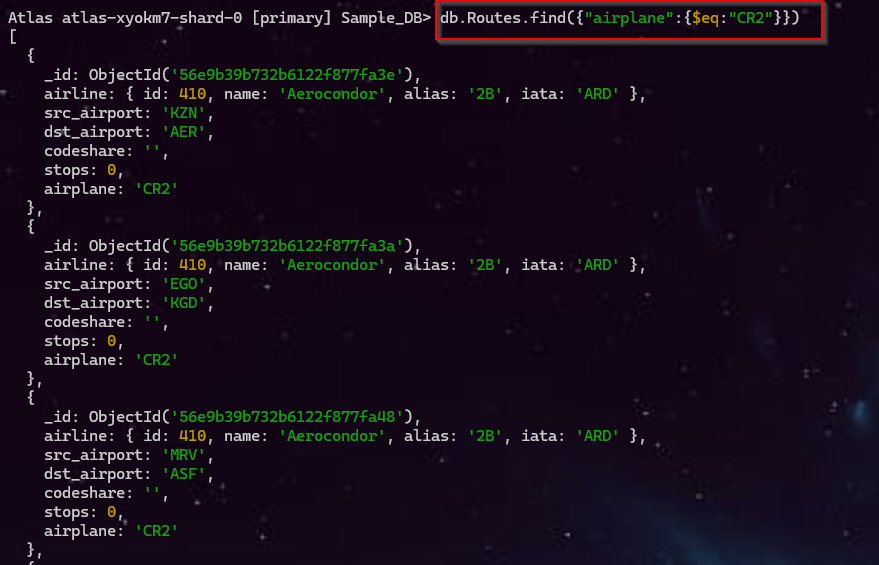 

##### 🧩 Query Breakdown:`find`
| Part                       | Meaning                     |
| -------------------------- | --------------------------- |
| `db`                       | Current database            |
| `Routes`                   | Collection                  |
| `find()`                   | Find matching documents     |
| `"airplane"`               | Field to check              |
| `$eq`                      | Equal to                    |
| `"CR2"`                    | Value we want               |
| `"airplane": {$eq: "CR2"}` | `airplane` must equal `CR2` |


<br>

##### 🧩 Query Breakdown:`$expr`
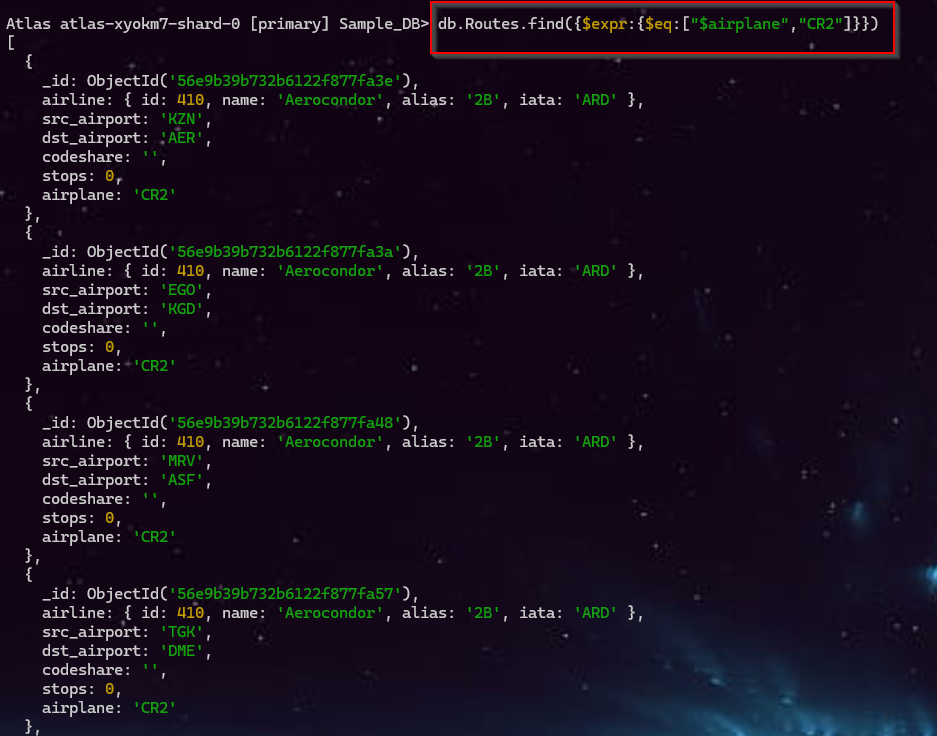 
| Part                        | Meaning                                   |
| --------------------------- | ----------------------------------------- |
| `db.Routes`                 | Use the `Routes` collection               |
| `.find()`                   | Find matching documents                   |
| `$expr`                     | Evaluate an expression                    |
| `$eq`                       | Check equality (`==`)                     |
| `"$airplane"`               | Get the **value of the `airplane` field** |
| `"CR2"`                     | Literal value to compare                  |
| `$eq: ["$airplane", "CR2"]` | `airplane == "CR2"`                       |


<br>

---

<br>

## 2. 📌 MongoDB Projection:

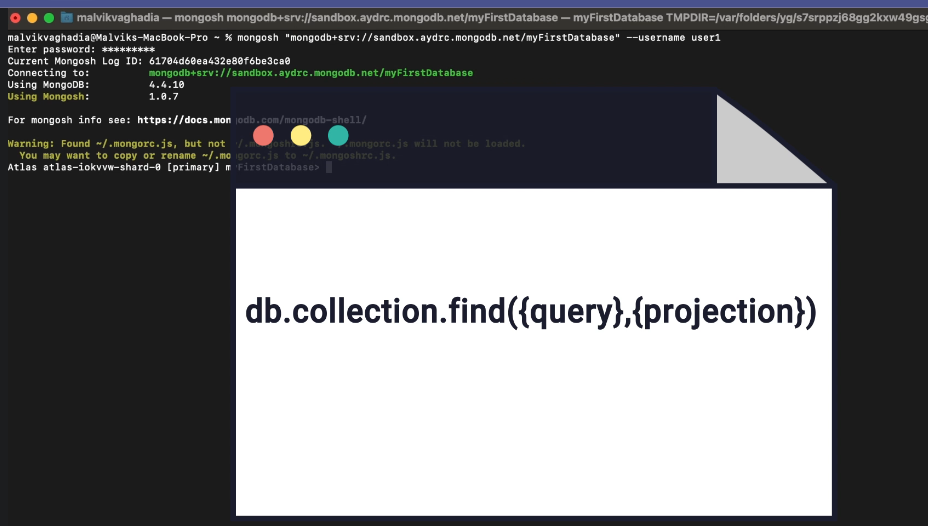 

<br>

**Projection** means <span style="color:#0D61FE">choosing which fields you want MongoDB to return in the result.</span> 

> [!Important] It is useful when a document has many fields, but you only need a few.

<br>

**Syntex:**
```
db.collection.find(
    { filter },
    { projection }
)
```

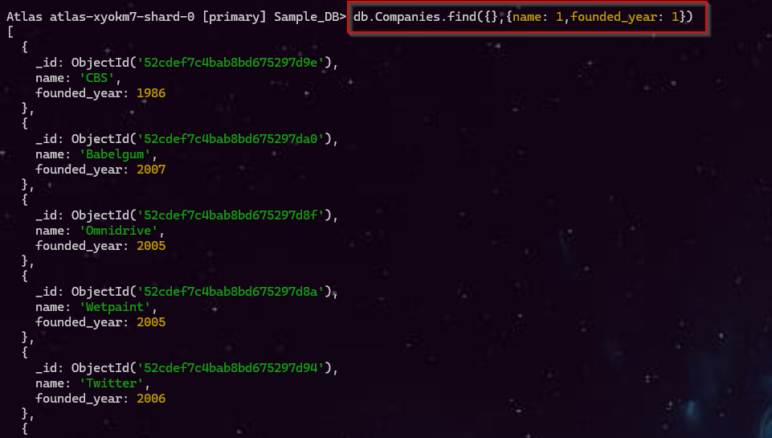 
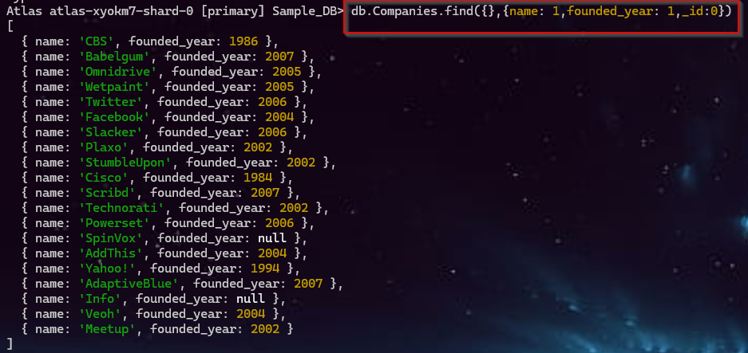 

<br>

---

<br>

## 3. 📌 MongoDB : Element Operation:

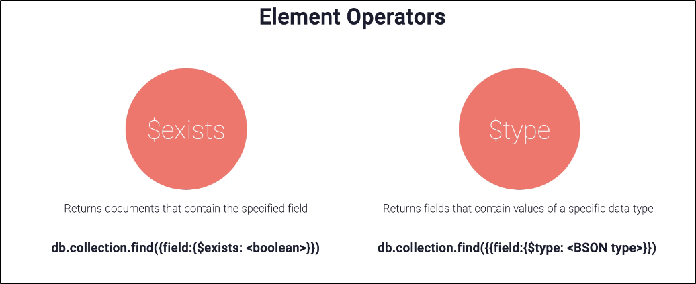 

- **$exists →** Selects documents based on whether a specified field exists.

- **$type →** Selects documents where a specified field has a particular BSON data type.

#### 🆚 `$exists` vs `$type`
| Feature  | `$exists`                 | `$type`                     |
| -------- | ------------------------- | --------------------------- |
| Checks   | Field presence            | Data type                   |
| Question | **Does the field exist?** | **What type is the field?** |
| Example  | `age: {$exists: true}`    | `age: {$type: "int"}`       |
| Result   | True/False condition      | Matches specified BSON type |

<br>

#### 1️⃣ $exists: `Field presence `

##### 🧭 Mongo Compass:
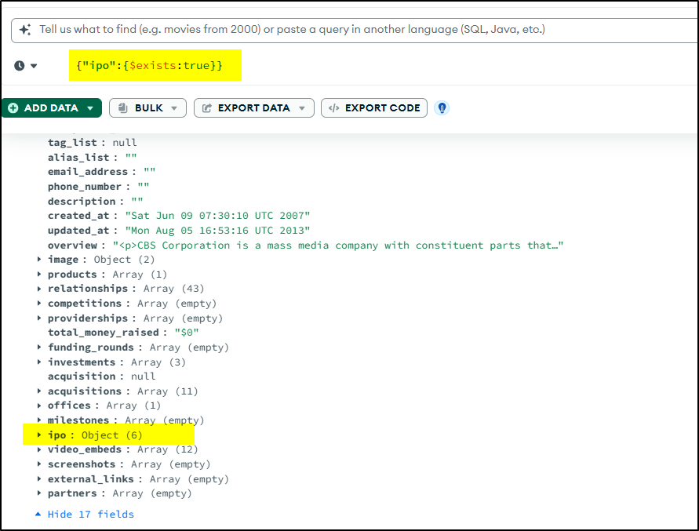 
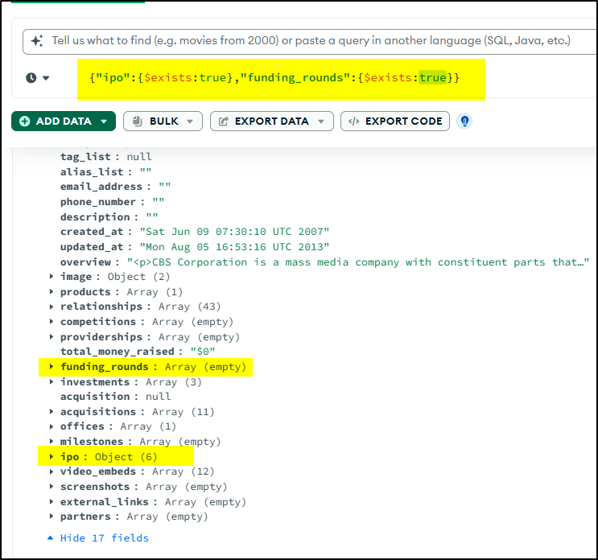 

<br>

##### 🐚 Mongo Shell:
**Command:** ` db.Companies.find({ "ipo": { $exists: true }, "funding_rounds": { $exists: true }}).limit(1)`
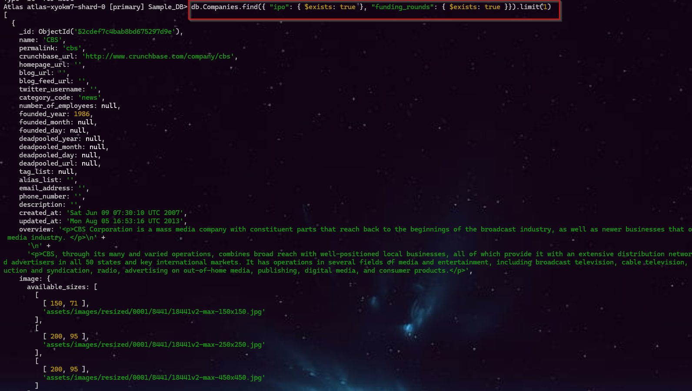 

<br>

#### 2️⃣  $type : `Data type`
**URL:** https://www.mongodb.com/docs/manual/reference/bson-types/
##### 🧭 Mongo Compass:
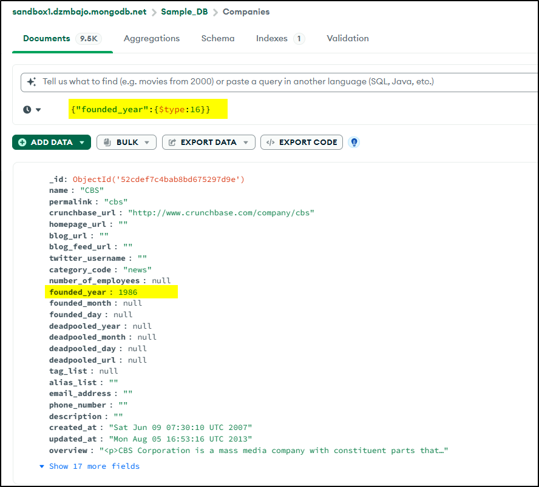 

<br>

##### 🐚 Mongo Shell:
**Command:** `db.Companies.find({"founded_year":{$type:16}}).limit(1)`
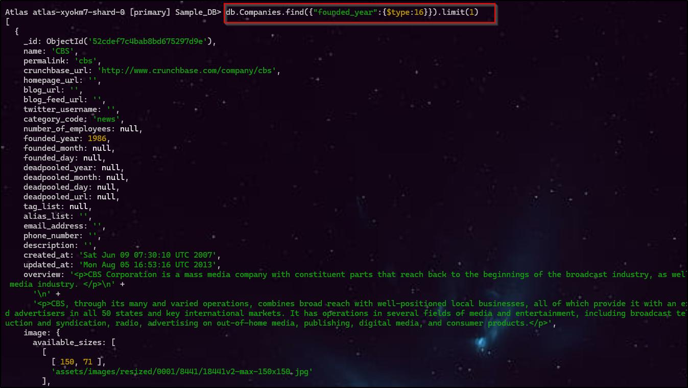 

<br>

---

<br>

## 4. 📌 MongoDB : Element Operation:
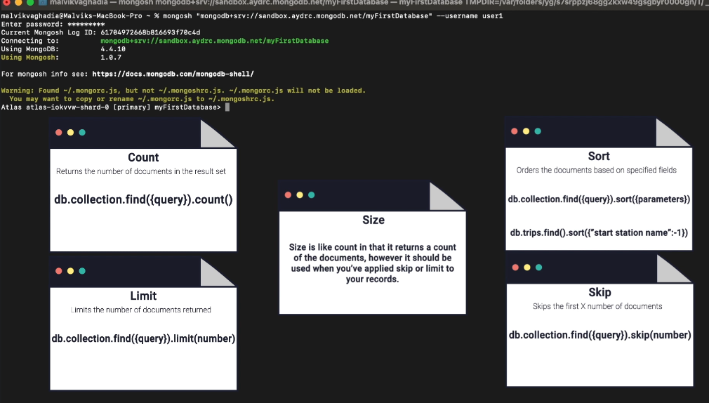 

<br>

#### ⏰ MongoDB `count()`, `limit()`, `skip()`, `sort()`, `size()`

| Method        | Purpose                             | Syntax                           | Easy meaning                                  |
| ------------- | ----------------------------------- | -------------------------------- | --------------------------------------------- |
| **`count()`** | Counts documents                    | `find({query}).count()`          | How many documents?                           |
| **`limit()`** | Limits documents                    | `find({query}).limit(n)`         | Give me only `n` documents                    |
| **`skip()`**  | Skips documents                     | `find({query}).skip(n)`          | Ignore first `n` documents                    |
| **`sort()`**  | Sorts documents                     | `find({query}).sort({field: 1})` | Arrange documents                             |
| **`size()`**  | Counts documents returned by cursor | `find({query}).size()`           | How many documents are in this cursor result? |

<br>


```js
// 1️⃣ Compound sort: first by "start station name" ascending, then by "tripduration" descending
db.trips.find().sort({"start station name": 1, "tripduration": -1})

// 2️⃣ Limit query: fetch only one document from the "trips" collection
db.trips.find().limit(1)

// 3️⃣ Count documents where tripduration > 300
db.trips.find({"tripduration": {$gt: 300}}).count()

// 4️⃣ Count documents where tripduration is between 300 and 400
db.trips.find({"tripduration": {$gt: 300, $lt: 400}}).count()
```


---

<br>

## 5. 📌 MongoDB :`Query Embedded`:

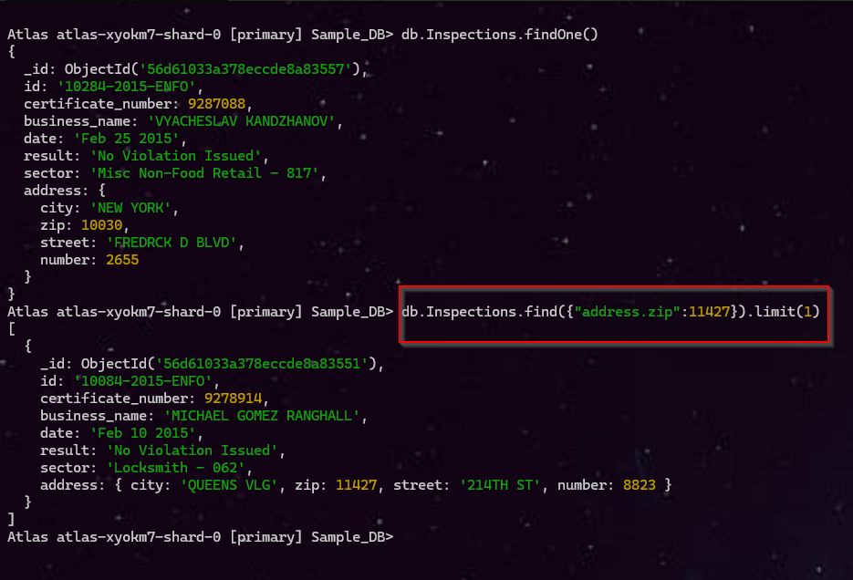 

```js
db.Inspections.find({"address.zip":11427}).limit(1)
```

##### 🧩 Query Breakdown

| Part            | Meaning          | Easy Explanation                     |
| --------------- | ---------------- | ------------------------------------ |
| `db`            | Current database | Uses the current MongoDB database    |
| `Inspections`   | Collection       | Searches inside `Inspections`        |
| `.find()`       | Find documents   | Finds matching documents             |
| `"address.zip"` | Nested field     | `zip` is inside the `address` object |
| `11427`         | Value to match   | ZIP code we are looking for          |
| `.limit(1)`     | Limit result     | Return only **1 document**           |


<br>

---

<br>

## 6. 🎯 Additional Resources - Query and Projection Operators:

**URL:** https://www.mongodb.com/docs/manual/reference/mql/query-predicates/

<br>

---

<br>

### 📚 Assignment: ⭐⭐⭐⭐⭐

|  **ID** | **Question** | **Answer (MongoDB Query)** |
| --- | --- | --- |
| 1 | Are there any documents in the **Trips** collection where the `start station name` or the `end station name` have been left as `null`? | `db.Trips.find{$or:[{"start station name":{$type:10},"end station name":{$type:10}}]}` |
| 2 | Return the **top 10 companies** by number of employees in descending order, projecting only the `name` and `number_of_employees` fields. | `db.Companies.find({},{"name":1,"number_of_employees":1,"_id":0}).sort({"number_of_employees":-1})` |
| 3 | Find out how many companies have **over 100,000 employees** in the Companies collection. | `db.Companies.find({number_of_employees:{$gt:100000}}).count()` |
| 4 | Return all documents in the **Companies** collection where there is a product named `"Jobster"`. The `name` field is inside the products array. `Project` only `_id` and `products` |  `db.Companies.find({ products: { $elemMatch: { name: "Jobster" } } }, { _id: 1, products: 1 })` |
| 5 | Return all documents in the Routes collection where the `id` (embedded in the `airline` field) is `410`.| `db.Routes.find({"airline.id":410}).limit(1)` |


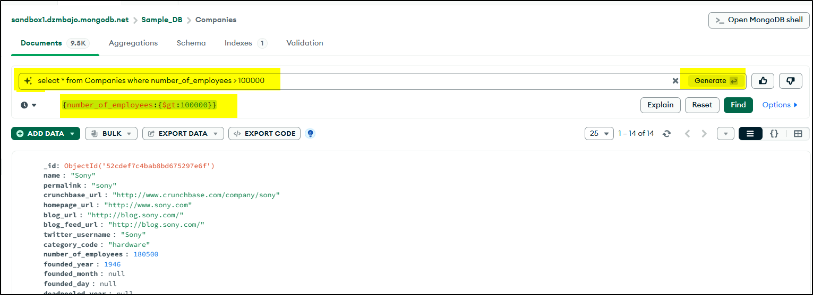 

<br>

---