# 1. Mongo Database Query Language (MQL) 
>[!Important]  Part 1 (INSERT, DELETE)

<br>


## 1.1 📊 Insert Document
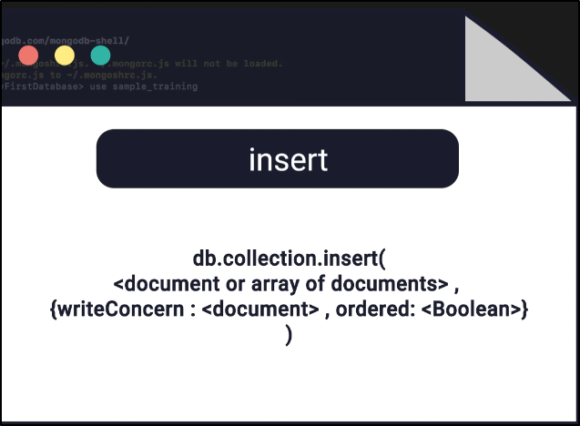

<br>

## Part 1: Insert Document - 🧭  Mongo Compass

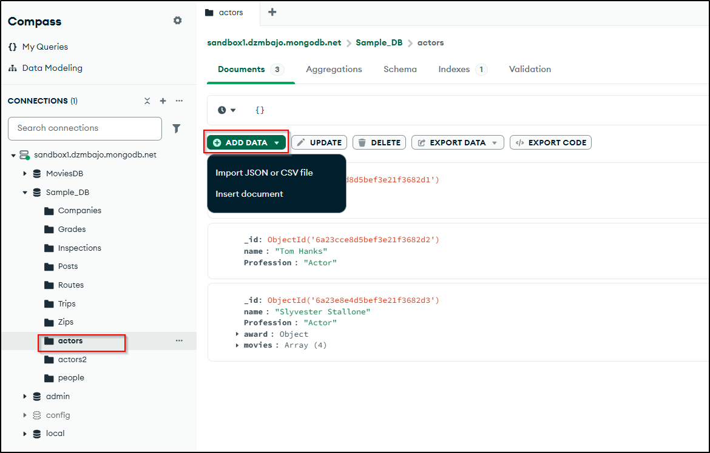

<br>

#### ⛩️ View -  `Table`:
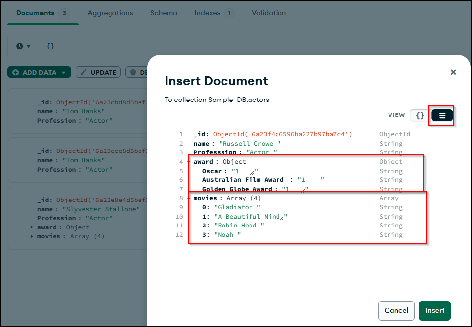

<br>

#### 📥 View -  `JSON`:
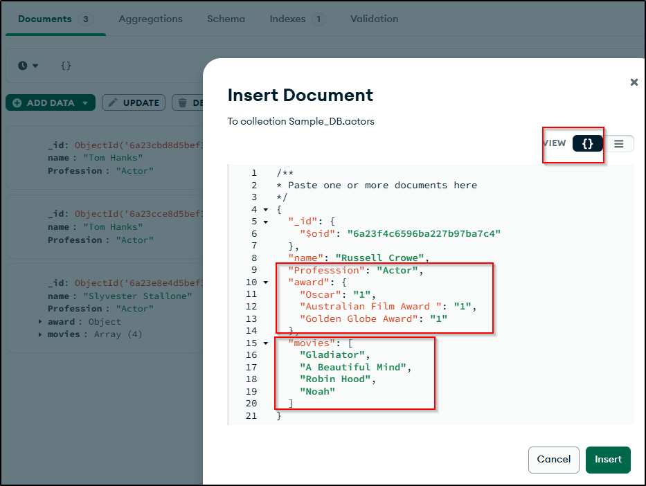
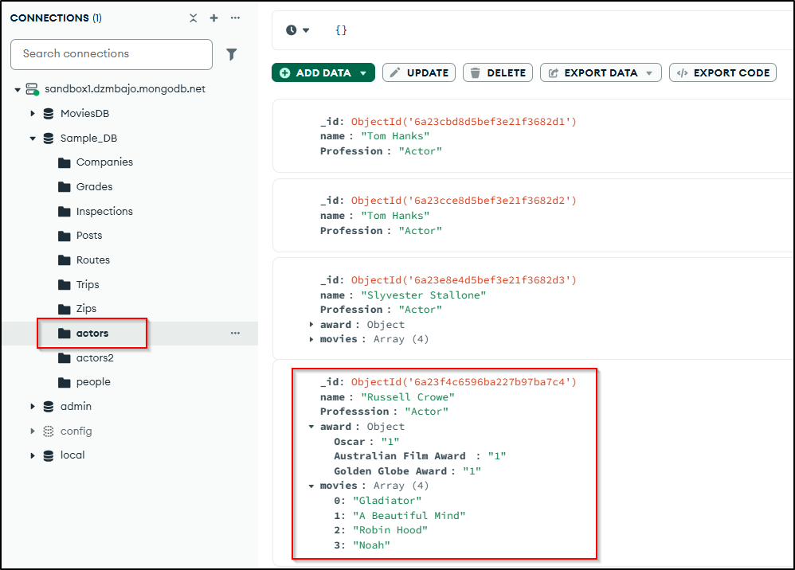


<br>
<br>


## Part 2: Insert Document -  Mongo Shell


#### Scenario 1:
>[!Note] Insert Document if "no collection" exists, then it will "create collection" and insert document
```mongodb
Atlas atlas-xyokm7-shard-0 [primary] Sample_DB> show collections
Atlas atlas-xyokm7-shard-0 [primary] Sample_DB> db.actors.insert({"name":"Tom Hanks", "Profession":"Actor"})
Atlas atlas-xyokm7-shard-0 [primary] Sample_DB> db.actors.find()
```
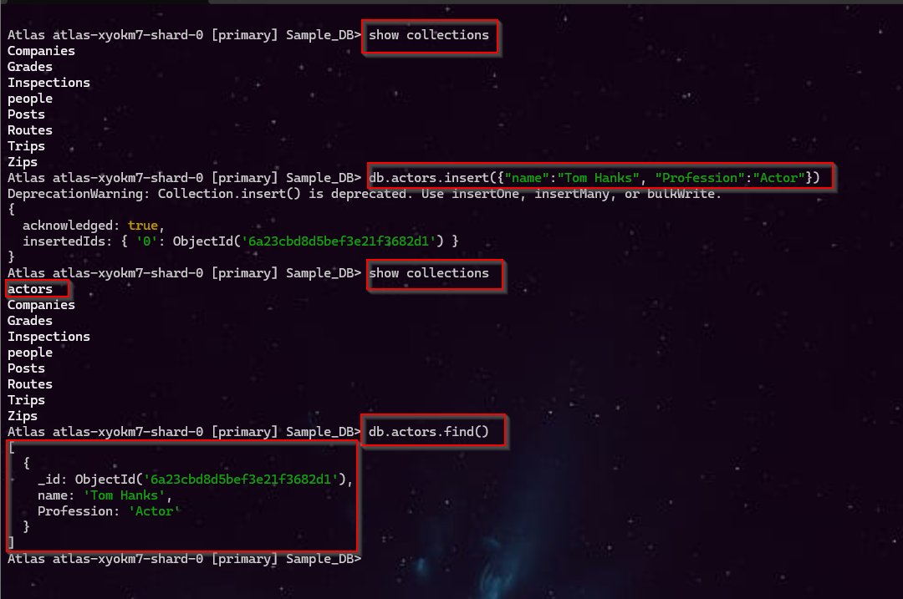 


<br>


#### Scenario 2: 
>[!Note] Insert Same Document, it will create unique "_id" for each document
```mongodb
Atlas atlas-xyokm7-shard-0 [primary] Sample_DB> db.actors.insert({"name":"Tom Hanks", "Profession":"Actor"})
```
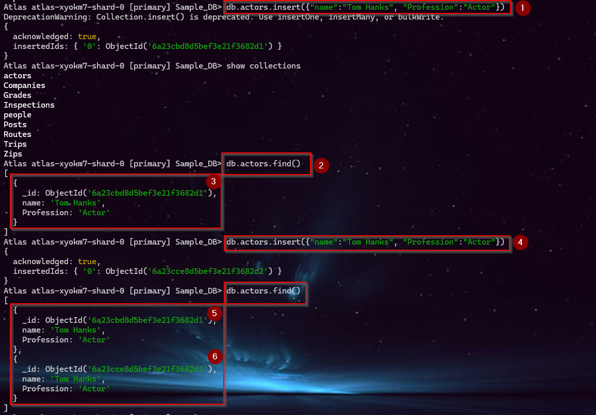 


<br>


#### Scenario 3:
>[!Note] Insert Same Document, it will create unique "_id" for each document
```mongodb
Atlas atlas-xyokm7-shard-0 [primary] Sample_DB> db.actors.insert({,"name":"Tom Hanks", "Profession":"Actor"})
```
 


<br>


#### Scenario 4: 
>[!Note] Insert Same Document with same "_id", it will throw <span style="color:red">error</span> because "_id" is unique for each document
```mongodb
Atlas atlas-xyokm7-shard-0 [primary] Sample_DB> db.actors.insert({"_id":6a23cce8d5bef3e21f3682d2,"name":"Tom Hanks", "Profession":"Actor"})
Atlas atlas-xyokm7-shard-0 [primary] Sample_DB> db.actors.find()
```
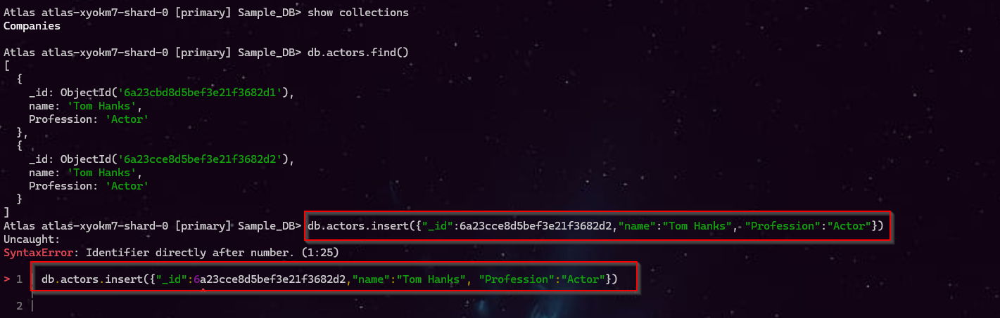 


<br>


#### Scenario 5: 
>[!Note] Insert Document with <span style="color:#0D61FE">different Schema</span> 
```mongodb
Atlas atlas-xyokm7-shard-0 [primary] Sample_DB> db.actors.insert({"name":"Slyvester Stallone", "Profession":"Actor", "award":{"Golden Globe":1, "Life Career Award":1},"movies":["Rocky","Rambo","Cobra","LockUp"]})
```
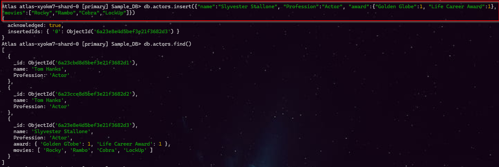


<br>


#### Scenario 6: 
>[!Note] <span style="color:green">Insert Multiple Documents</span> at once
```mongodb
Atlas atlas-xyokm7-shard-0 [primary] Sample_DB>db.actors2.insert([{"name":"Slyvester Stallone", "Profession":"Actor"},{"name":"Loniel Messi", "Profession":"Footballer"},{"name":"Virat Kohli", "Profession":"Cricketer"},{"name":"Roger Federer", "Profession":"Tennis Player"}])
Atlas atlas-xyokm7-shard-0 [primary] Sample_DB> db.actors.find()
```
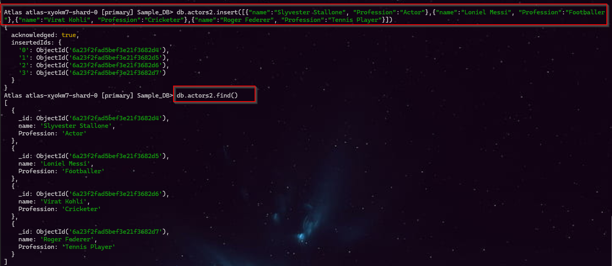


<br>
<br>

---


<br>


## 1.2 🎪 $MongoDB$ - `Delete Document`


<br>


### Part 1: `Delete Document` - 🧭 Mongo Compass
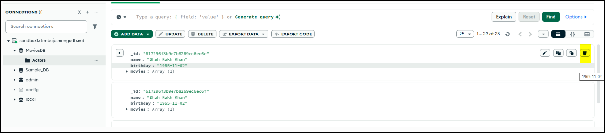


<br>


### Part 2: `Delete Document` - 🐚 Mongo Shell 

#### Scenario 1: Delete One Documents
```mongodb
db.Actors.find({ name: "Varun Dhawan" })
db.Actors.deleteOne({ name: "Varun Dhawan" })
```
#### Before Delete:
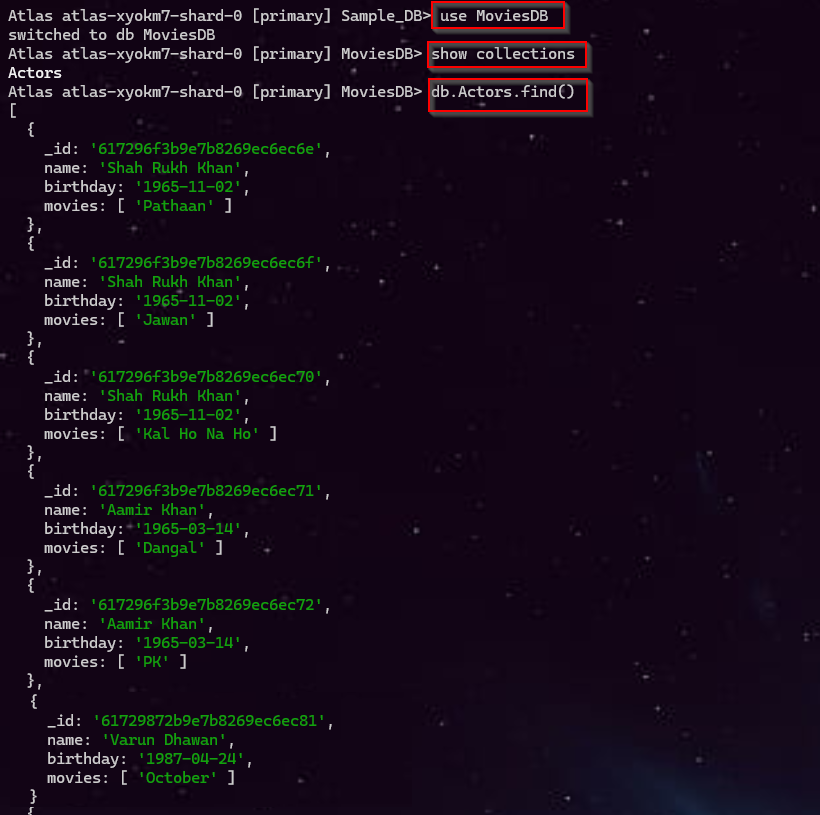

#### After Delete:
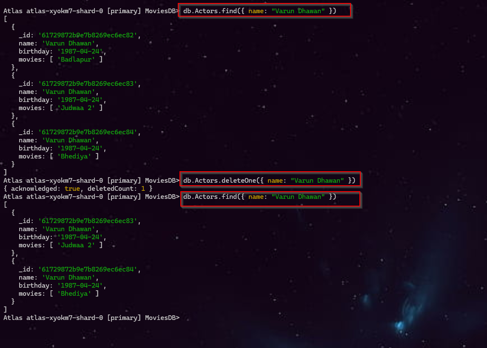


<br>

### Scenario 2: `Delete Many` Documents:
```mongodb
db.Actors.find({ name: "Varun Dhawan" })
db.Actors.deleteMany({ name: "Varun Dhawan" })
```
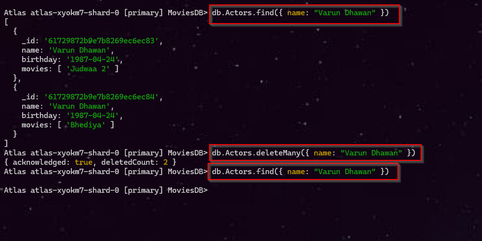

---