# 1. Mongo Database Query Language (MQL) 
>[!Important]  Part 2 (UPDATE)

<br>
<br>

### 1.1 🎯 Update Collection in MongoDB: 

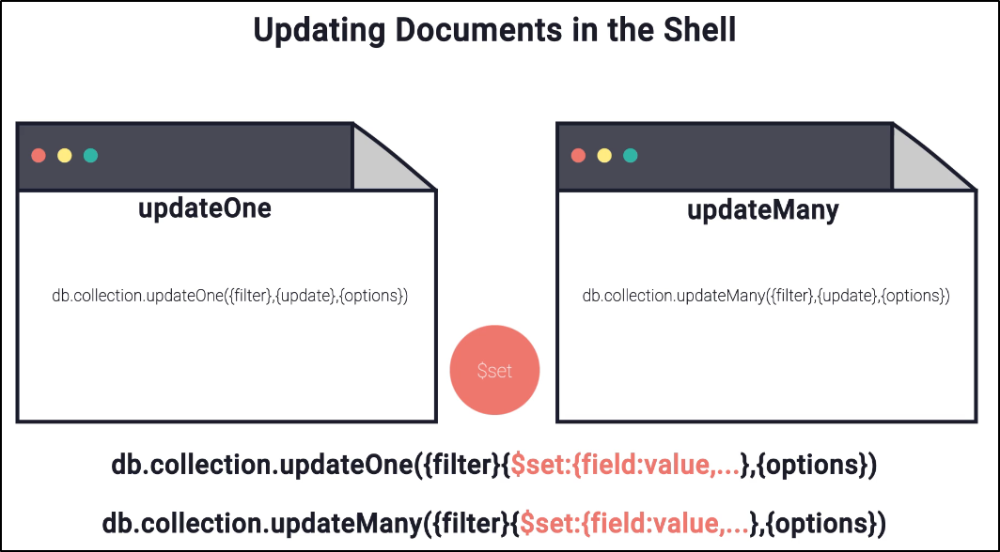

<br>

### 1.2 📟 Updating Documents in MongoDB Shell:

| Feature | `updateOne` | `updateMany` |
|---|---|---|
| **Syntax** | `db.collection.updateOne({filter}, {$set:{field:value,...}}, {options})` | `db.collection.updateMany({filter}, {$set:{field:value,...}}, {options})` |
| **Documents Affected** | Updates **only the first** matching document | Updates **all** matching documents |
| **Use Case** | When you want to modify a single specific record | When you want to modify multiple records at once |
| **Performance** | Faster — stops after first match | Slower — scans and updates all matches |
| **Risk Level** | Lower risk — limited impact | Higher risk — can affect many documents |
| **Example** | `db.users.updateOne(  { city: "Pune" },  { $set: { status: "active" } })` | `db.users.updateMany(  { city: "Pune" },  { $set: { status: "active" } })` |


### Key Operator — `$set`
- `$set` modifies **only the specified fields**, leaving all other fields in the document untouched.
- Without `$set`, the entire document would be **replaced** with just the update object.

<br>
<br>

---

<br>

## ✨ Example 1: Update `Single` Document:

- **Step 1:** `Create a new collection` and `insert` sample documents:

```MongoDB
db.people.insertMany([
	{ name: "Samantha Owen", profession: "chef" ,age: 24, hobbies_list: ["puzzles", "travelling"] },
	{ name: "Pratik Shah ", profession: "chef" ,age: 51, hobbies_list: ["sports"] },
	{ name: "Jack Ross", profession: "doctor" ,age: 33, hobbies_list: ["cooking", "reading", "sports"] },
	{ name: "Meera Patel", profession: "doctor" ,age: 37, hobbies_list: ["travelling"] },
	{ name: "Alex Bell", profession: "accountant" ,age: 26, hobbies_list: ["movies", "sports"] },
	{ name: "Jose Ramon", profession: "architect" ,age: 43, hobbies_list: ["cooking", "reading", "painting"] },
	{ name: "Jess Raymond", profession: "accountant" ,age: 40, hobbies_list: []},
])
```
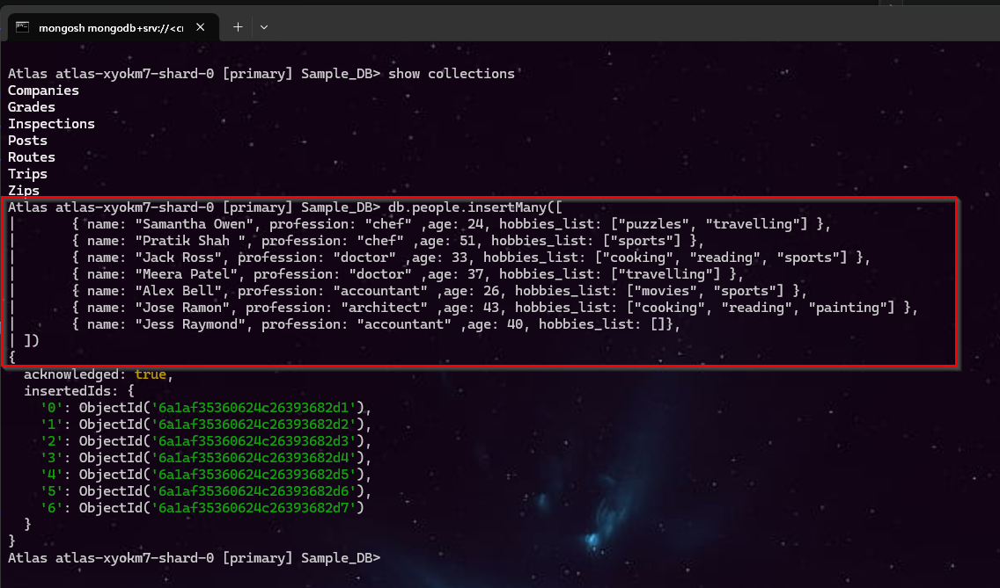

<br>

- 🥭**Step 2:** Update a Single Document

```MongoDB
Atlas atlas-xyokm7-shard-0 [primary] Sample_DB> db.people.updateOne(
| {"profession":"chef"},
| {$set:
| {"profession":"cook"}
| }
| )
```

##### Before update:
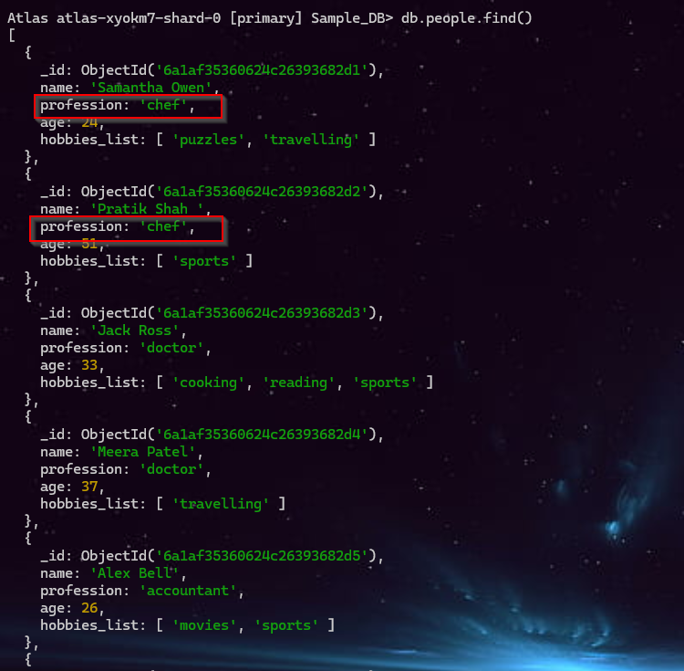

<br>

##### After update:
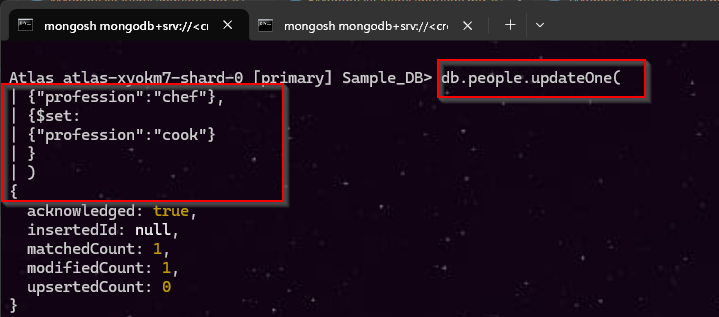
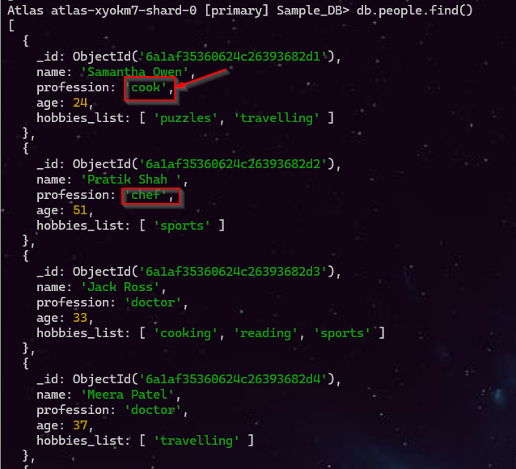

<br>

- 🍊 **Step 3:** Rerunning the same update command again will update the next matching document:
#### Rerun updateone command:
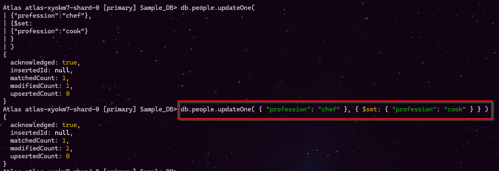

#### Next matching document:
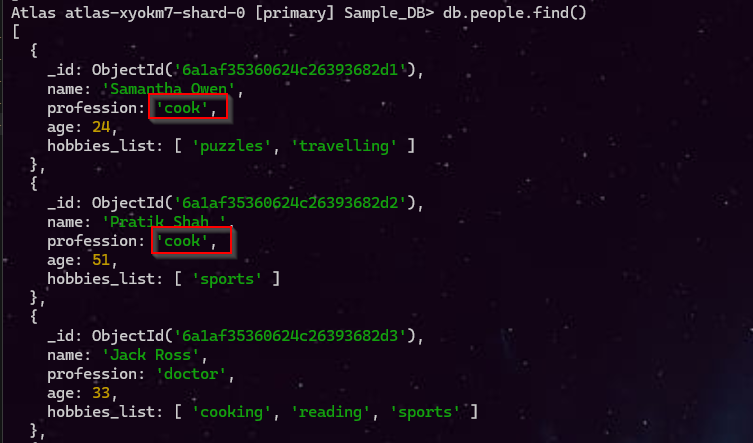


<br>
<br>

---


<br>

## ✨ Example 2: Update `Many` Documents:

```MongoDB
Atlas atlas-xyokm7-shard-0 [primary] Sample_DB> db.people.updateMany( {"profession":"chef"}, {$set: {"profession":"cook"} } )
```

<br>

##### Before update:


<br>

##### After update:
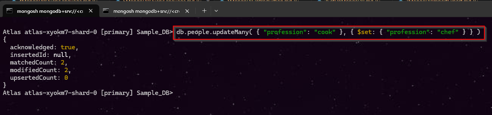
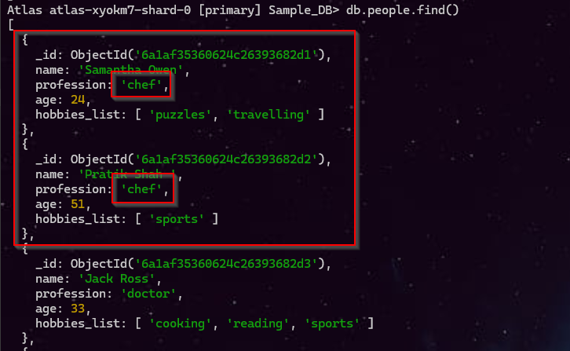

<br>

---

<br>

## ✨ Example 3: Update Many Documents - with `no criteria`:

```MongoDB
Atlas atlas-xyokm7-shard-0 [primary] Sample_DB> db.people.updateMany({ }, {$set: {"profession":"cook"} } )
```
#### Before update:


##### After update - New Field added to all documents:
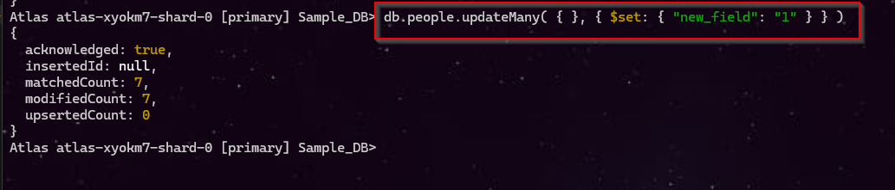
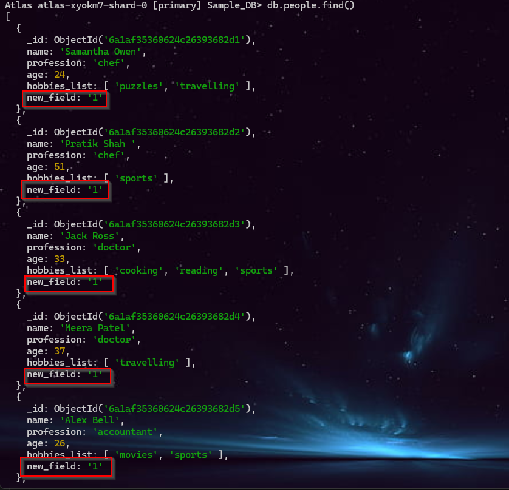

<br>
<br>

---

<br>


## ✨ Example 4: Update Multiple Fields:

```MongoDB
Atlas atlas-xyokm7-shard-0 [primary] Sample_DB>db.people.findOne({"name": "Jess Raymond"})

Atlas atlas-xyokm7-shard-0 [primary] Sample_DB> db.people.updateOne( {"name": "Jess Raymond"}, {$set: {"age": 30 ,"profession": "CA"}} )
```
#### Before update:
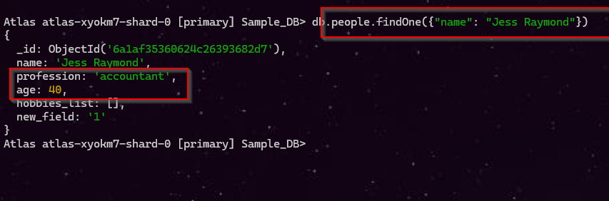

#### After update:
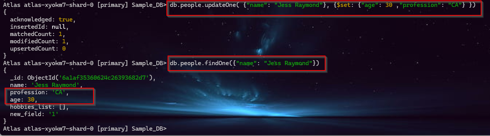


<br>
<br>

---

<br>


## ✨ Example 5: Update using `COMPASS GUI`:

#### you can edit only one document at a time using COMPASS GUI, and it will update the first matching document:
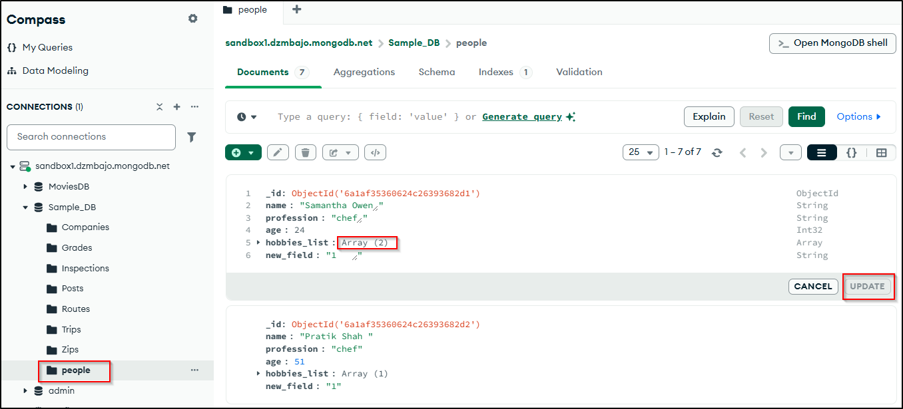


<br>
<br>

---

<br>


## ✨ Example 6: UPSERT in MongoDB:

**Upsert = Update + Insert**
It's a combination operation — if a matching document is found, it updates it; if not found, it inserts a new document.


| Scenario | upsert: false (default) | upsert: true |
|---|---|---|
| **Match found** | Updates document | Updates document |
| **No match found** | Does nothing | Inserts new document |
| **Risk** | Safe — no new data | May create unintended docs |
| **Use case** | Only update existing | Update or create if missing |

<br>

```MongoDB
Atlas atlas-xyokm7-shard-0 [primary] Sample_DB>db.people.updateMany({"name": "unknown"},{$set: {"profession":"cook", "age":24} })

Atlas atlas-xyokm7-shard-0 [primary] Sample_DB> db.people.findOne({"name": "unknown"})

Atlas atlas-xyokm7-shard-0 [primary] Sample_DB> db.people.updateMany({"name": "unknown"},{$set: {"profession":"cook", "age":24} }, {upsert:true})

```

<br>

#### After update:
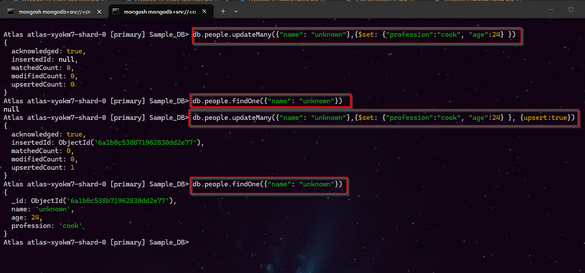


<br>
<br>

---

<br>


## Example 7: `UPDATE OPERATORS` in MongoDB:

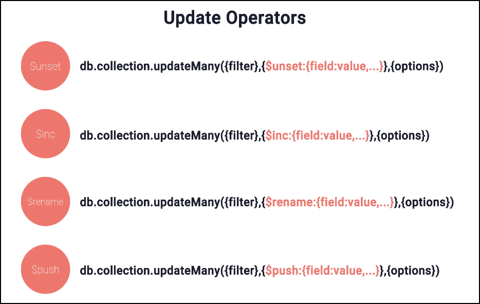

<br>

## 🍎 MongoDB Update Operators

| Operator | Syntax | Description | Example |
|---|---|---|---|
| **`$unset`** | `db.collection.updateMany({filter}, {$unset:{field:value,...}}, {options})` | **Removes** a field from the document entirely | `db.users.updateMany({city:"Pune"}, {$unset:{age:""}})` |
| **`$inc`** | `db.collection.updateMany({filter}, {$inc:{field:value,...}}, {options})` | **Increments** a numeric field by the given value (use negative to decrement) | `db.products.updateMany({category:"electronics"}, {$inc:{price:100}})` |
| **`$rename`** | `db.collection.updateMany({filter}, {$rename:{field:value,...}}, {options})` | **Renames** an existing field to a new name | `db.users.updateMany({}, {$rename:{"fname":"firstName"}})` |
| **`$push`** | `db.collection.updateMany({filter}, {$push:{field:value,...}}, {options})` | **Appends** a value to an array field | `db.users.updateMany({city:"Pune"}, {$push:{hobbies:"reading"}})` |


<br>


### 🔰 **Scenario 1:** **`$unset`**

```MongoDB
Atlas atlas-xyokm7-shard-0 [primary] Sample_DB> db.people.find()
Atlas atlas-xyokm7-shard-0 [primary] Sample_DB> db.people.updateMany({"profession":"chef"},{$unset:{"new_field":""}})
```
##### Before update:
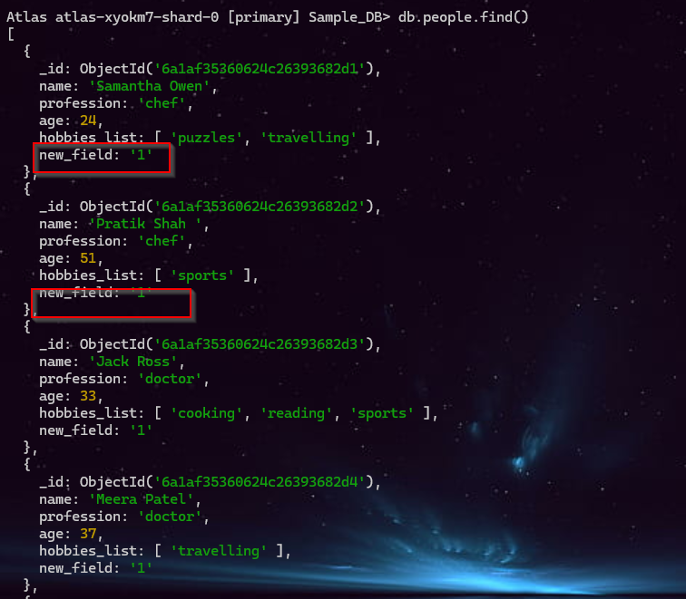

##### After update:
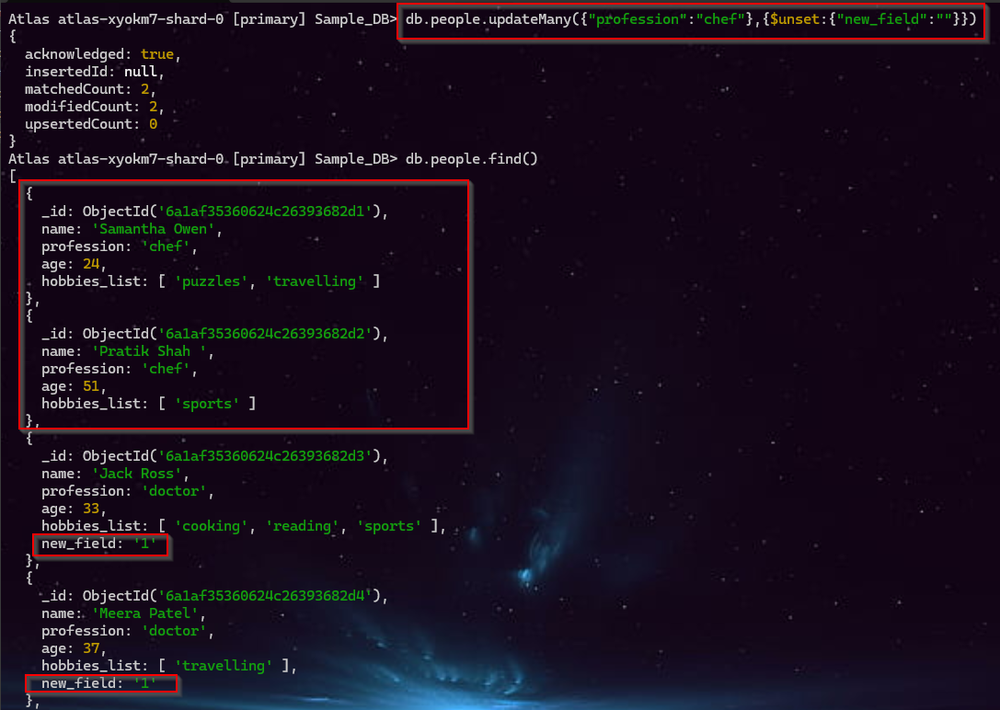


<br>

### 🔰 **Scenario 2:** **`$push`**

```MongoDB
Atlas atlas-xyokm7-shard-0 [primary] Sample_DB> db.people.findOne( {name: 'Meera Patel'})
Atlas atlas-xyokm7-shard-0 [primary] Sample_DB> db.people.updateMany({name: 'Meera Patel'},{$push:{"hobbies_list":"reading"}})
```
#### After update: Added "reading" to hobbies_list array for Meera Patel
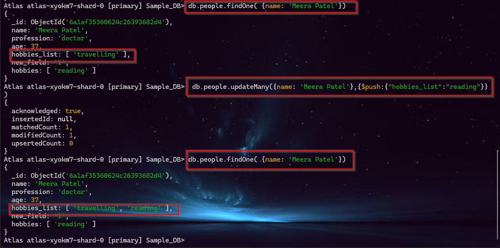  


<br>


### 🔰 **Scenario 3:** **`$rename`**

```MongoDB
Atlas atlas-xyokm7-shard-0 [primary] Sample_DB> db.people.find()
Atlas atlas-xyokm7-shard-0 [primary] Sample_DB> db.people.updateMany({},{$rename:{"hobbies_list": "hobbies"}})
```
#### Before update:
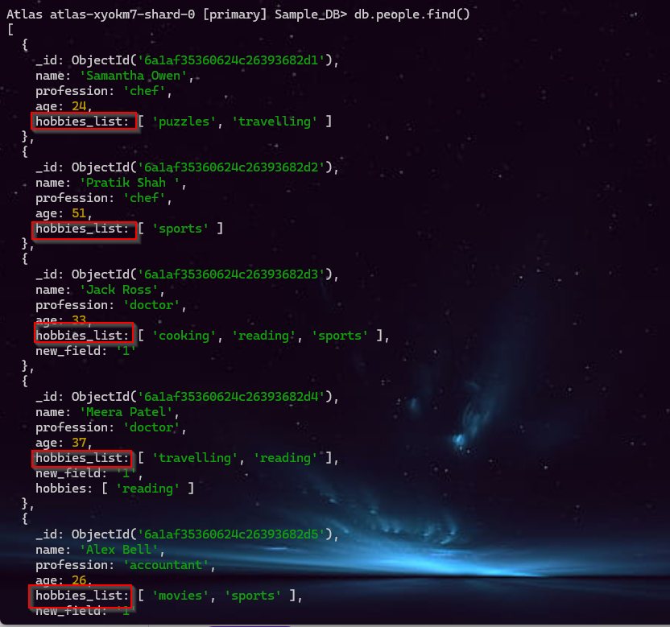

#### After update: Feild name "hobbies_list" renamed to "hobbies" for all documents
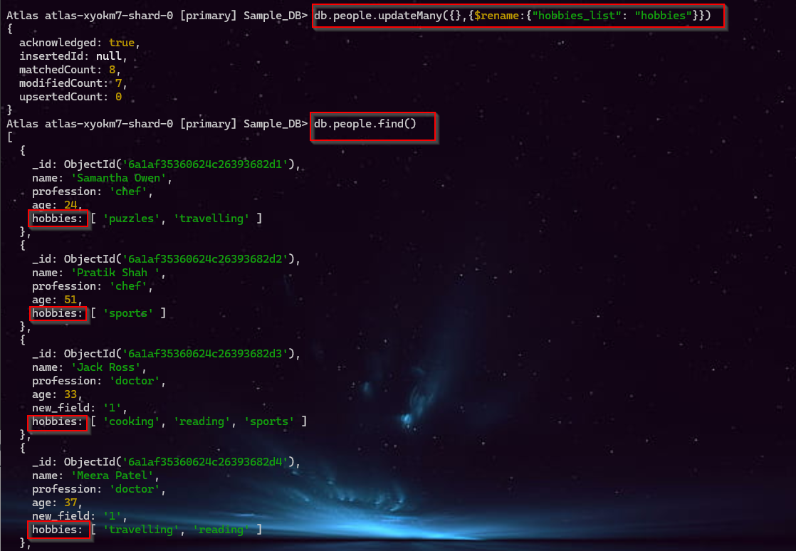


<br>

### 🔰 **Scenario 4:** **`$inc`**

```MongoDB
Atlas atlas-xyokm7-shard-0 [primary] Sample_DB> db.people.find()
Atlas atlas-xyokm7-shard-0 [primary] Sample_DB> db.people.updateMany({},{$inc:{"age":1}})
```
#### Before update:
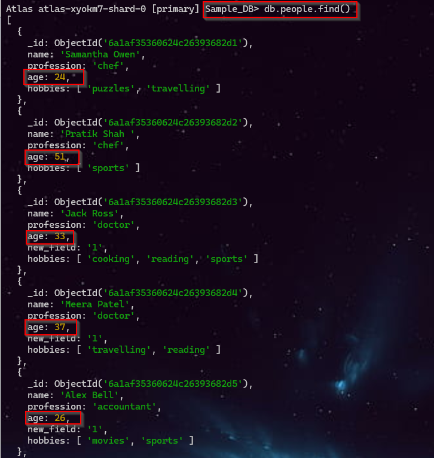

#### After update: Incremented age by 1 for all documents
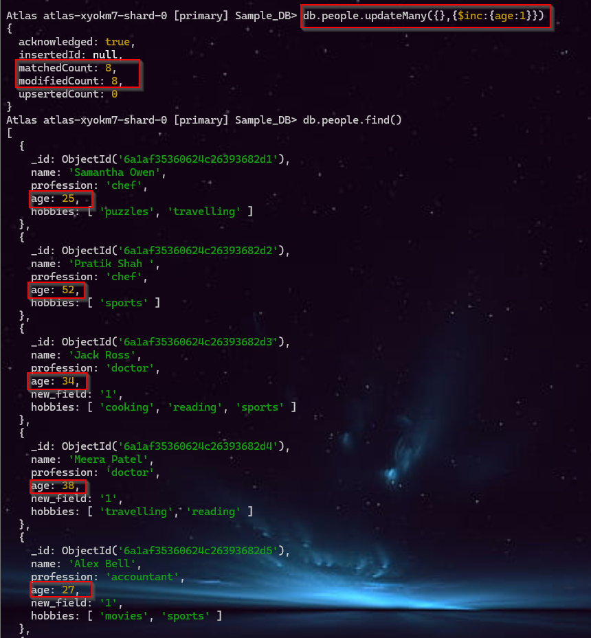

---

