# 📊 MongoDB Aggregation Framework-1

### 🔎  `MongoDB Aggregation Framework`:
- A **powerful tool** in MongoDB for performing advanced data analysis and transformations.  
- Works through an **aggregation pipeline**, where documents pass through multiple stages, each transforming the data.  
- Similar to SQL’s `GROUP BY`, `JOIN`, and `HAVING`, but more flexible.

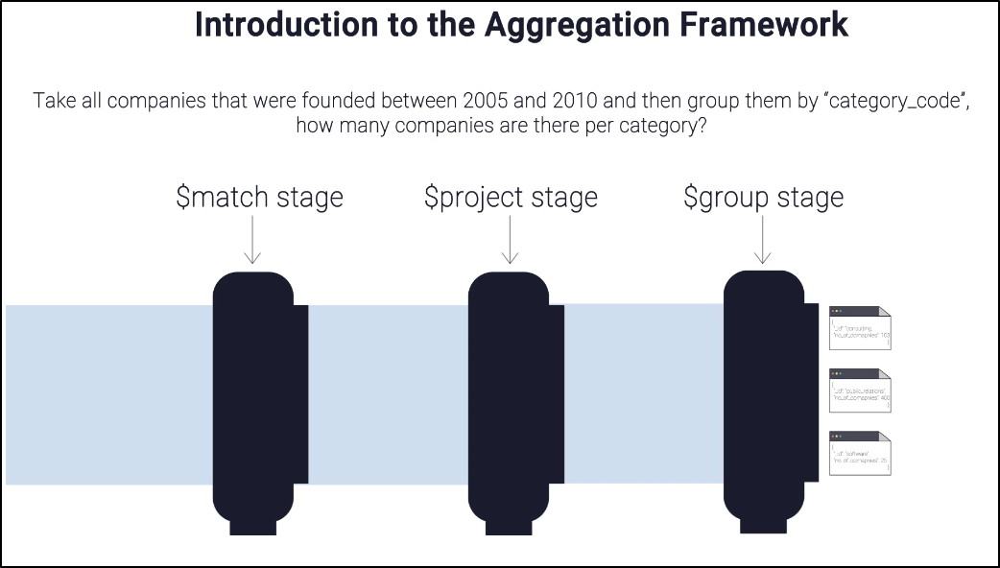

### ⚙️ Key Features:
- **Aggregation Pipelines**  
  - Stages like `$match`, `$group`, `$sort`, `$project`, `$unwind`.  
  - Each stage processes documents and passes results to the next.  

- **Single-Purpose Aggregation Methods**  
  - Simpler alternatives: `count()`, `distinct()`, `group()`.  
  - Less flexible than pipelines.  

- **Operators & Expressions**  
  - Math: `$sum`, `$avg`, `$min`, `$max`  
  - Arrays: `$unwind`, `$push`  
  - Conditional: `$cond`, `$ifNull`

<br>

#### 📊 Example Pipeline
Find the **top 3 directors with the most movies**:

```javascript
db.movies.aggregate([
  { $match: { directors: { $exists: true, $ne: null, $not: { $size: 0 } } } },
  { $unwind: "$directors" },
  { $group: { _id: "$directors", movieCount: { $sum: 1 } } },
  { $sort: { movieCount: -1 } },
  { $limit: 3 }
]);
```

- `$match` → Filters documents with valid directors  
- `$unwind` → Splits arrays into individual docs  
- `$group` → Groups by director, counts movies  
- `$sort` → Orders by count  
- `$limit` → Restricts to top 3  


<br>

### ✅ Advantages:
- Runs directly on MongoDB servers → **efficient**  
- Handles complex transformations → **flexible**  
- Integrates with MongoDB Atlas UI → **visualization ready**


## ⚠️ Considerations
- Large pipelines can be **resource-intensive** → indexing helps  
- Pipelines may become **hard to read** if too long  
- For huge datasets, external tools (Spark, Hadoop) may be better  


👉 In short: The **Aggregation Framework** is MongoDB’s built-in analytics engine, letting you filter, group, and transform data with pipelines instead of exporting it elsewhere.  

<br>

---

<br>


## 2️⃣ Match Operation:

**Match Stage:** Filters documents based on specified criteria.

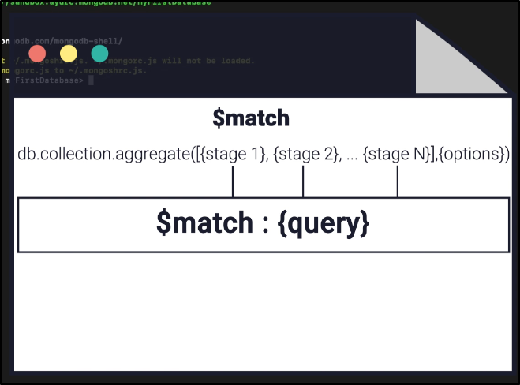

<br>

#### ♨️ Example 1: `Find companies founded between 2005 and 2010`:

**Command:** `db.Companies.aggregate([{$match:{"founded_year":{$gte:2005,$lte:2010}}}])`

| Part             | Meaning                                 |
| ---------------- | --------------------------------------- |
| `db`             | Refers to the current MongoDB database  |
| `Companies`      | Collection containing company documents |
| `.aggregate()`   | Runs an **aggregation pipeline**        |
| `[ ... ]`        | Contains pipeline stages                |
| `$match`         | Filters documents                       |
| `"founded_year"` | Field being checked                     |
| `$gte: 2005`     | Greater than or equal to 2005           |
| `$lte: 2010`     | Less than or equal to 2010              |


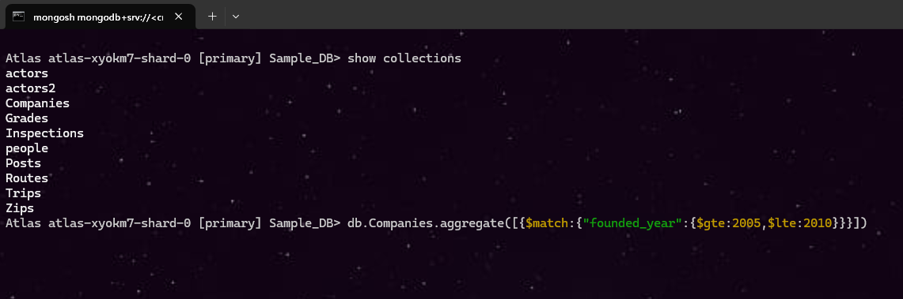
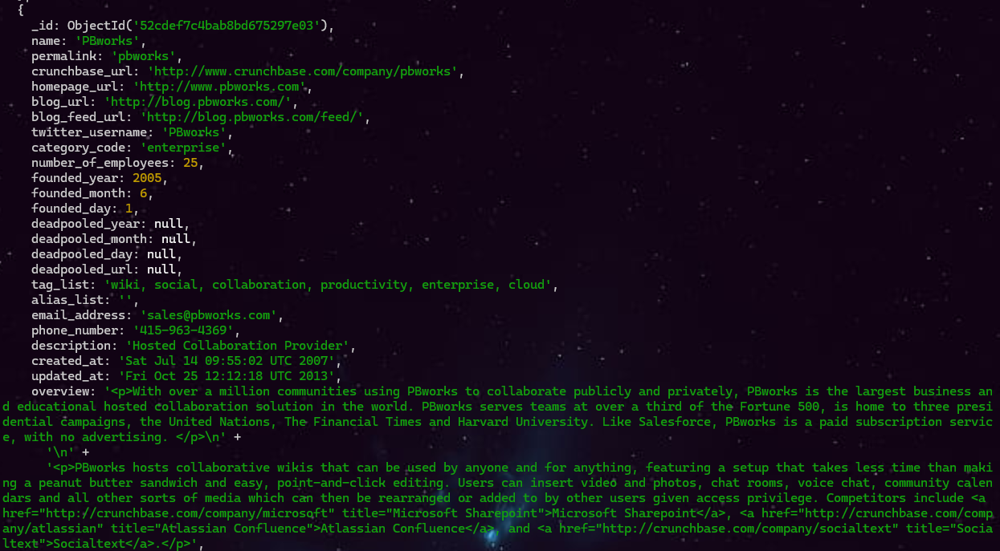

<br>

#### ♨️ Example 2: `Find companies founded in 2005 or 2010`:

**Command:** `db.Companies.aggregate([{$match:{"founded_year":{$in:[2005,2010]}}}])`

| Part           | Meaning                                   |
| -------------- | ----------------------------------------- |
| `db`           | Current database                          |
| `Companies`    | Companies collection                      |
| `aggregate()`  | Runs aggregation pipeline                 |
| `$match`       | Filters documents                         |
| `founded_year` | Field to check                            |
| `$in`          | Matches **any value from the given list** |
| `[2005, 2010]` | Allowed values                            |

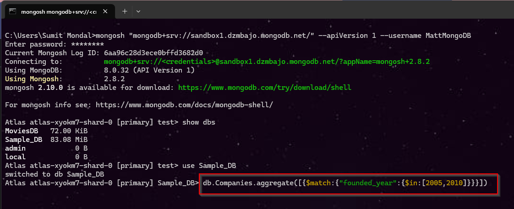

<br>

#### ♨️ Example 3: `Find companies founded in 2005 or 2010`:

**Command:** `db.Grades.aggregate([{$match:{"scores":{$elemMatch:{"type":"exam", "score":{$gt:85}}}}}])`

| Part            | Meaning                                                                |
| --------------- | ---------------------------------------------------------------------- |
| `db.Grades`     | `Grades` collection                                                    |
| `aggregate()`   | Runs aggregation pipeline                                              |
| `$match`        | Filters documents                                                      |
| `scores`        | An **array** field                                                     |
| `$elemMatch`    | Checks whether **at least one array element** satisfies the conditions |
| `"type":"exam"` | The element must be an exam                                            |
| `$gt:85`        | Score must be greater than 85                                          |


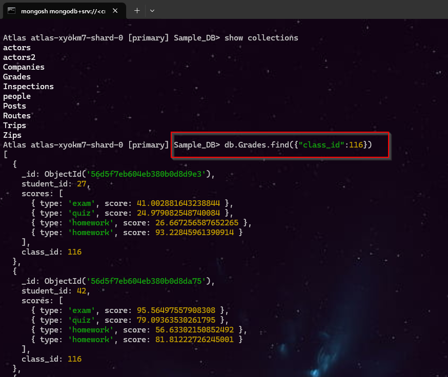
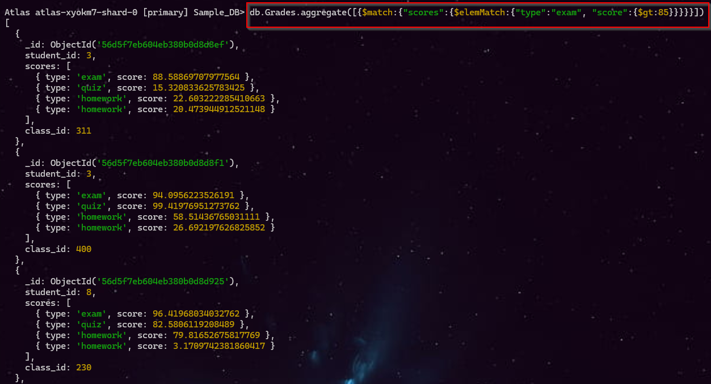

<br>

---

<br>

## 3️⃣ Project Operation:

**Project Stage:** Reshapes documents, including or excluding fields.

| Value      | Meaning               |
| ---------- | --------------------- |
| `1`        | Include field ✅      |
| `0`        | Exclude field ❌      |
| `_id: 0`   | Hide `_id`            |
| Expression | Create/modify a field |

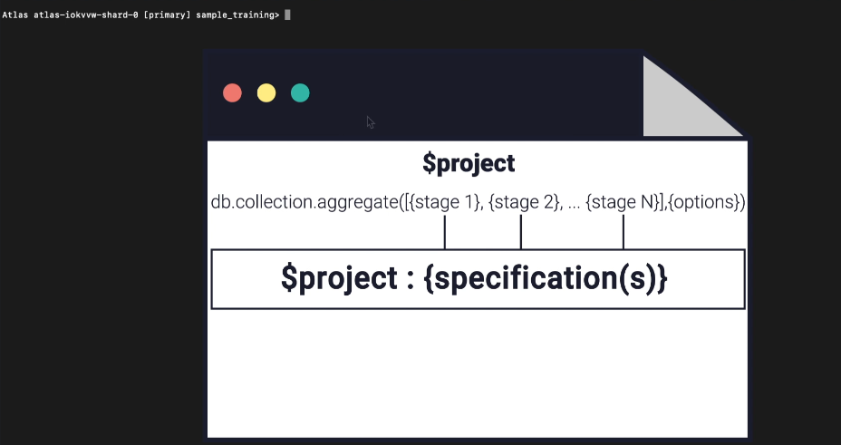

<br>

#### ♨️ Example 1: Display only `founded_year` and `category_code` for companies founded between 2005 and 2010:

**Command:** `db.Companies.aggregate([{$match:{"founded_year":{$gte:2005,$lte:2010}}}, {$project:{"founded_year":1, "category_code":1}}])`

| Value      | Meaning               |
| ---------- | --------------------- |
| `1`        | Include field -  `founded_year` ✅      |
| `1`        | Include field -  `category_code` ✅     |


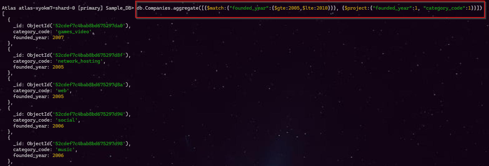

<br>


#### ♨️ Example 2: Display only `founded_year` , `category_code` and exclude `_id` for companies founded between 2005 and 2010:

**Command:** `db.Companies.aggregate([{$match:{"founded_year":{$gte:2005,$lte:2010}}}, {$project:{"founded_year":1, "category_code":1, "_id":0}}])`

| Value      | Meaning               |
| ---------- | --------------------- |
| `1`        | Include field -  `founded_year` ✅      |
| `1`        | Include field -  `category_code` ✅     |
| `0`        | Exclude field -  `_id` ❌     |

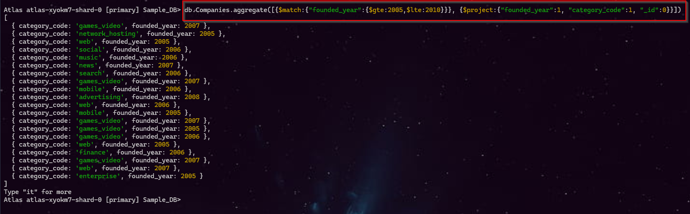


<br>

#### ♨️ Example 3: Display only external_links.external_url and exclude _id:

**Command:** `db.Companies.aggregate([{$project:{"external_links.external_url":1,"_id":0}}}])`

| Value | Meaning                                         |
| ----- | ----------------------------------------------- |
| `1`   | Include field - `external_links.external_url` ✅ |
| `0`   | Exclude field - `_id` ❌                         |

>[!Note] The . means we are accessing a nested field.

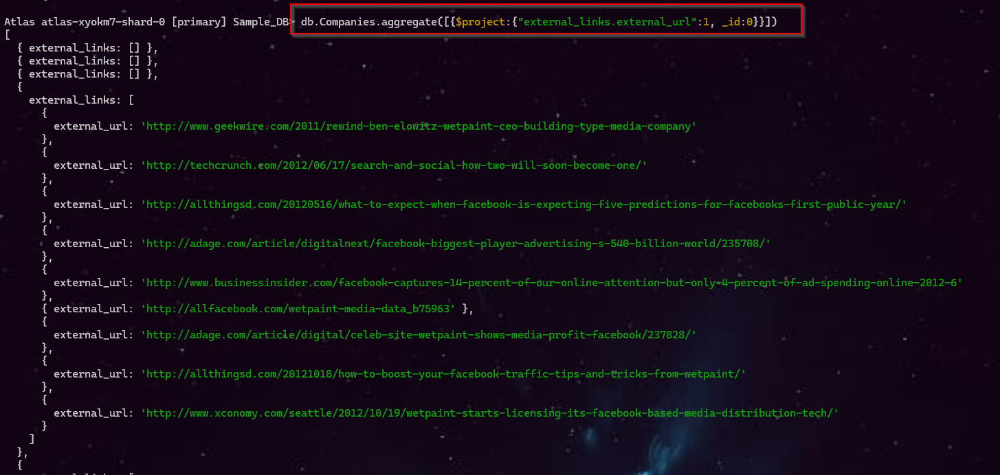


<br>

#### ♨️ Example 4: Display `number_of_employees` and create a new field `new_number_of_employees` with the same value:

| Value                    | Meaning                                                                      |
| ------------------------ | ---------------------------------------------------------------------------- |
| `1`                      | Include `number_of_employees` ✅                                              |
| `0`                      | Exclude `_id` ❌                                                              |
| `"$number_of_employees"` | Take the value from `number_of_employees` and put it into a **new field** 🔄 |

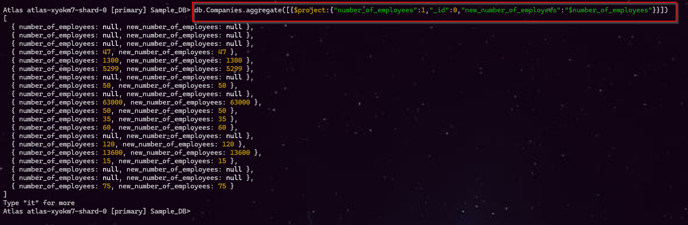

>[!Note] Example: "new_salary": "$salary" → creates new_salary with the same value as salary.


<br>

#### ♨️ Example 5: Rename `number_of_employees` to `Total_Employees` and exclude `_id`:

| Value                    | Meaning                                      |
| ------------------------ | -------------------------------------------- |
| `"_id": 0`               | Exclude `_id` ❌                              |
| `"Total_Employees"`      | Create a new field with this name 🆕         |
| `"$number_of_employees"` | Take the value from `number_of_employees` 🔄 |

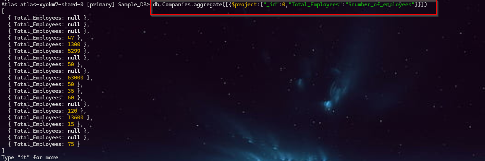


<br>

#### ♨️ Example 6: Convert `number_of_employees` from `employees` to thousands:

| Part                     | Meaning                                |
| ------------------------ | -------------------------------------- |
| `"_id": 0`               | Exclude `_id` ❌                        |
| `"number_of_employees"`  | Output field name                      |
| `$divide`                | Performs division ➗                    |
| `"$number_of_employees"` | Gets the value from the existing field |
| `1000`                   | Divides the value by 1000              |

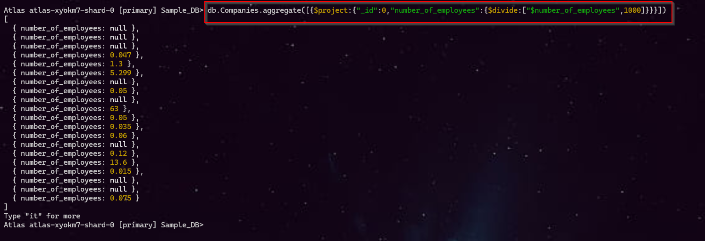

<br>

---
