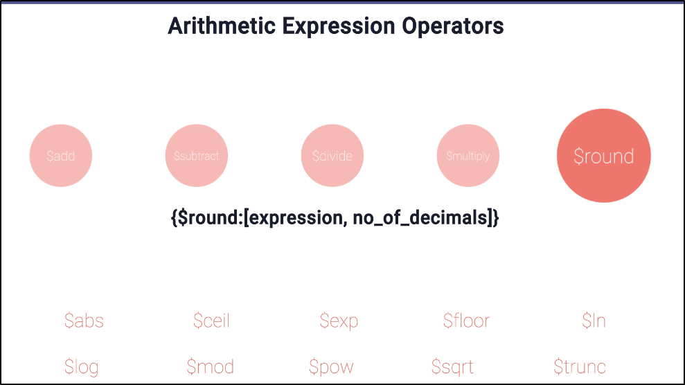
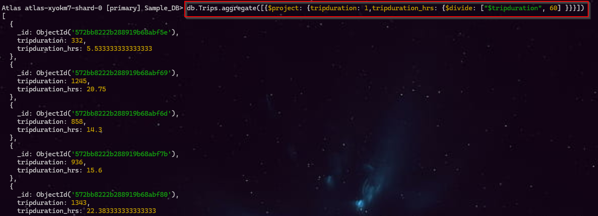
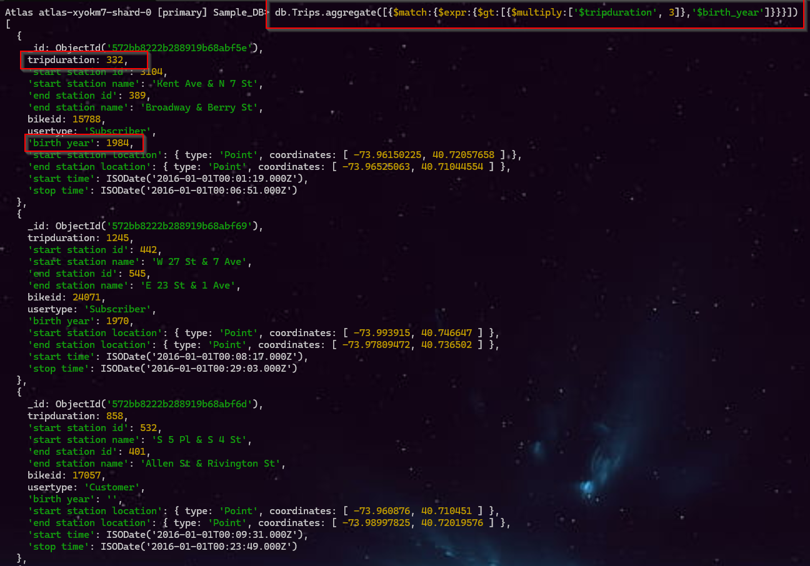
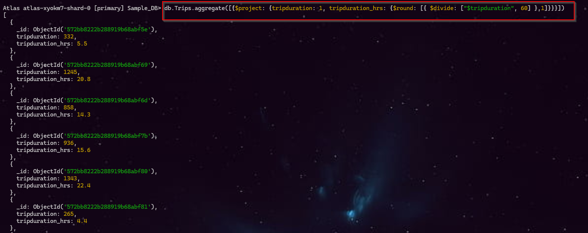

# 📊 MongoDB Aggregation Framework-2

<br>

## 🔢 MongoDB Arithmetic Expression Operators

These operators are mainly used inside **aggregation pipelines**, especially with `$project`, `$set`, `$addFields`, etc.




<br>

### 1️⃣ Basic Arithmetic Operators

| Operator    | Purpose        | Example                   |  Result |
| ----------- | -------------- | ------------------------- | ------: |
| `$add`      | Addition       | `{ $add: [10, 5] }`       |    `15` |
| `$subtract` | Subtraction    | `{ $subtract: [10, 5] }`  |     `5` |
| `$multiply` | Multiplication | `{ $multiply: [10, 5] }`  |    `50` |
| `$divide`   | Division       | `{ $divide: [10, 5] }`    |     `2` |
| `$round`    | Round a number | `{ $round: [10.567, 2] }` | `10.57` |

### `$round` Syntax

```javascript
{ $round: [ <expression>, <place> ] }
```

Example:

```javascript
{ $round: [10.5678, 2] }
```

➡️ `10.57`

| Parameter    | Meaning                    |
| ------------ | -------------------------- |
| `expression` | Number/expression to round |
| `place`      | Number of decimal places   |

<br>

#### ✨ Example 1: `$divide`   

**Command:** `db.Trips.aggregate([{$project: {tripduration: 1,tripduration_hrs: {$divide: ["$tripduration", 60]}}}])`

| Part                               | Explanation                                              |
| ---------------------------------- | -------------------------------------------------------- |
| `db.trips`                         | Selects the **trips** collection                         |
| `.aggregate()`                     | Runs an **aggregation pipeline**                         |
| `$project`                         | Selects existing fields and/or creates calculated fields |
| `"tripduration": 1`                | Includes the original `tripduration` field in output     |
| `"tripduration_hrs"`               | Creates a **new calculated field**                       |
| `$divide`                          | Performs division                                        |
| `"$tripduration"`                  | Takes the value from the `tripduration` field            |
| `60`                               | Divides the duration by 60                               |
| `{$divide: ["$tripduration", 60]}` | Converts the duration from **minutes to hours**          |





<br>

#### ✨ Example 2: `$expr` + `multiply`
**Command:** `db.Trips.aggregate([{$match:{$expr:{$gt:[{$multiply:['$tripduration', 3]},'$birth_year']}}}])`

| Part                 | Meaning                               |
| -------------------- | ------------------------------------- |
| `db.trips`           | Selects the `trips` collection        |
| `$aggregate()`       | Performs aggregation operations       |
| `$project`           | Selects/creates fields for the output |
| `"tripduration": 1`  | Includes original `tripduration`      |
| `"tripduration_hrs"` | Creates a new calculated field        |
| `$divide`            | Divides one value by another          |
| `"$tripduration"`    | Value from the `tripduration` field   |
| `60`                 | Divisor                               |
| `$round`             | Rounds the calculated result          |
| `1`                  | Keeps **1 digit after decimal**       |




<br>

---

<br>

## 2️⃣ Mathematical Functions

| Operator | Meaning                           | Example               |     Result |
| -------- | --------------------------------- | --------------------- | ---------: |
| `$abs`   | Absolute value                    | `{ $abs: -10 }`       |       `10` |
| `$ceil`  | Round **up** to nearest integer   | `{ $ceil: 10.2 }`     |       `11` |
| `$floor` | Round **down** to nearest integer | `{ $floor: 10.8 }`    |       `10` |
| `$exp`   | \(e^x\)                           | `{ $exp: 1 }`         | `2.718...` |
| `$ln`    | Natural logarithm (base **e**)    | `{ $ln: 10 }`         | `2.302...` |
| `$log`   | Logarithm with specified base     | `{ $log: [100, 10] }` |        `2` |
| `$mod`   | Remainder                         | `{ $mod: [10, 3] }`   |        `1` |
| `$pow`   | Power                             | `{ $pow: [2, 3] }`    |        `8` |
| `$sqrt`  | Square root                       | `{ $sqrt: 25 }`       |        `5` |
| `$trunc` | Remove decimal part               | `{ $trunc: 10.89 }`   |       `10` |

<br>

#### ✨ Example : 
| Component          | Meaning                                        |
| ------------------ | ---------------------------------------------- |
| `db.trips`         | Selects the `trips` collection                 |
| `$aggregate()`     | Performs aggregation operations                |
| `$project`         | Selects existing fields and creates new fields |
| `tripduration: 1`  | Displays the original `tripduration`           |
| `tripduration_hrs` | Creates a new calculated field                 |
| `$divide`          | Divides one value by another                   |
| `"$tripduration"`  | Gets the value from `tripduration`             |
| `60`               | Divisor                                        |
| `$round`           | Rounds the calculated result                   |
| `1`                | Keeps **1 decimal place**                      |



<br>

---

<br>


### 🧠 Easy Way to Remember:

```text
                MongoDB Arithmetic
                       │
        ┌──────────────┴──────────────┐
        │                             │
   Basic Arithmetic              Math Functions
        │                             │
 ┌──────┼──────┐              ┌───────┼────────┐
 │      │      │              │       │        │
$add $sub  $multiply       $abs    $sqrt    $pow
      │      │                  │
   $divide  $round            $ceil
                              $floor
                              $trunc
                              $ln
                              $log
                              $exp
                              $mod
```

<br>

### ⭐ Most Important Differences

| Operator | Think of it as         | Example  | Result |
| -------- | ---------------------- | -------- | -----: |
| `$ceil`  | ⬆️ Always up           | `10.2`   |   `11` |
| `$floor` | ⬇️ Always down         | `10.8`   |   `10` |
| `$trunc` | ✂️ Remove decimal      | `10.8`   |   `10` |
| `$round` | 🎯 Nearest value       | `10.6`   |   `11` |
| `$abs`   | ➕ Remove negative sign | `-10`    |   `10` |
| `$mod`   | `%` remainder          | `10 % 3` |    `1` |
| `$pow`   | Power                  | `2³`     |    `8` |
| `$sqrt`  | √                      | `√25`    |    `5` |


**URL:** https://www.mongodb.com/docs/manual/reference/mql/expressions/

---

# 📘 MongoDB Date Operators

| **Command**       | **URL**                                                                 |
|--------------------|-------------------------------------------------------------------------|
| `$dateAdd`         | https://www.mongodb.com/docs/manual/reference/operator/aggregation/dateadd/ |
| `$dateDiff`        | https://www.mongodb.com/docs/manual/reference/operator/aggregation/datediff/ |
| `$dateFromParts`   | https://www.mongodb.com/docs/manual/reference/operator/aggregation/datefromparts/ |
| `$dateFromString`  | https://www.mongodb.com/docs/manual/reference/operator/aggregation/datefromstring/ |
| `$dateSubtract`    | https://www.mongodb.com/docs/manual/reference/operator/aggregation/datesubtract/ |
| `$dateToParts`     | https://www.mongodb.com/docs/manual/reference/operator/aggregation/datetoparts/ |
| `$dateToString`    | https://www.mongodb.com/docs/manual/reference/operator/aggregation/datetostring/ |
| `$dateTrunc`       | https://www.mongodb.com/docs/manual/reference/operator/aggregation/datetrunc/ |


