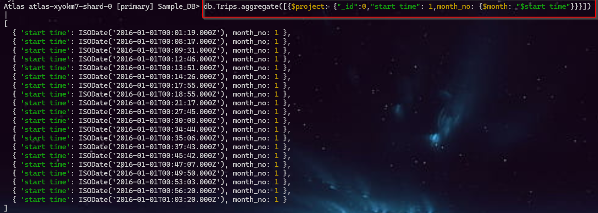

## 📆 Date Functions

**Command**: `db.Trips.aggregate([{$project: {"_id":0,"start time": 1,month_no: {$month: "$start time"}}}])` 

| Part              | Meaning                                         |
| ----------------- | ----------------------------------------------- |
| `db.trips`        | Selects the `trips` collection                  |
| `$aggregate()`    | Starts an aggregation pipeline                  |
| `$project`        | Selects fields and creates calculated fields    |
| `"start_time": 1` | Displays the original `start_time`              |
| `"month_no"`      | Creates a new field containing the month number |
| `$month`          | Extracts the **month** from a date              |
| `"$start_time"`   | Uses the value of the `start_time` field        |

 

---

 

### 🎒 MongoDB `Date` Operators:

| **Command**       | **URL**                                                                 |
|--------------------|-------------------------------------------------------------------------|
| `$dateAdd`         | https://www.mongodb.com/docs/manual/reference/operator/aggregation/dateadd/ |
| `$dateDiff`        | https://www.mongodb.com/docs/manual/reference/operator/aggregation/datediff/ |
| `$dateFromParts`   | https://www.mongodb.com/docs/manual/reference/operator/aggregation/datefromparts/ |
| `$dateFromString`  | https://www.mongodb.com/docs/manual/reference/operator/aggregation/datefromstring/ |
| `$dateSubtract`    | https://www.mongodb.com/docs/manual/reference/operator/aggregation/datesubtract/ |
| `$dateToParts`     | https://www.mongodb.com/docs/manual/reference/operator/aggregation/datetoparts/ |
| `$dateToString`    | https://www.mongodb.com/docs/manual/reference/operator/aggregation/datetostring/ |
| `$dateTrunc`       | https://www.mongodb.com/docs/manual/reference/operator/aggregation/datetrunc/ |

 

---
