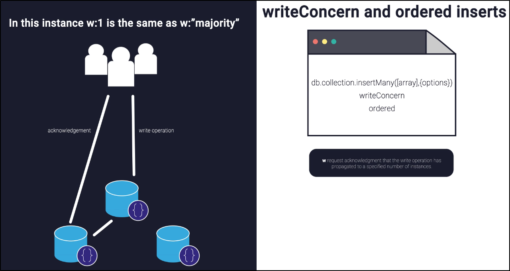
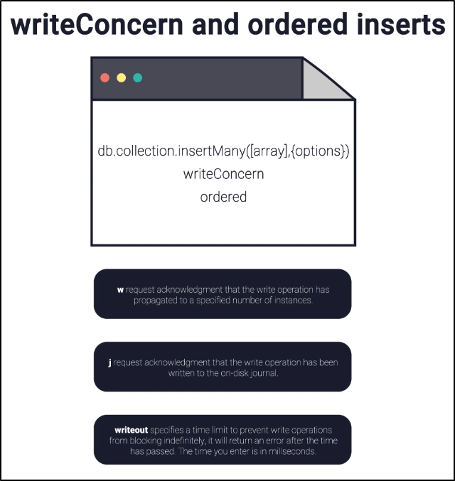
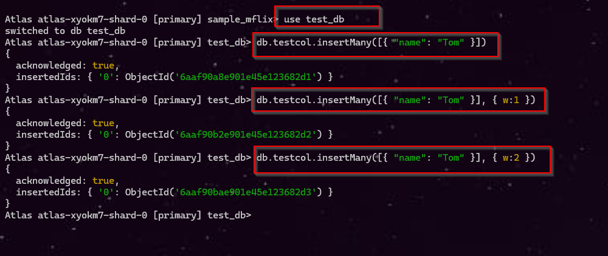
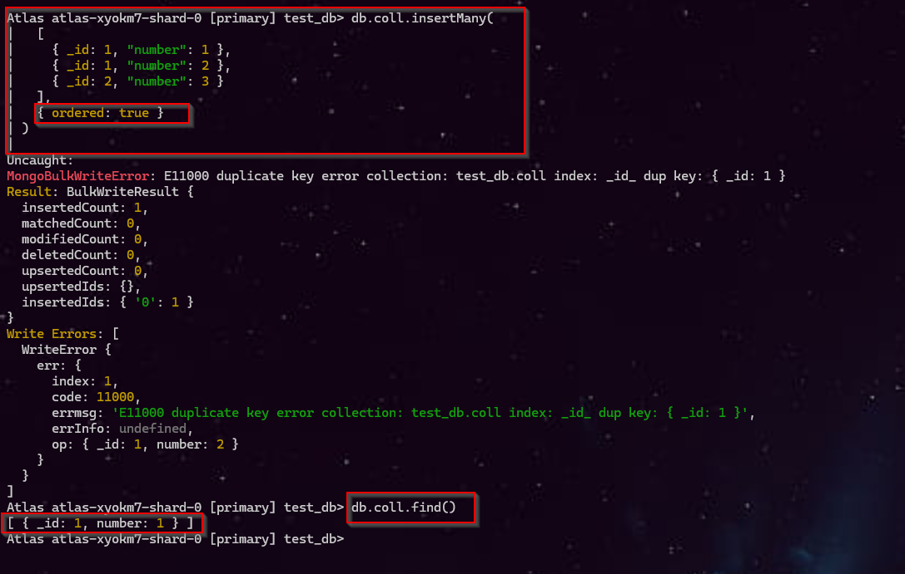
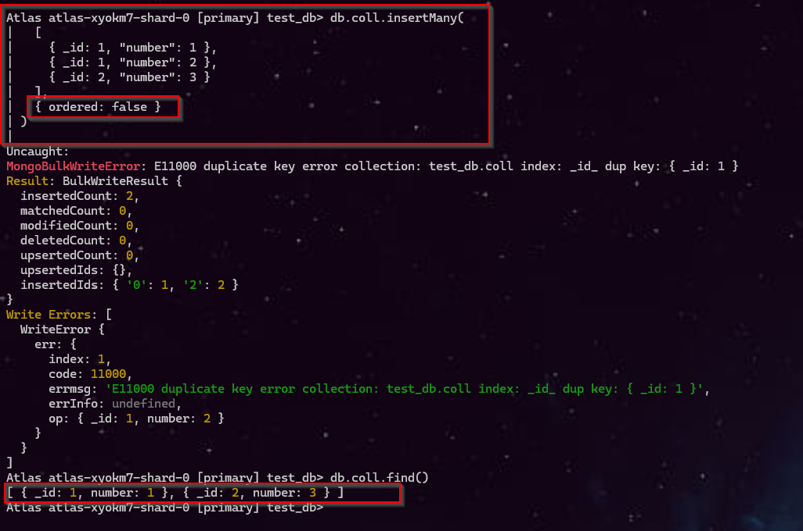
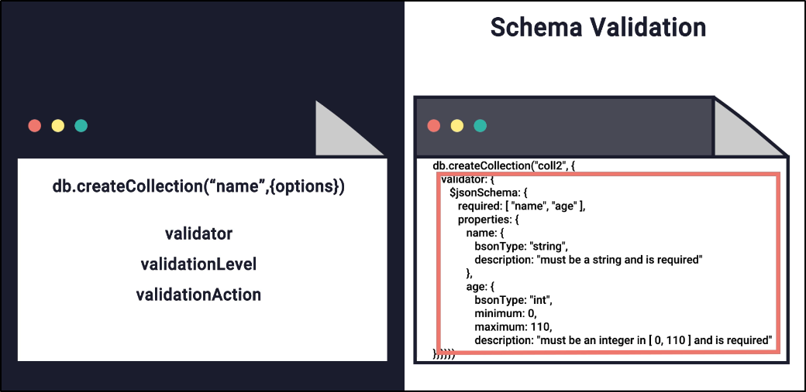
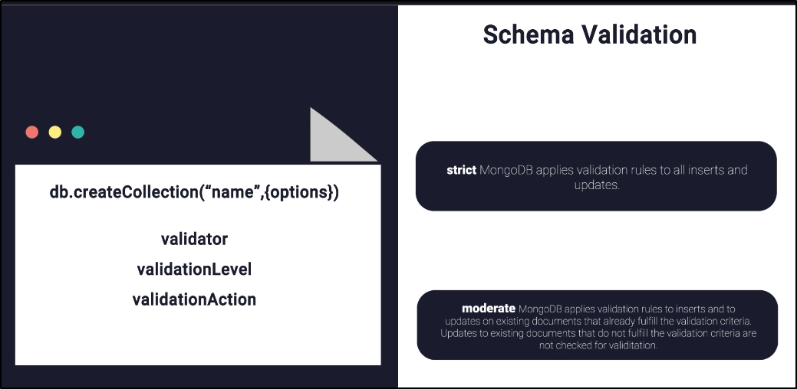
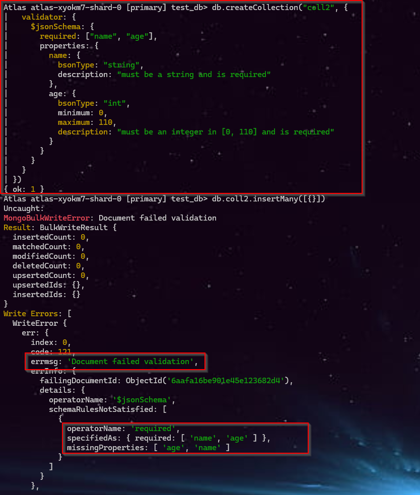
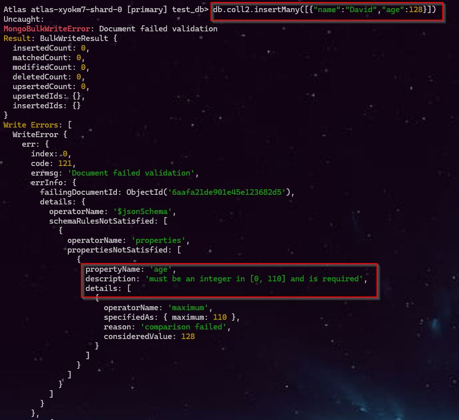
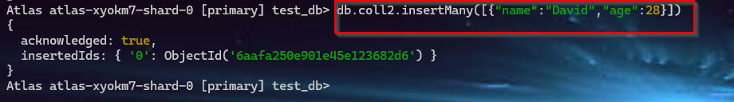

# 🌿 Mongo Schema - 1

## 1. 🍃🛢️ MongoDB `Limits` and `Thresholds`
The slide you shared is from MongoDB’s official documentation about system limits. Let’s break it down clearly:

🗂️ **1. BSON Document Size Limit:**
- Maximum size of a $BSON document = 16 MB$
- $BSON (Binary JSON)$ is the format MongoDB uses to store documents.
- This limit ensures:
  - A single document doesn’t consume $too much RAM.$
  - Transmission of documents doesn’t use **excessive bandwidth.**

⚠️ **2. Why the Limit Exists:**
- MongoDB is designed for $scalability$ and $performance$.
- If documents were allowed to be arbitrarily large:
  - Queries would become slower.
  - Memory usage could spike.
  - Network transfers could be inefficient.

📦 **3. Handling Larger Data**
- For documents larger than 16 MB, MongoDB provides $GridFS.$
- $GridFS$ splits large files into smaller chunks and stores them across multiple documents.
- Useful for storing:
  - Large images
  - Videos
  - PDFs or other big binary files

⚠️ **4. Memory Limit**
- Each pipeline stage has a 100 MB RAM limit.
- If a stage exceeds this limit → MongoDB throws an error.
- Example: $group or $sort on huge datasets may hit this limit.

💾 **5. Disk Usage with allowDiskUse**
- To handle larger workloads, you can enable:

```js
db.collection.aggregate(pipeline, { allowDiskUse: true })
```

- This allows MongoDB to spill data to disk (temporary files) when RAM is insufficient.
- Stages that can spill to disk include:
  - $bucket
  - $bucketAuto
  - $group
  - $sort (when not supported by an index)
  - $sortByCount

<br>

---

<br>

## 📌 2 . MongoDB `insertMany()` — `Write Concern` & `Ordered Inserts`

<br>




**URL:** https://www.mongodb.com/docs/manual/reference/method/db.collection.insertmany/

The image explains how **`insertMany()`** controls how MongoDB handles multiple document inserts and how it confirms that the write was successful.

<br>

#### 1️⃣ Basic Definition

```javascript
db.collection.insertMany(
    [ documents ],
    {
        writeConcern: { w: ..., j: ..., wtimeout: ... },
        ordered: true
    }
)
```

* **`insertMany()`** → Inserts <span style="color:#0D61FE">multiple documents at oncet</span>.
* **`writeConcern`** → Defines  <span style="color:#E43AE1"> how much acknowledgment MongoDB</span>  should provide for the write.
* **`ordered`** → Determines <span style="color:green"> whether MongoDB should stop when one insert fails or continue with the remaining documents </span>.


<br>


#### 2️⃣ Parameters in Table:

| Parameter            | Meaning                       | Example          | Easy Explanation                                                           |
| -------------------- | ----------------------------- | ---------------- | -------------------------------------------------------------------------- |
| **`w`**              | Write acknowledgment level    | `w: 1`           | Wait until the specified number of MongoDB instances acknowledge the write |
| **`j`**              | Journal acknowledgment        | `j: true`        | Wait until the write is written to the **on-disk journal**                 |
| **`wtimeout`**       | Time limit for acknowledgment | `wtimeout: 5000` | Don't wait forever; return an error after **5000 ms**                      |
| **`ordered`**        | Controls insertion order      | `ordered: true`  | If one insert fails, stop processing subsequent inserts                    |
| **`ordered: false`** | Unordered insertion           | `ordered: false` | Continue inserting remaining documents even if one fails                   |


<br>


#### 3️⃣ 🔹 `w` — Write Acknowledgment

`w` specifies **how many MongoDB instances must acknowledge the write**.

```javascript
writeConcern: { w: 1 }
```

| Value        | Meaning                                |
| ------------ | -------------------------------------- |
| `w: 0`       | No acknowledgment requested            |
| `w: 1`       | Primary acknowledges the write         |
| `w: 2`       | Primary + one secondary acknowledge    |
| `"majority"` | Majority of voting members acknowledge |

### Simple idea

```text
Application
     │
     ▼
  Primary
     │
     ├── Secondary 1
     └── Secondary 2
```

`w: 2` → wait for acknowledgment from **2 members**.


<br>


#### 4️⃣ 🔹 `j` — Journal

```javascript
writeConcern: { j: true }
```

Means MongoDB should wait until the write has been written to the **journal on disk**.

| `j`     | Meaning                                            |
| ------- | -------------------------------------------------- |
| `true`  | Wait for journal acknowledgment                    |
| `false` | Don't specifically wait for journal acknowledgment |

> 💡 **Why?** The journal helps MongoDB recover writes after a crash.


<br>


#### 5️⃣🔹 `wtimeout`

```javascript
writeConcern: {
    w: "majority",
    wtimeout: 5000
}
```

Means:

> Wait for the required write acknowledgment, but **don't wait longer than 5000 milliseconds**.

```text
Write
  │
  ▼
Wait for acknowledgment
  │
  ├── Received → Success ✅
  │
  └── 5000 ms exceeded → Error/timeout ❌
```

> In current MongoDB documentation, this option is commonly written as **`wtimeoutMS`**; the image uses the older `wtimeout` terminology.


<br>


#### 6️⃣ 🔥 `ordered`

#### A. `ordered: true`

MongoDB processes documents **in order**.

```javascript
db.students.insertMany(
    [
        {id: 1},
        {id: 2},
        {id: 1},  // duplicate ❌
        {id: 3}
    ],
    { ordered: true }
)
```

Processing:

```text
1 → ✅
2 → ✅
1 → ❌ Error
3 → ⛔ Not processed
```

#### B. `ordered: false`

MongoDB tries to insert **all documents**, even if one fails.

```text
1 → ✅
2 → ✅
1 → ❌ Error
3 → ✅
```


<br>


### 🎯 Example 1: `Write Concern`

```mongoDB
use test_db
db.testcol.insertMany([{ "name": "Tom" }])
db.testcol.insertMany([{ "name": "Tom" }], { w:1 })
db.testcol.insertMany([{ "name": "Tom" }], { w:2 })
```


<br>


### 🎯 Example 2 : `Ordered`


>[!Important] ordered: true → Stops at first error → partial insert.


```mongoDB
db.coll.insertMany(
  [
    { _id: 1, "number": 1 },
    { _id: 1, "number": 2 },
    { _id: 2, "number": 3 }
  ],
  { ordered: true }
)
```


>[!Important] ordered: false → Continues inserting remaining documents even after errors.

```mongoDB
db.coll.insertMany(
  [
    { _id: 1, "number": 1 },
    { _id: 1, "number": 2 },
    { _id: 2, "number": 3 }
  ],
  { ordered: false }
)
```


<br>

---

<br>

## 📌 3 . MongoDB : Schema Validation




<br>

#### 📝 Explanation:

- **`db.createCollection("coll2", {...})`** → Creates a new collection named `coll2`.  
- **`validator`** → <span style="color:blue">Defines schema rules for documents in the collection.</span>.   
- **`$jsonSchema`** → JSON Schema object used to enforce validation.  
- **`required: ["name", "age"]`** → Both fields must exist in every document.  
- **`properties`** → Defines rules for each field:  
  - `name` → Must be a string.  
  - `age` → Must be an integer between 0 and 110.  
- MongoDB is **schema-less by default**, but schema validation enforces **data integrity**.  
- Useful for ensuring consistent data types and preventing invalid inserts.  
- Validation can be tuned with:  
  - **`validationLevel`** → <span style="color:red">strict vs moderate enforcement.</span>.  
  - **`validationAction`** → <span style="color:green">whether invalid docs are rejected or just warned.</span>.

<br>

```js
db.createCollection("coll2", {
  validator: {
    $jsonSchema: {
      required: ["name", "age"],
      properties: {
        name: {
          bsonType: "string",
          description: "must be a string and is required"
        },
        age: {
          bsonType: "int",
          minimum: 0,
          maximum: 110,
          description: "must be an integer in [0, 110] and is required"
        }
      }
    }
  }
})
```

<br>

##### Validation Failed 1: No Parameter
```js
db.coll2.insertMany([{}])
```


<br>

##### Validation Failed 2: Age greater than 110
```js
db.coll2.insertMany([{"name":"David","age":128}])
```


<br>

##### Validation Success 3:
```js
db.coll2.insertMany([{"name":"David","age":28}])
```


---

