# 🌿 Mongo Schema - 2:

<br>

## 1️⃣  Data Modelling Considerations: 🚀
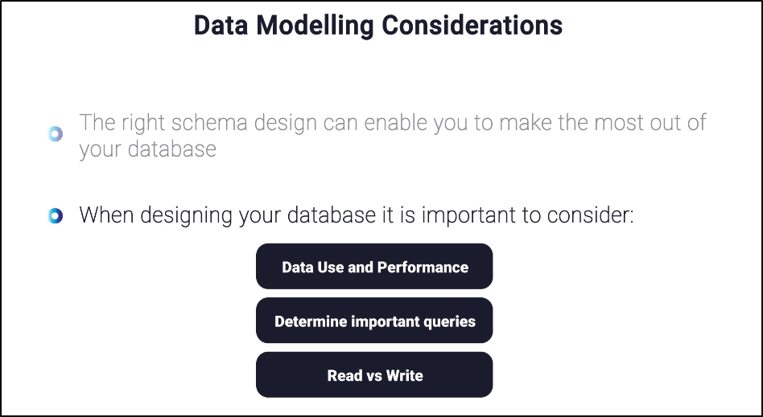

<br>

### 📊 Key Considerations in Schema Design

#### 1. **Data Use and Performance**
- Schema should match how data will be accessed.
- Optimize for speed and efficiency.
- Example: If queries often filter by `customer_id`, indexing that column is crucial.

#### 2. **Determine Important Queries**
- Identify the most frequent and critical queries.
- Design tables and relationships to minimize joins and maximize query speed.
- Example: Reporting queries may need denormalized tables for faster aggregation.

#### 3. **Read vs Write Balance**
- **Read-heavy systems** (e.g., analytics dashboards):
  - Favor denormalization, caching, and indexing.
- **Write-heavy systems** (e.g., transaction processing):
  - Favor normalization to reduce redundancy and maintain consistency.
- Trade-off: More indexes improve reads but slow down writes.

<br>

#### 📝 Exam-Style Summary
- **Schema design = performance + usability.**
- Always ask: *What queries matter most?*
- Balance **read vs write** needs → normalization vs denormalization.
- Index smartly, not excessively.


<br>


---


<br>


## 2️⃣  Installing the `Sample_mflix DB`: 🧮

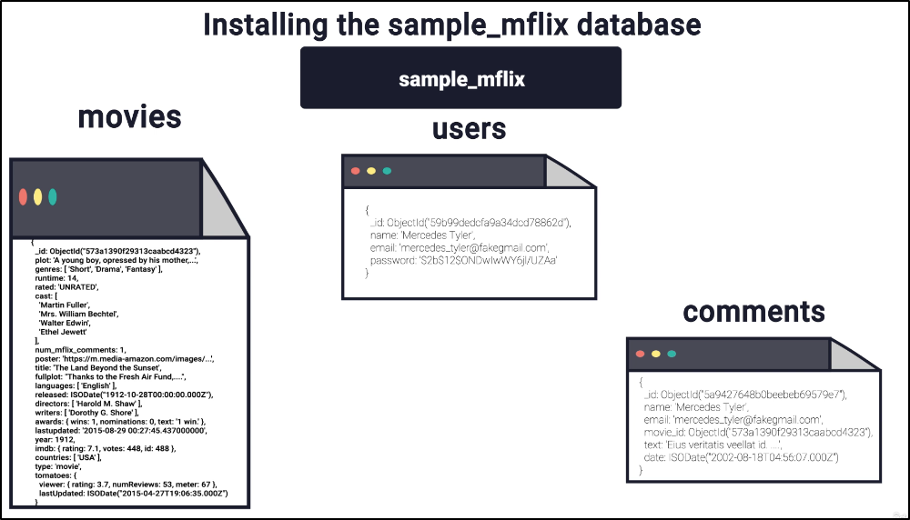
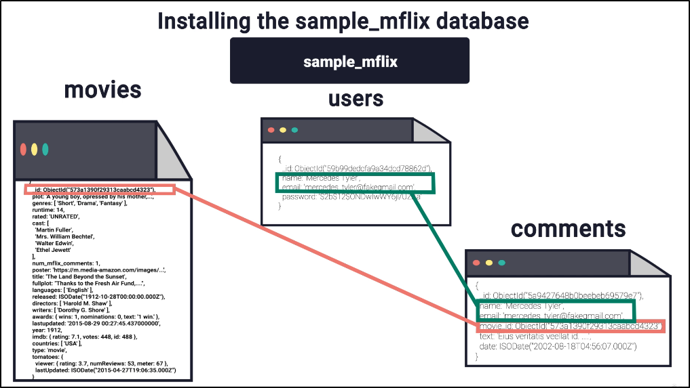
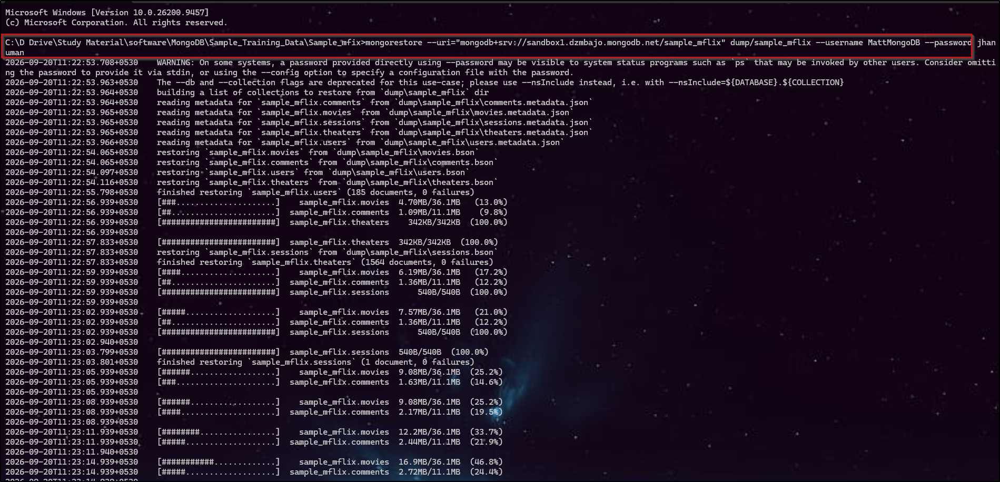

```bash
mongorestore --uri="mongodb+srv://sandbox1.dzmbajo.mongodb.net/sample_mflix" dump/sample_mflix --username MattMongoDB --password jhanuman
```

<br>

#### ⚙️ Explanation of Each Part

- **`mongorestore`**  
    - <span style="color:blue">Tool used to restore data from a BSON dump into a MongoDB databaset</span>.


- **`--uri="mongodb+srv://sandbox1.dzmbajo.mongodb.net/sample_mflix"`**  
  - Connection string to your MongoDB Atlas cluster.  
  - `mongodb+srv://` → indicates a DNS seed list connection (Atlas style).  
  - `sandbox1.dzmbajo.mongodb.net` → your cluster host.  
  - `sample_mflix` → the target database name.

- **`dump/sample_mflix`**  
  - Path to the dump folder containing BSON files (created earlier with `mongodump`).  
  - This is the source data being restored.

- **`--username MattMongoDB --password jhanuman`**  
  - Credentials for authentication.  
  - `MattMongoDB` → the MongoDB user.  
  - `jhanuman` → the password for that user.  
  - These are passed directly in the command for login.

<br>

---

<br>


## 3️⃣ `$lookup` in MongoDB:

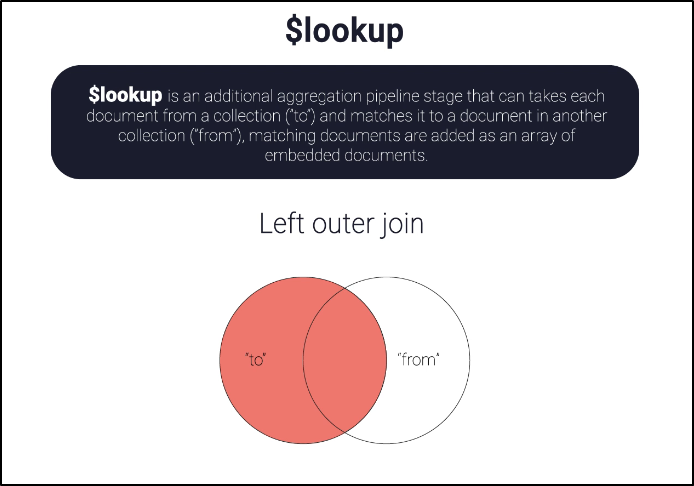

#### 1. **Definition**
- `$lookup` is an **aggregation pipeline stage**.
- It performs a **left outer join** between two collections.
- Documents from the **“to” collection** (the one you’re aggregating on) are matched with documents from the **“from” collection**.
- Matching documents are added as an **array of embedded documents**.

<br>

#### 2. **Key Characteristics**
- **Left outer join** → All documents from the “to” collection are included, even if no match is found in the “from” collection.
- **Result** → Each document gets a new field (array) containing matched documents.
- **Syntax** (basic form):

```js
{
  $lookup: {
    from: "otherCollection",
    localField: "fieldInToCollection",
    foreignField: "fieldInFromCollection",
    as: "newArrayField"
  }
}
```

**🧠 Easy way to remember:**

```ja
CURRENT COLLECTION
       │
       │ localField
       ▼
    $lookup
       │
       │ foreignField
       ▼
OTHER COLLECTION
       │
       ▼
    as → result
```

**📊 Meaning of Each Parameter:**

| Parameter          | Easy meaning                             | Example      |
| ------------------ | ---------------------------------------- | ------------ |
| **`from`**         | Which collection do you want to search?  | `"comments"` |
| **`localField`**   | Field from the **current collection**    | `"name"`     |
| **`foreignField`** | Field from the **other collection**      | `"name"`     |
| **`as`**           | Name of the new field containing matches | `"comments"` |


<br>

####  **Example*:*

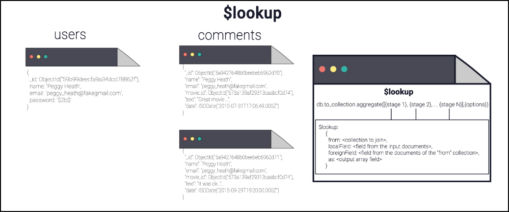

<br>

#### 🐦‍🔥 Query 1:  users → comments

```js
db.users.aggregate([
  {
    $lookup: {
      from: "comments",
      localField: "name",
      foreignField: "name",
      as: "comments"
    }
  }
])
```
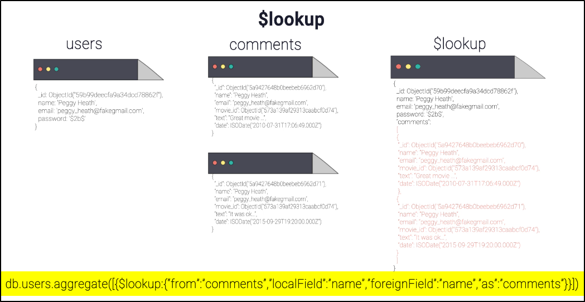

<br>

#### 🐦‍🔥  Query 2: comments → users

```js
db.comments.aggregate([
  {
    $lookup: {
      from: "users",
      localField: "name",
      foreignField: "name",
      as: "user"
    }
  }
])
```

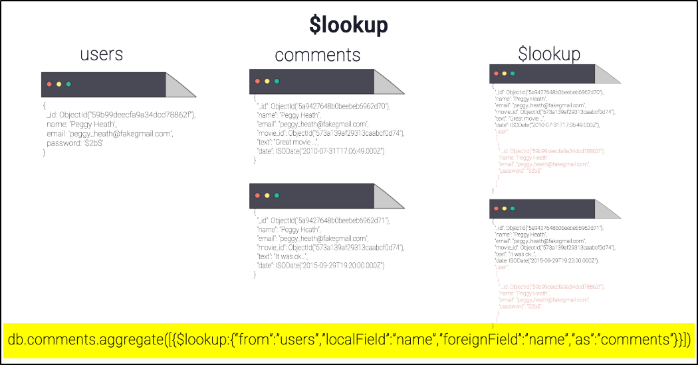

<br>

**📊 Difference:**

| Point               | Query 1                    | Query 2              |
| ------------------- | -------------------------- | -------------------- |
| Starting collection | `users`                    | `comments`           |
| `from`              | `comments`                 | `users`              |
| `localField`        | `users.name`               | `comments.name`      |
| `foreignField`      | `comments.name`            | `users.name`         |
| `as`                | `"comments"`               | `"user"`             |
| Result              | User + comments            | Comment + user       |
| Relationship        | **1 User → Many Comments** | **1 Comment → User** |


<br>


---


<br>


## 4️⃣ `Type of Relationship` in MongoDB:

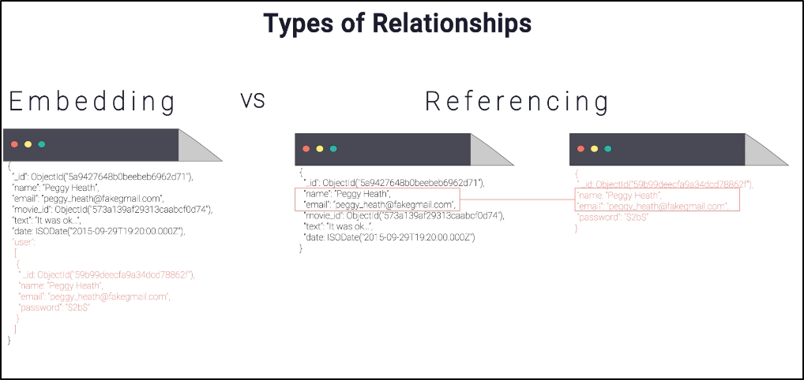


#### 📌 MongoDB: Embedding vs Referencing

There are two ways to design relationships between MongoDB documents:

- **Embedding →** Put related data `inside the same document`
- **Referencing →** Keep related data in a `separate document/collection` and store a reference to it.

<br>

#### 1️⃣ Embedding:

**Embedding** means storing related information inside the parent document.

```js
{
  _id: 101,
  name: "Peggy Heath",
  email: "peggy@gmail.com",

  user: {
    _id: 201,
    name: "Peggy Heath",
    email: "peggy@gmail.com"
  }
}
```

**Think:**
```
User
 └── Related Data
      └── Stored INSIDE user document
```

##### ✅ Advantage
- Data can be retrieved with one query
- Faster for data that is frequently accessed together

##### ❌ Disadvantage
- Document can become very large
- Same data may be duplicated
- Updating duplicated data can be difficult

<br>

#### 2️⃣ Referencing:

**Referencing** means keeping related data separately and storing its ID/reference.

$users:$
```js
{
  _id: 101,
  name: "Peggy Heath",
  email: "peggy@gmail.com"
}
```

$comments:$
```js
{
  _id: 201,
  user_id: 101,
  text: "Great movie!"
}
```

**Think:**
```js
users
  │
  │ _id = 101
  ▼
comments
  │
  └── user_id = 101
```

You can then use $lookup to combine them.

<br>

#### 🔥 Embedding vs Referencing

| Feature          | Embedding 📦                  | Referencing 🔗                   |
| ---------------- | ----------------------------- | -------------------------------- |
| Data location    | Same document                 | Separate documents               |
| Relationship     | Data inside parent            | ID/reference to other data       |
| Query            | Usually simpler               | May require `$lookup`            |
| Performance      | Often faster for related data | Can require additional lookup    |
| Data duplication | Possible                      | Less duplication                 |
| Document size    | Can become large              | Smaller documents                |
| Best when        | Data belongs closely together | Data is shared/large/independent |
| Example          | User + address                | User + many comments             |


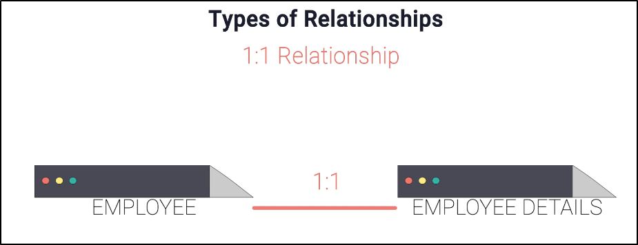
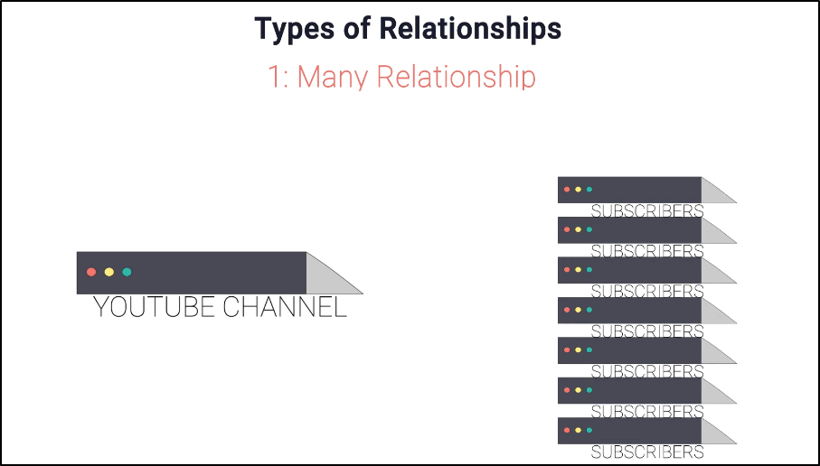
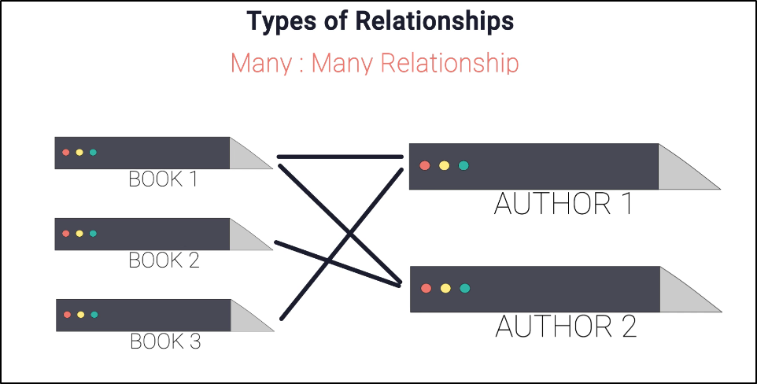


**URL:** https://www.mongodb.com/company/blog/building-with-patterns-a-summary

---