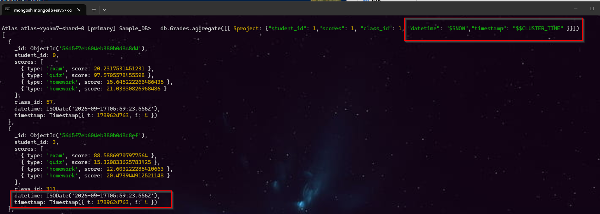
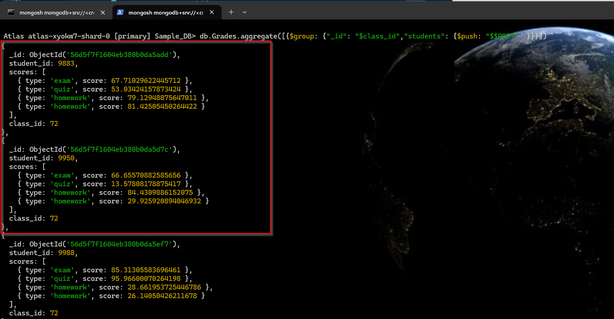
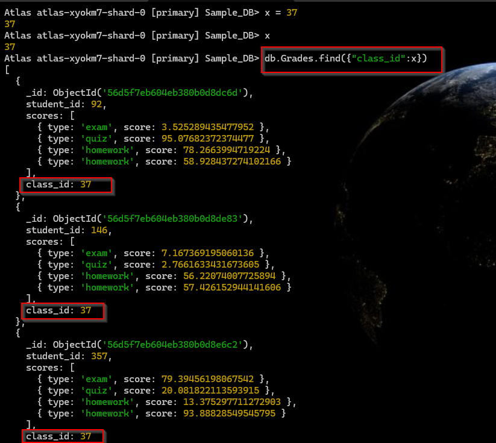
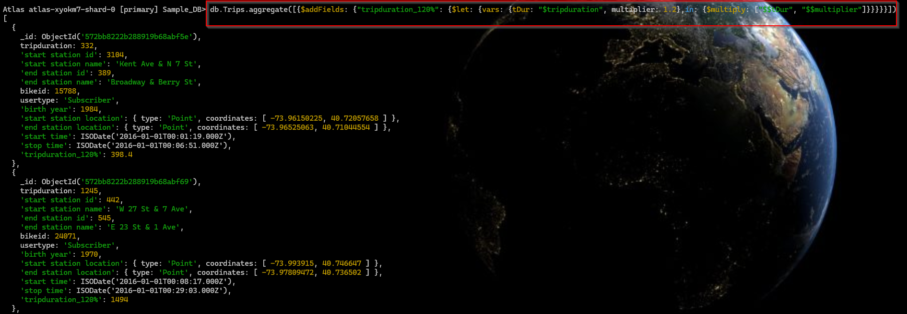

# 🍃 Variables in Aggregation Expressions

Aggregation expressions can use **user-defined** and **system variables**.

- **Variables** can hold any `BSON type data`.
- To access a variable → prefix with `$$`  
    - Example: `$$<variable>`
- To access a field inside an object → use dot notation  
    - Example: `$$<variable>.<field>`

>[!Note] Variables are **case-sensitive**.
https://www.mongodb.com/docs/manual/reference/aggregation-variables/

---


## 📘 1. MongoDB System Variables:

> [!Note] MongoDB provides built-in system variables:

| **Variable**   | **Description** |
|----------------|-----------------|
| 🕒 **NOW**        | Returns the current datetime. Same for all members, constant across pipeline stages. |
| ⏳ **CLUSTER_TIME** | Current timestamp. Only on replica sets & sharded clusters. Same for all members, constant across pipeline stages. |
| 🌳 **ROOT**       | References the root (top-level) document being processed. |
| 🎯 **CURRENT**    | References the start of the field path. Defaults to ROOT. Modifiable → rebinding changes `$` accesses. |
| 🗑️ **REMOVE**     | Evaluates to "missing value". Used to exclude fields in `$addFields` / `$project`. |
| ⬇️ **DESCEND**    | Allowed result of a `$redact` expression (continue deeper). |
| ✂️ **PRUNE**      | Allowed result of a `$redact` expression (cut branch). |
| ✅ **KEEP**       | Allowed result of a `$redact` expression (retain branch). |
| 🔎 **SEARCH_META** | Stores Atlas Search metadata results. Can be returned in supported stages. |
| 👤 **USER_ROLES** | Returns roles assigned to current user. Not supported in M0/Flex clusters. *(New in v7.0)* |
| 🔢 **IDX**        | Index of current array element. Works with `$map`, `$filter`, `$reduce`. First element = 0. *(New in v8.3)* |


<br>


**Command 1:**  `db.Grades.aggregate([{ $project: {"student_id": 1,"scores": 1, "class_id": 1, "datetime": "$$NOW","timestamp": "$$CLUSTER_TIME" }}])`


| Expression                    | Meaning                          |
| ----------------------------- | -------------------------------- |
| `aggregate()`                 | Run aggregation pipeline         |
| `$project`                    | Select/create fields             |
| `student_id: 1`               | Include `student_id`             |
| `scores: 1`                   | Include `scores`                 |
| `class_id: 1`                 | Include `class_id`               |
| `datetime: "$$NOW"`           | Add current date/time            |
| `timestamp: "$$CLUSTER_TIME"` | Add MongoDB logical cluster time |
| `_id`                         | Included by default              |
| `_id: 0`                      | Exclude `_id`                    |




<br>


**Command 2:**  `db.Grades.aggregate([{$group: {"_id": "$class_id","students": {$push: "$$ROOT"  }}}])`

**Use:** It groups all documents by `class_id` and puts all documents belonging to each class into a `students` array.

| Part           | Meaning                                          | Example                    |
| -------------- | ------------------------------------------------ | -------------------------- |
| `db`           | Current MongoDB database                         | `sample_training`          |
| `grades`       | Collection being queried                         | `grades`                   |
| `.aggregate()` | Runs an aggregation pipeline                     | Processes documents        |
| `[...]`        | Aggregation pipeline stages                      | Contains `$group`          |
| `$group`       | Groups documents based on a field/expression     | Group by class             |
| `_id`          | Defines the grouping key                         | `"$class_id"`              |
| `"$class_id"`  | Value of `class_id` becomes the group identifier | `class_id: 10` → `_id: 10` |
| `students`     | Name of the new output field                     | `students: [...]`          |
| `$push`        | Adds each document/value to an array             | Collect documents          |
| `$$ROOT`       | Represents the **entire current document**       | Complete grade document    |





<br>

### 1.2 🎮 Interactive Memory Trick:

Think of it like a game:

- 🕒 **NOW** → "What time is it now?"
- ⏳ **CLUSTER_TIME** → "Cluster’s clock tick."
- 🌳 **ROOT** → "Tree root = whole doc."
- 🎯 **CURRENT** → "Target field path."
- 🗑️ **REMOVE** → "Trash this field."
- ⬇️ **DESCEND** → "Go deeper."
- ✂️ **PRUNE** → "Cut branch."
- ✅ **KEEP** → "Keep branch."
- 🔎 **SEARCH_META** → "Search insights."
- 👤 **USER_ROLES**  → "Who am I?"
- 🔢 **IDX**    → "Array position."


<br>

---

## 👤 2. User Variables
- Names can contain ASCII characters `[_a-zA-Z0-9]` and non-ASCII characters.
- Must begin with a **lowercase ASCII letter [a-z]** or a **non-ASCII character**.
- Cannot begin with an uppercase letter or a number.
    - Example:  
  ```js
  { $let: { vars: { myVar: 5 }, in: { $multiply: ["$$myVar", 10] } } 
  ```

**Command 1:** `db.Grades.find({"class_id":x})`


<br>


**Command 2:** `db.Grades.find({"class_id":x})`

###### 📋 Parameter-by-parameter: 

| Parameter             | Meaning                                 | In this command             |
| --------------------- | --------------------------------------- | --------------------------- |
| `db`                  | Current database                        | MongoDB database            |
| `trips`               | Collection name                         | `trips` collection          |
| `aggregate()`         | Runs aggregation pipeline               | Processes documents         |
| `$addFields`          | Adds a new field to each document       | Creates `tripduration_120%` |
| `"tripduration_120%"` | Name of new field                       | Stores calculated value     |
| `$let`                | Creates temporary variables             | `tDur` and `multiplier`     |
| `vars`                | Defines variables used inside `$let`    | `tDur`, `multiplier`        |
| `tDur`                | Temporary variable                      | Gets `$tripduration`        |
| `"$tripduration"`     | Existing field value                    | Trip duration               |
| `multiplier`          | Temporary variable                      | `1.2`                       |
| `in`                  | Expression to execute using variables   | Performs multiplication     |
| `$multiply`           | Multiplies values                       | `tDur × multiplier`         |
| `"$$tDur"`            | References `$let` variable `tDur`       | Trip duration               |
| `"$$multiplier"`      | References `$let` variable `multiplier` | `1.2`                       |





```FlowCommand
Document
   │
   │ tripduration = 100
   ▼
$let
   │
   ├── tDur = 100
   │
   └── multiplier = 1.2
   │
   ▼
$multiply
   │
   │ 100 × 1.2
   ▼
120
   │
   ▼
New field:
tripduration_120% = 120
```

---